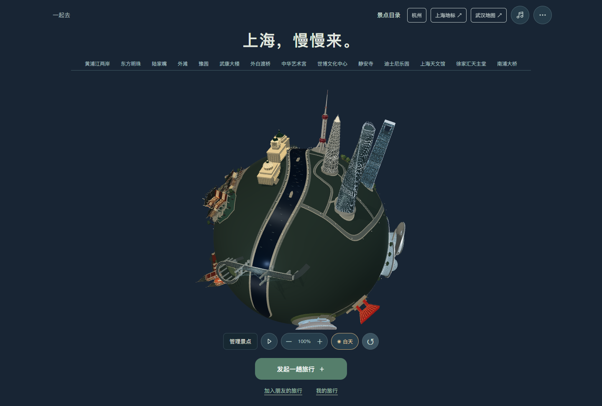
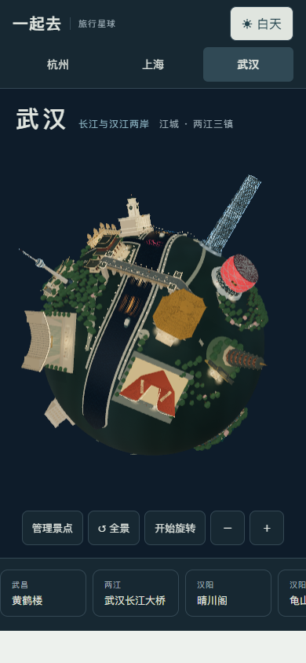
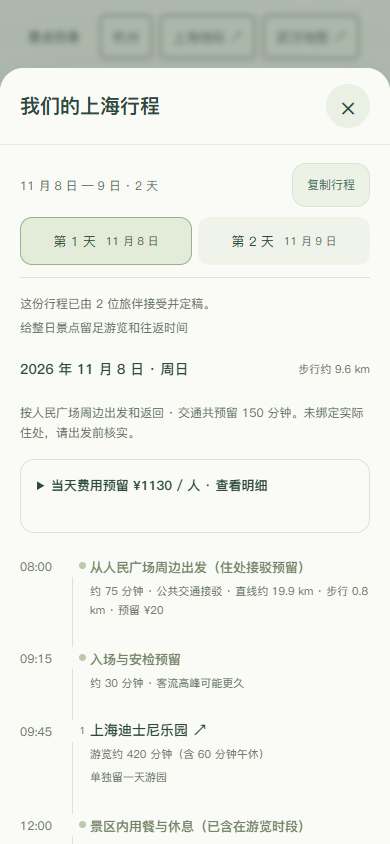

# 一起去 · Travel Planet

用可旋转的 3D 城市星球发现景点，再和朋友一起决定怎么旅行。当前版本 **0.23.0**，支持桌面和手机网页。

**[上海旅行 · 在线体验](https://43.139.249.151/travel/shanghai-trip.html)** · **[杭州旅行](https://43.139.249.151/travel/)** · **[武汉旅行](https://43.139.249.151/travel/wuhan-trip.html)** · **[武汉纯地图](https://43.139.249.151/travel/wuhan.html)** · **[上海纯地图](https://43.139.249.151/travel/shanghai.html)** · **[北京地图](https://43.139.249.151/travel/beijing.html)** · **[深圳地图](https://43.139.249.151/travel/shenzhen.html)** · **[顺德地图](https://43.139.249.151/travel/shunde.html)** · **[广州地图](https://43.139.249.151/travel/guangzhou.html)** · **[长沙地图](https://43.139.249.151/travel/changsha.html)**

这些是公开测试入口。测试时请创建自己的旅行；无需配置密钥即可使用「基础排程」。线上演示不是订票或支付服务。

## 可以做什么

| 功能 | 当前范围 |
| --- | --- |
| 3D 城市浏览 | 杭州、上海、武汉、北京、深圳、顺德、广州、长沙；旋转、缩放、近看地标、日夜切换 |
| 景点模块 | 上海、武汉、北京、深圳、顺德、广州、长沙整组添加或移除；杭州装扮；设置保存在当前浏览器 |
| 多人旅行 | 杭州、上海、武汉；选点、邀请加入、偏好提交、方案比较、明确接受、共同定稿 |
| 约束校验 | 游览时间、首末接驳、转场、过江、步行、餐饮和分项预算 |
| 可选 AI | 整理自然语言想法、协助提出方案；未配置时使用明确标注的基础排程 |
| 手机网页 | 单指拖动、双指缩放、可滑动的景点导航、底部表单和景点管理面板 |

武汉保留 **17 组地标**，已接入 **16 个去处的多人旅行**；武汉站仅作交通地标，不自动安排观光。上海景观也是 17 组地标；模型数量与旅行目录并非一一对应。

北京包含 **12 组具名地标**：故宫、天安门、天坛、颐和园、长城、北海白塔、钟鼓楼、国家大剧院、央视总部、鸟巢、水立方和景山。景山包含五座不同形制的亭阁、连续山林、绮望楼与寿皇殿；中轴步道连接天安门、故宫、景山和钟鼓楼。提供日夜、自由旋转、逐景近看和整组管理；北京当前为景观地图，尚未接入多人旅行。详见 [北京造型参考](docs/BEIJING_REFERENCES.md)。

深圳包含 **12 组具名地标**：平安金融中心、春笋、地王大厦、京基100、市民中心、春茧、湾区之光、世界之窗铁塔、大鹏南门、莲花山、海上世界·明华轮和人才公园。包含内湖与两座步桥、环湖跑道、后海景点连接、客轮甲板与舷窗、独立喷泉池和连续滨海步道、日夜与整组管理；深圳当前为景观地图，尚未接入多人旅行。详见 [深圳造型参考](docs/SHENZHEN_REFERENCES.md)。

顺德新增 **8 组具名景点**：清晖园、顺峰山公园、和美术馆、华盖路、逢简水乡、顺德演艺中心、碧江金楼和宝林寺。顺峰山公园包含青云湖、青龙阁、青云塔、九曲桥和五行桥；滨河步道连接八组场地。包含双半球布局、日夜、手机浏览和整组管理；顺德尚未接入多人旅行。详见 [顺德造型参考](docs/SHUNDE_REFERENCES.md)。

广州包含 **10 组具名地标**：广州塔、珠江新城东西塔、广州大剧院、广东省博物馆、中山纪念堂、陈家祠、石室圣心大教堂、五羊石像、海心桥和花城广场。单道斜拱桥跨越珠江，两岸步道连接场馆与文化景点，花城广场接通大剧院、省博与东西塔；提供夜景、自由旋转、手机触控与整组管理；广州当前未接入多人旅行。详见 [广州造型参考](docs/GUANGZHOU_REFERENCES.md)。

长沙包含 **9 组具名地标**：岳麓书院、爱晚亭、杜甫江阁、天心阁、湖南博物院、梅溪湖艺术中心、谢子龙影像艺术馆、国金中心双塔和橘子洲大桥。包含连续山地、山林、跨江低拱与环形匝道、两岸步道和湘江洲地、双半球布局、日夜、自由旋转、手机与整组管理；长沙尚未接入多人旅行。详见 [长沙造型参考](docs/CHANGSHA_REFERENCES.md)。

## 界面预览



| 手机地图 | 手机行程 |
| --- | --- |
|  |  |

## 在本机运行

需要 Node.js **22.13+**，建议 Node.js 24。首次安装需要网络。

```sh
git clone https://github.com/Monking-peng/travel-planet.git
cd travel-planet
npm ci
npm start
```

打开 [本地上海旅行](http://127.0.0.1:4178/shanghai-trip.html)。杭州入口为 `/`，武汉旅行入口为 `/wuhan-trip.html`，纯地图入口为 `/wuhan.html`。

默认使用基础排程，不需要 API Key。本地数据保存在 `.local/travel.sqlite`。停止服务后数据保留；不希望留存测试数据时，可配置 `TRAVEL_DB=:memory:`。

需要修改端口或接入 AI 时，将 `.env.example` 复制为 `.env`，填写自己的配置，再运行 `npm start`。AI 使用兼容 Chat Completions 的服务端接口；实际费用由所选服务商决定。`.env` 和数据库已列入忽略规则，不能提交到仓库。

## 完整演示一次旅行

1. 在任一城市旅行页打开「景点目录」，选中想去的地点并创建旅行。
2. 复制邀请，用另一浏览器或无痕窗口加入第二位旅伴。
3. 两人各自提交想法、预算、步行上限和最早出门时间。
4. 发起人检查分歧后，用基础排程生成方案；查看逐日时间与费用明细。
5. 双方明确接受同一份方案，由发起人确认定稿，然后复制行程。

「更喜欢」不等于接受；修改偏好会让旧版确认失效。未提交草稿保留在当前浏览器，发送失败可重试。

## 检查项目

```sh
npm test
npm run check
```

自动测试覆盖业务规则、隐私、接口、规划限制、模型涉水与布局、整组资源生命周期、触屏误点和窄屏取景。GitHub Actions 在推送和拉取请求时执行以上检查。

可选浏览器验收脚本：安装 Python 与 Playwright 后运行 `python tools/mobile-check.py` 、`python tools/travel-flow-check.py` 和 `python tools/wuhan-flow-check.py`。默认使用本机 Edge，也可通过 `BROWSER_CHANNEL=chromium` 使用已安装的 Playwright Chromium。脚本自动启动独立内存服务，不连接公开测试数据，不调用付费模型，结果写入 `test-results/`。新城市地图运行 `python tools/destination-check.py beijing`、`python tools/destination-check.py shenzhen` 、`python tools/destination-check.py shunde`、`python tools/destination-check.py guangzhou` 或 `python tools/destination-check.py changsha`。详细范围见 [验收说明](docs/TESTING.md)。

## 已知边界

- 地图是艺术化缩微景观，尺寸、摆放和道路经过压缩，不是实时导航或精确测绘。
- 规划的距离、时间和费用为估算。门票、预约、开放时间需出发前核实；预算不含住宿和往返目的地交通。[查看估算依据](PLANNING_ASSUMPTIONS.md)
- 无订票、支付、实时定位和跨设备账号找回。清理浏览器身份后可能无法再访问原旅行身份。
- 预算字段仅本人可见；自由文字会分享给旅伴。不要在演示旅行中填写敏感信息。
- 手机验收目前采用浏览器触屏模拟，尚未完成 iOS Safari、微信内置浏览器和低端 Android 真机测试。高细节 3D 在较弱设备上的性能仍需验证。
- `miniprogram/`、`cloudfunctions/` 保留历史实验和回归依赖，不代表微信小程序已发布。

[架构与自行部署](ARCHITECTURE.md) · [素材与参考边界](ASSETS.md) · [上海造型参考](上海地标与参考.md) · [武汉造型参考](武汉地标与参考.md)

武汉目录范围、过江交通预留和开放来源见 [武汉旅行说明](docs/WUHAN_TRAVEL.md)。
