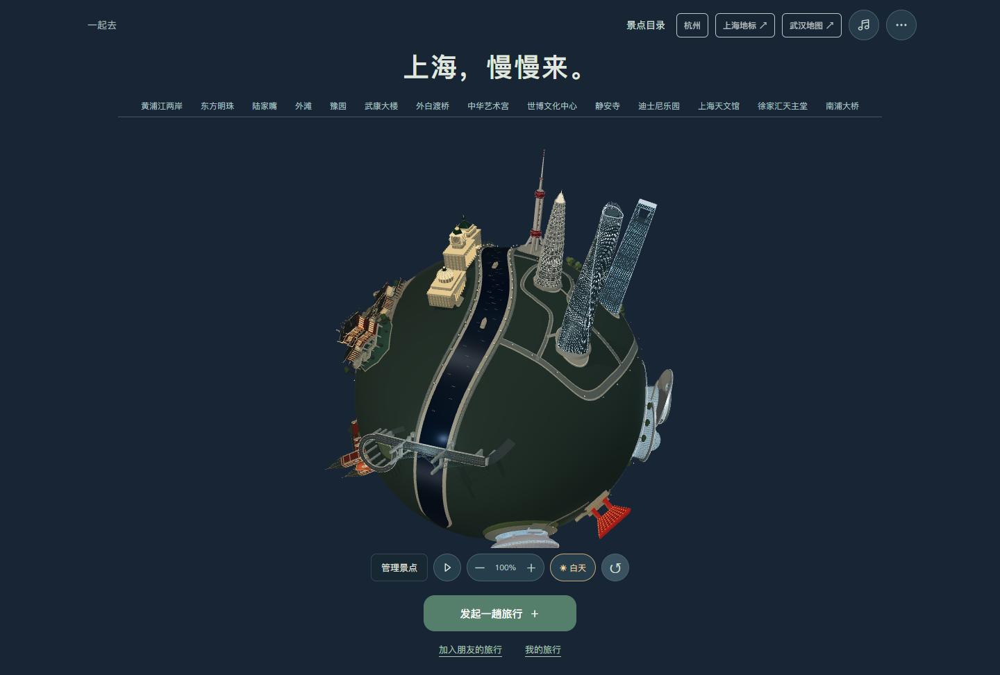
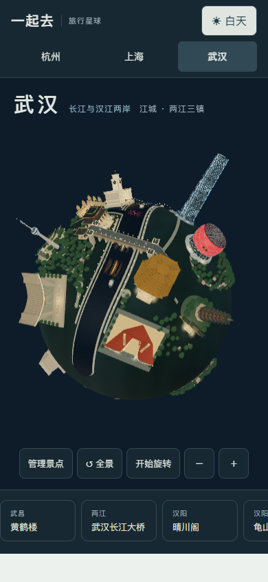
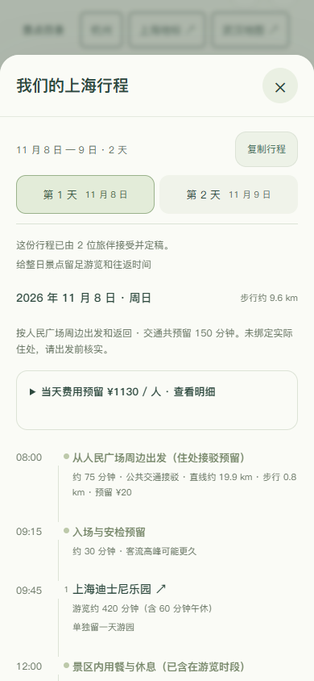

# 一起去 · Travel Planet

用可旋转的 3D 城市星球发现景点，再和朋友一起决定怎么旅行。当前版本 **0.55.53**，支持桌面和手机网页。

**[上海旅行 · 在线体验](https://43.139.249.151/travel/shanghai-trip.html)** · **[杭州旅行](https://43.139.249.151/travel/)** · **[武汉旅行](https://43.139.249.151/travel/wuhan-trip.html)** · **[武汉纯地图](https://43.139.249.151/travel/wuhan.html)** · **[上海纯地图](https://43.139.249.151/travel/shanghai.html)** · **[北京地图](https://43.139.249.151/travel/beijing.html)** · **[深圳地图](https://43.139.249.151/travel/shenzhen.html)** · **[顺德地图](https://43.139.249.151/travel/shunde.html)** · **[广州地图](https://43.139.249.151/travel/guangzhou.html)** · **[长沙地图](https://43.139.249.151/travel/changsha.html)** · **[西安地图](https://43.139.249.151/travel/xian.html)** · **[成都地图](https://43.139.249.151/travel/chengdu.html)** · **[重庆地图](https://43.139.249.151/travel/chongqing.html)** · **[南京地图](https://43.139.249.151/travel/nanjing.html)** · **[苏州地图](https://43.139.249.151/travel/suzhou.html)** · **[厦门地图](https://43.139.249.151/travel/xiamen.html)** · **[泉州地图](https://43.139.249.151/travel/quanzhou.html)** · **[青岛地图](https://43.139.249.151/travel/qingdao.html)** · **[天津地图](https://43.139.249.151/travel/tianjin.html)** · **[大理地图](https://43.139.249.151/travel/dali.html)** · **[桂林地图](https://43.139.249.151/travel/guilin.html)** · **[三亚地图](https://43.139.249.151/travel/sanya.html)** · **[香港地图](https://43.139.249.151/travel/hongkong.html)** · **[澳门地图](https://43.139.249.151/travel/macau.html)**

这些是公开测试入口。测试时请创建自己的旅行；无需配置密钥即可使用「基础排程」。线上演示不是订票或支付服务。

## 可以做什么

| 功能 | 当前范围 |
| --- | --- |
| 3D 城市浏览 | 杭州、上海、武汉、北京、深圳、顺德、广州、长沙、西安、成都、重庆、南京、苏州、厦门、泉州、青岛、天津、大理、桂林、三亚、香港、澳门；旋转、缩放、近看地标、日夜切换 |
| 景点模块 | 上海、武汉、北京、深圳、顺德、广州、长沙、西安、成都、重庆、南京、苏州、厦门、泉州、青岛、天津、大理、桂林、三亚、香港、澳门整组添加或移除；杭州装扮；设置保存在当前浏览器 |
| 多人旅行 | 杭州、上海、武汉；选点、邀请加入、偏好提交、方案比较、明确接受、共同定稿 |
| 约束校验 | 游览时间、首末接驳、转场、过江、步行、餐饮和分项预算 |
| 可选 AI | 整理自然语言想法、协助提出方案；未配置时使用明确标注的基础排程 |
| 手机网页 | 单指拖动、双指缩放、可滑动的景点导航、底部表单和景点管理面板 |

武汉地图顶部可以直接「选景点，发起旅行」「加入朋友的旅行」或打开「我的旅行」。从地标详情进入后，可以新建旅行，也可以把景点放进同城已有旅行的草稿；提交前不会更改旅伴看到的偏好。

武汉保留 **17 组地标**，已接入 **16 个去处的多人旅行**；武汉站仅作交通地标，不自动安排观光。上海景观也是 17 组地标；模型数量与旅行目录并非一一对应。

北京包含 **12 组具名地标**：故宫、天安门、天坛、颐和园、长城、北海白塔、钟鼓楼、国家大剧院、央视总部、鸟巢、水立方和景山。颐和园佛香阁保留八角回廊、四重橙黄绿边瓦檐与彩绘梁枋。景山包含五座不同形制的亭阁、连续山林、绮望楼与寿皇殿；中轴步道连接天安门、故宫、景山和钟鼓楼。提供日夜、自由旋转、逐景近看和整组管理；长城包含起伏山脊、灰褐砖墙、贯通敌楼和林坡，石阶连续通过各座塔楼。祈年殿补齐十二根外檐朱柱、蓝绿金梁枋、瓦垄和上檐竖匾。国家大剧院补齐宽阔玻璃帷幕、内部暖金剧场、细分缝和连续环绕水面。北京当前为景观地图，尚未接入多人旅行。详见 [北京造型参考](docs/BEIJING_REFERENCES.md)。

深圳包含 **13 组具名地标**：平安金融中心、春笋、地王大厦、京基100、市民中心、春茧、湾区之光、世界之窗铁塔、大鹏南门、莲花山、海上世界·明华轮、人才公园和音乐厅与图书馆文化双馆。春茧改为连续长椭圆透空网壳，保留露天体育场、两座闭合屋盖、中部开敞入口与冷暖分层夜景。包含双馆折叠玻璃屋顶、金银树枝支柱、暖金与冷白夜景及中轴连接，内湖与两座步桥、环湖跑道、后海景点连接、客轮甲板与舷窗、独立喷泉池和连续滨海步道、日夜与整组管理；深圳当前为景观地图，尚未接入多人旅行。详见 [深圳造型参考](docs/SHENZHEN_REFERENCES.md)。

顺德新增 **8 组具名景点**：清晖园、顺峰山公园、和美术馆、华盖路、逢简水乡、顺德演艺中心、碧江金楼和宝林寺。清晖园补齐双层船厅、架空澄漪亭、竹纹圆洞、六角亭、荷池与细栏杆，夜景以窗灯和檐下暖光分层。顺峰山公园包含青云湖、青龙阁、青云塔、九曲桥和五行桥；宝林寺以连续山坡、宽石阶、绿瓦山门、钟鼓楼和重檐主殿呈现，滨河步道连接八组场地。包含双半球布局、日夜、手机浏览和整组管理；顺德尚未接入多人旅行。详见 [顺德造型参考](docs/SHUNDE_REFERENCES.md)。

广州包含 **11 组具名地标**：广州塔、珠江新城东西塔、广州大剧院、广东省博物馆、中山纪念堂、陈家祠、石室圣心大教堂、五羊石像、海心桥、花城广场和沙面历史街区。广东省博物馆采用方正悬挑、深红凹槽、突出玻璃展廊与内退屋顶中庭；沙面以露德圣母堂、海关红楼和林荫步道组成整组场景；单道斜拱桥跨越珠江，两岸步道连接场馆与文化景点，花城广场接通大剧院、省博与东西塔；提供夜景、自由旋转、手机触控与整组管理；广州当前未接入多人旅行。详见 [广州造型参考](docs/GUANGZHOU_REFERENCES.md)。

长沙包含 **10 组具名地标**：岳麓书院、爱晚亭、杜甫江阁、天心阁、湖南博物院、梅溪湖艺术中心、谢子龙影像艺术馆、国金中心双塔、橘子洲大桥和青年毛泽东艺术雕塑。杜甫江阁补齐深灰瓦歇山顶、红柱白回廊、双向台阶与两侧游廊小亭，夜间以暖金屋面与窗灯分层。雕塑包含横向肩部、立体面部与侧扬发束，洲头草坪和环形步道置于两侧水道之间；两岸建筑已避让扩展后的河道。梅溪湖按四瓣大剧场、三瓣艺术馆和单瓣小剧场分出轮廓与翻卷屋盖。包含连续山地、山林、跨江低拱与环形匝道、两岸步道和湘江洲地、双半球布局、日夜、自由旋转、手机与整组管理；长沙尚未接入多人旅行。详见 [长沙造型参考](docs/CHANGSHA_REFERENCES.md)。

西安新增 **8 组具名地标**：钟楼、鼓楼、永宁门城墙、大雁塔与大慈恩寺、小雁塔与荐福寺、陕西历史博物馆、大唐芙蓉园紫云楼、秦始皇帝陵博物院。钟楼补齐三开间红门与外廊、青绿金彩绘、层叠斗拱、细密绿瓦、铜钟与石栏；鼓楼重做七开间外廊、歇山红山墙、青绿彩绘、两列鼓架和侧面台阶；大雁塔补齐七层券窗、砖仿木柱、叠涩檐带、底层碑龛、葫芦塔刹及灰瓦寺院；小雁塔补齐南北券窗、十三层叠涩密檐、四角残墙、南石门与北门罩、灰瓦寺院及古树；陕历博分开前门、重檐主殿和四角楼，补连续柱廊、宽阶、水院与廊下暖光；兵马俑展馆按实拍重做浅拱长壳、连续天窗、石柱门廊和相邻保护厅，扩大与陕历博间距；保留贯通券洞、砖塔收分、柱廊、临水园林和保护展馆大跨度拱壳，提供双半球布局、日夜、逐景近看、手机触控和整组管理。西安当前为景观地图，未接入多人旅行。详见 [西安实拍参考](docs/XIAN_REFERENCES.md)。

成都新增 **8 组具名地标**：武侯祠汉昭烈庙入口、杜甫草堂茅屋故居、安顺廊桥、IFS 爬墙熊猫、熊猫基地熊猫塔、天府美术馆、金沙遗址博物馆陈列馆、东安湖主体育场。区分茅草、木构、铜色外肋、花瓣曲面与玻璃幕墙；日夜保留建筑原色，体育场屋面和商业街有缓慢灯光变化。提供双半球、自由旋转、手机触控与整组管理；成都尚未接入多人旅行。[查看实拍参考](docs/CHENGDU_REFERENCES.md)。

重庆新增 **8 组具名地标**：洪崖洞、来福士朝天门、千厮门大桥、重庆大剧院、人民大礼堂、人民解放纪念碑、李子坝单轨穿楼和长江索道。连续河道表现两江交汇，八组分布于两半球；洪崖洞包含临江山墙、错层露台、退后的暗窗、吊脚柱、贯通入口和连续崖坡；保留玻璃连廊、桥塔真开口、绿瓦圆殿、穿楼通道与悬挂轿厢。提供日夜、自由旋转、手机触控和整组管理，重庆尚未接入多人旅行。[查看实拍参考](docs/CHONGQING_REFERENCES.md)。

南京新增 **8 组具名地标**：中山陵、夫子庙秦淮河、中华门瓮城、南京博物院、鸡鸣寺药师佛塔、大报恩寺遗址新塔、紫峰大厦和南京眼。中山陵补齐蓝瓦屋面、灰石斗拱、卷草石雕、青铜花窗、真实门洞与承托山坡；保留连续石阶、贯通藏兵洞、古建木格门窗、玻璃保护塔与倾斜双桥环；双半球布局，支持日夜、近看、手机触控和整组管理。南京博物院补齐深棕瓦顶、金色脊饰、红柱前廊、相连侧馆和两段宽阶，夜间采用檐口与门窗暖光。南京当前未接入多人旅行。[查看实拍参考](docs/NANJING_REFERENCES.md)。

苏州博物馆已补齐八角主厅、菱格石屋面、下沉玻璃天窗、通透连廊、片石水院与门庭。苏州新增 **8 组具名地标**：苏州博物馆、拙政园、留园冠云峰、虎丘云岩寺塔、寒山寺普明宝塔、东方之门、盘门水陆城门和平江路胡厢使桥。保留几何水院、六角荷亭、穿孔太湖石、砖塔与木塔的不同形制，以及水陆门洞和银灰玻璃尖拱；支持两半球、日夜、自由旋转、手机触控和整组管理。苏州当前未接入多人旅行。[查看实拍参考](docs/SUZHOU_REFERENCES.md)。

厦门新增 **8 组具名地标**：八卦楼、日光岩、菽庄花园四十四桥、南普陀寺、建南大会堂、南薰楼与龙舟池、世茂海峡双子塔、海沧大桥。保留红穹顶、闽南飞檐、石墙柱廊、临海曲桥、双帆斜顶和悬索结构；提供两半球、日夜、自由旋转、手机触控与整组管理。厦门当前未接入多人旅行。[查看实拍参考](docs/XIAMEN_REFERENCES.md)。

泉州新增 **8 组具名地标**：开元寺东西塔、清源山老君岩、清净寺、天后宫、洛阳桥、钟楼、石狮洛伽寺与府文庙。保留八角石塔、席地石像、尖拱、燕尾脊、舟形石墩和海岛寺院，提供两半球、日夜、自由旋转、手机触控与整组管理。泉州当前未接入多人旅行。[查看实拍参考](docs/QUANZHOU_REFERENCES.md)。

青岛新增 **8 组具名地标**：栈桥回澜阁、五月的风、圣弥厄尔大教堂、奥帆中心、花石楼、青岛站东立面、信号山观景楼与崂山太清宫。保留双层八角阁、红钢带螺旋、双塔红顶、帆船港、石砌圆塔与三座红球，支持两半球、日夜、自由旋转、手机触控和整组管理。青岛当前未接入多人旅行。[查看实拍参考](docs/QINGDAO_REFERENCES.md)。

天津新增 **8 组具名地标**：天津之眼与永乐桥、瓷房子、西开教堂、民园广场、解放桥、天塔、国家海洋博物馆与独乐寺观音阁。保留摩天轮分叉支架、瓷片与曲墙、三穹顶、连续拱廊、钢桁架、湖中高塔与分叉展厅，支持日夜、两半球、自由旋转、触控和整组管理。天津当前未接入多人旅行。[查看实拍参考](docs/TIANJIN_REFERENCES.md)。

大理新增 **8 组具名景点**：崇圣寺三塔、大理古城南门、五华楼、严家大院、小普陀、苍山洗马潭、兴盛大桥和剑川沙溪古戏台。保留方塔与八角塔的区别、白族照壁、石岛阁楼、山脊栈道与真实桥拱，支持两半球、日夜、自由旋转、手机触控和整组管理。大理当前未接入多人旅行。[查看实拍参考](docs/DALI_REFERENCES.md)。

桂林新增 **8 组具名景点**：象鼻山、杉湖日月双塔、靖江王府与独秀峰、逍遥楼、兴坪漓江、富里桥、龙脊梯田和月亮山。保留贯通天然石洞、九层铜塔与七层青灰塔、王城门楼、山水竹筏和真实高差的田埂；支持两半球、日夜、自由旋转、触控与整组管理。桂林当前未接入多人旅行。[查看实拍参考](docs/GUILIN_REFERENCES.md)。

三亚新增 **8 组具名景点**：南山海上观音、凤凰岛、亚特兰蒂斯、国际免税城一期、天涯海角、鹿回头、蜈支洲岛情人桥和亚龙湾过江龙索桥。保留三面观音与莲台、五座弧塔、双鳍流线高楼、四处采光穹顶、刻字礁石和真正跨谷的索桥；支持两半球、日夜、自由旋转、触控和整组管理。三亚当前未接入多人旅行。[查看实拍参考](docs/SANYA_REFERENCES.md)。

香港新增 **10 组具名地标**：中银大厦、国际金融中心二期、汇丰总行大厦、香港会议展览中心、凌霄阁、环球贸易广场、尖沙咀钟楼、M+、志莲净苑和天坛大佛。保留三角折面、内收塔冠、悬吊钢架、曲顶、倒 T 形媒体立面和青铜坐像，支持维港两侧半球布局、日夜、自由旋转、手机触控与整组管理。香港当前未接入多人旅行。[查看实拍参考](docs/HONGKONG_REFERENCES.md)。

澳门新增 **10 组具名地标**：大三巴牌坊、议事亭前地、玫瑰堂、妈阁庙、东望洋灯塔与教堂、澳门旅游塔、新葡京、摩珀斯、龙环葡韵和澳门科学馆。保留大三巴五层灰石立面、矩形入口与铜像壁龛、波浪碎石广场、葡式拱廊、山寺、新葡京窄腰与内收塔冠、三角玻璃基座和现代建筑贯通孔洞，支持日夜、缓慢变化的窗灯、自由旋转、手机触控和整组管理。澳门当前未接入多人旅行。[查看实拍参考](docs/MACAU_REFERENCES.md)。

## 界面预览



| 手机地图 | 手机行程 |
| --- | --- |
|  |  |

## 在本机运行

需要 Node.js **22.13+**，建议 Node.js 24。首次安装需要网络。

```sh
git clone https://github.com/Monking-peng/travel-planet.git
cd travel-planet
npm ci
npm start
```

打开 [本地上海旅行](http://127.0.0.1:4178/shanghai-trip.html)。杭州入口为 `/`，武汉旅行入口为 `/wuhan-trip.html`，纯地图入口为 `/wuhan.html`。

默认使用基础排程，不需要 API Key。本地数据保存在 `.local/travel.sqlite`。停止服务后数据保留；不希望留存测试数据时，可配置 `TRAVEL_DB=:memory:`。

需要修改端口或接入 AI 时，将 `.env.example` 复制为 `.env`，填写自己的配置，再运行 `npm start`。AI 使用兼容 Chat Completions 的服务端接口；实际费用由所选服务商决定。`.env` 和数据库已列入忽略规则，不能提交到仓库。

## 完整演示一次旅行

1. 在任一城市旅行页打开「景点目录」，选中想去的地点并创建旅行。
2. 复制邀请，用另一浏览器或无痕窗口加入第二位旅伴。
3. 两人各自提交想法、预算、步行上限和最早出门时间。
4. 发起人检查分歧后，用基础排程生成方案；查看逐日时间与费用明细。
5. 双方明确接受同一份方案，由发起人确认定稿，然后复制行程。

「更喜欢」不等于接受；修改偏好会让旧版确认失效。未提交草稿保留在当前浏览器，发送失败可重试。

## 检查项目

```sh
npm test
npm run check
```

自动测试覆盖业务规则、隐私、接口、规划限制、模型涉水与布局、整组资源生命周期、触屏误点和窄屏取景。GitHub Actions 在推送和拉取请求时执行以上检查。

可选浏览器验收脚本：安装 Python 与 Playwright 后运行 `python tools/mobile-check.py` 、`python tools/travel-flow-check.py` 、`python tools/wuhan-flow-check.py` 和 `python tools/wuhan-entry-check.py`。默认使用本机 Edge，也可通过 `BROWSER_CHANNEL=chromium` 使用已安装的 Playwright Chromium。脚本自动启动独立内存服务，不连接公开测试数据，不调用付费模型，结果写入 `test-results/`。新城市地图运行 `python tools/destination-check.py beijing`、`python tools/destination-check.py shenzhen` 、`python tools/destination-check.py shunde`、`python tools/destination-check.py guangzhou` 、`python tools/destination-check.py changsha` 、`python tools/destination-check.py xian` 、`python tools/destination-check.py chengdu` 、`python tools/destination-check.py chongqing` 、`python tools/destination-check.py nanjing` 或 `python tools/destination-check.py suzhou`。详细范围见 [验收说明](docs/TESTING.md)。

## 已知边界

- 地图是艺术化缩微景观，尺寸、摆放和道路经过压缩，不是实时导航或精确测绘。
- 规划的距离、时间和费用为估算。门票、预约、开放时间需出发前核实；预算不含住宿和往返目的地交通。[查看估算依据](PLANNING_ASSUMPTIONS.md)
- 无订票、支付、实时定位和跨设备账号找回。清理浏览器身份后可能无法再访问原旅行身份。
- 预算字段仅本人可见；自由文字会分享给旅伴。不要在演示旅行中填写敏感信息。
- 手机验收目前采用浏览器触屏模拟，尚未完成 iOS Safari、微信内置浏览器和低端 Android 真机测试。高细节 3D 在较弱设备上的性能仍需验证。
- `miniprogram/`、`cloudfunctions/` 保留历史实验和回归依赖，不代表微信小程序已发布。

[架构与自行部署](ARCHITECTURE.md) · [素材与参考边界](ASSETS.md) · [上海造型参考](上海地标与参考.md) · [武汉造型参考](武汉地标与参考.md)

武汉目录范围、过江交通预留和开放来源见 [武汉旅行说明](docs/WUHAN_TRAVEL.md)。

和美术馆现以馆方实拍为依据，呈现错位圆层、密竖格、通透天窗、双螺旋梯与夹岸水院。夜景使用温和室内光。
永宁门已按实拍精修三重檐城楼、四排箭窗、瓮城与弧形月城，补齐贯通券洞和墙顶石阶；[参考与日夜画面](docs/XIAN_REFERENCES.md)。


紫云楼已按景区实拍重做宽石台、四角亭、拱形连桥、红柱回廊与临湖宽阶；夜景保留建筑原色，详见[西安参考与画面](docs/XIAN_REFERENCES.md)。


天府美术馆已补齐五翼玻璃展厅、中央庭院、连续临水步道及分层室内夜景；参见[成都参考与画面](docs/CHENGDU_REFERENCES.md)。

来福士已补齐两端露天花园、连接高塔的短桥、弯曲楼身、退台裙楼和分层夜景；参见[重庆参考与画面](docs/CHONGQING_REFERENCES.md)。

重庆大剧院已按设计方实拍细化玻璃折面、前后高低舞台体量、凹入门厅和分层透光夜景，参见[重庆参考与画面](docs/CHONGQING_REFERENCES.md)。

人民大礼堂已细化高大柱廊、三层翼楼、端塔、白色栏杆、牌楼与连续台阶，保持蓝绿屋面和分层夜景；参见[重庆实拍参考与模型](docs/CHONGQING_REFERENCES.md)。
