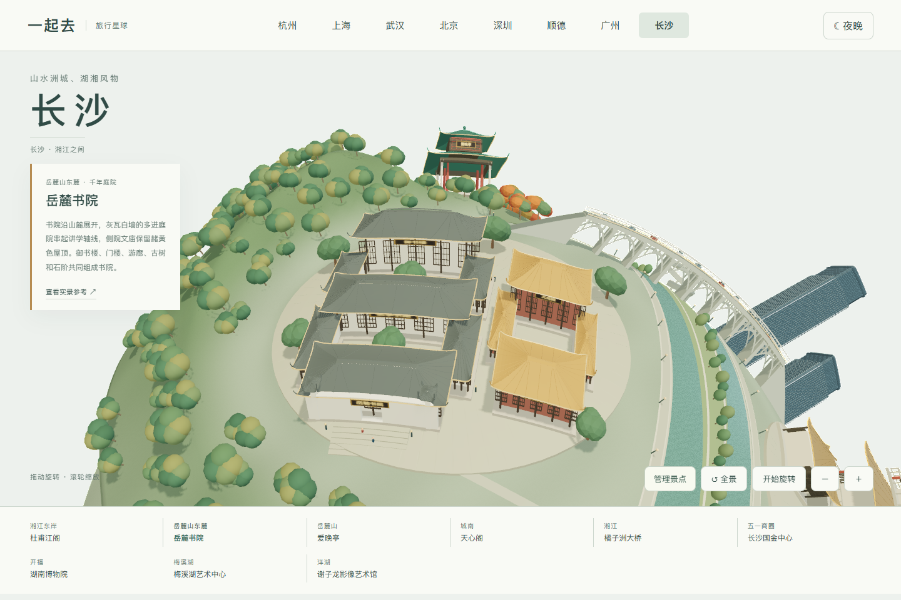
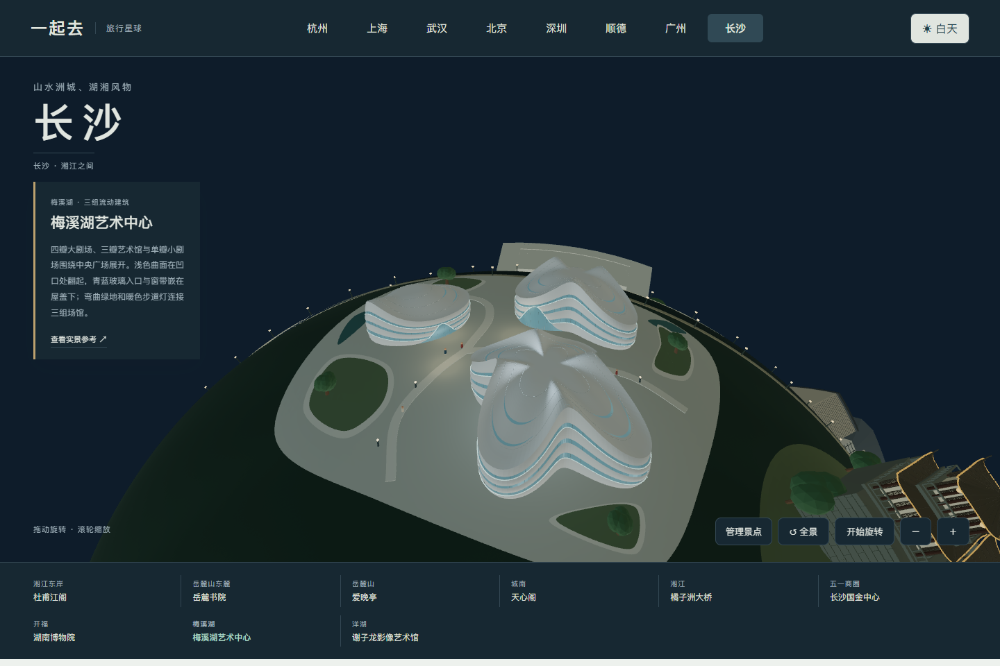
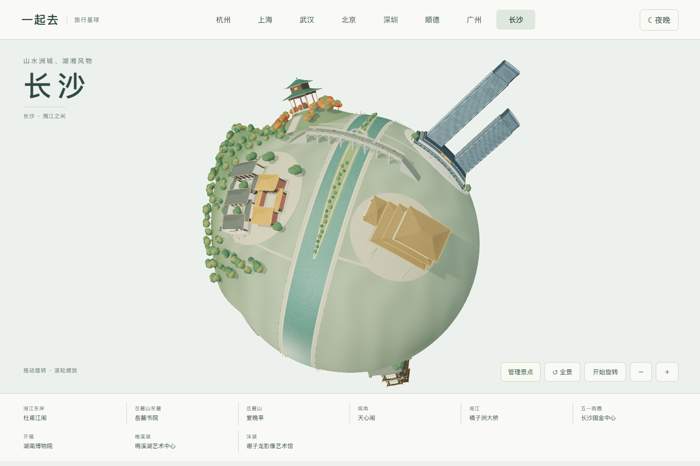
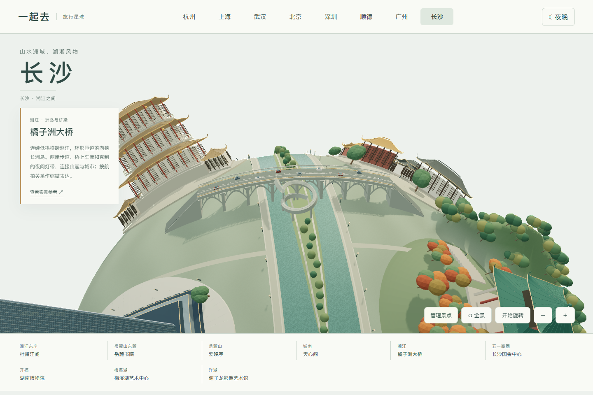
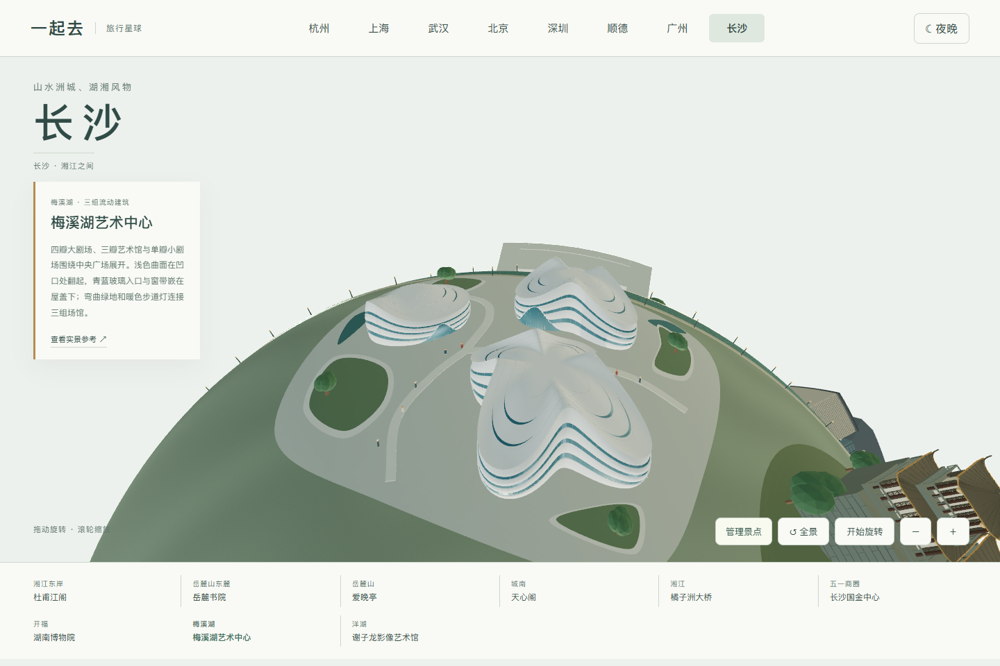
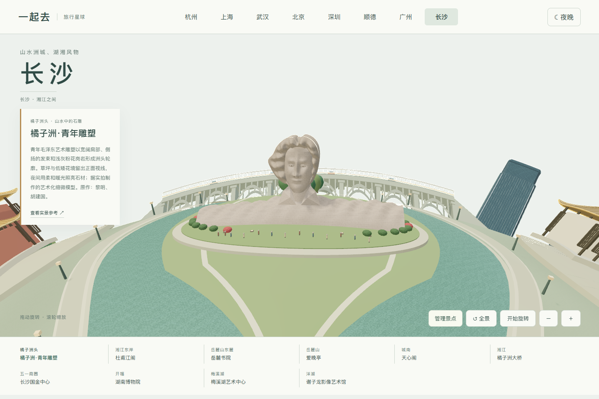
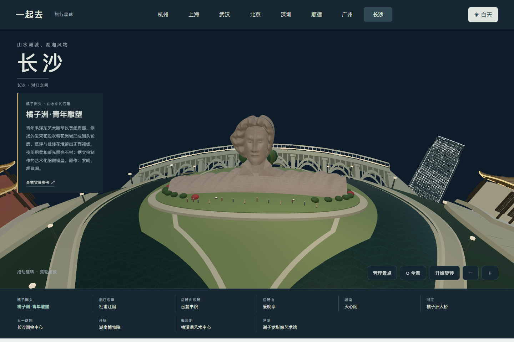

# 长沙地图与造型参考

长沙入口为 `changsha.html`，含十组可独立添加或移除的地标。当前交付景观地图，未接入长沙多人旅行目录；杭州、上海和武汉旅行保持。

## 实景与模型

| 地标 | 实际观察与模型特征 | 来源 |
| --- | --- | --- |
| 岳麓书院 | 灰瓦白墙、多进院落、讲学中轴、御书楼及侧院赭黄色文庙 | [湖南大学建筑资料](https://ylsy.hnu.edu.cn/info/1011/9009.htm)、[院落航拍](https://m.app.dawuhanapp.com/wuhan/p/31648525.html) |
| 爱晚亭 | 绿色重檐、灰色外柱和红色内柱、山坡石阶和枫林 | [湖南文旅资料](https://whhlyt.hunan.gov.cn/ggwh/201408/t20140804_5430585.html)、[中南大学照片](https://px.csu.edu.cn/info/1015/1207.htm) |
| 杜甫江阁 | 三层飞檐、红柱、白色回廊、正面石阶与夜间暖光 | [湖南省英文资料](https://enghunan.gov.cn/hneng/News/UpcomingEvents/202408/t20240801_33417827.html)、[夜间实拍](https://bbs.zol.com.cn/dcbbs/d34024_4316.html) |
| 天心阁 | 深色木构与瓦顶、主阁和侧阁、灰砖厚城墙与垛口 | [港铁长沙景点照片](https://www.highspeed.mtr.com.hk/en/travel/changsha.html) |
| 橘子洲大桥 | 连续低拱、桥墩、双向车道、岛上环形匝道与狭长绿洲 | [长沙晚报航拍](https://www.icswb.com/h/152/20160518/415626.html)、[湖南省橘子洲资料](https://www.hunan.gov.cn/hnszf/c101474/202108/t20210827_20403826.html) |
| 长沙国金中心 | 高低双塔、深蓝玻璃、退台塔冠、竖向构件与商场裙楼 | [建筑事务所资料](https://www.wongtung.com/cn/projects/changsha-international-finance-square-2/)、[整体建筑实拍](https://www.kinlong.com/case-landmark/9.html) |
| 湖南博物院 | 宽大的深色悬挑屋盖、通高玻璃、两侧浅色展馆与下层入口 | [正立面实拍](https://travel.voc.com.cn/article/201712/201712010956426419.html) |
| 梅溪湖艺术中心 | 四瓣大剧场、三瓣艺术馆、单瓣小剧场；凹口翻卷屋盖、青蓝玻璃、短天窗、弯曲绿地和连通前场 | [北京市建筑设计研究院](https://www.biad.com.cn/project/id/8/)、[航拍照片](https://www.hunantoday.cn/news/xhn/202609/33876599.html) |
| 谢子龙影像艺术馆 | 浅色清水混凝土、悬挑与架空水院、狭长窗、窄桥与入口楼梯 | [湖南湘江新区照片](https://xjxq.hunan.gov.cn/hnxjxq/sytpxw/202003/t20200318_11814798.html) |

制作前已实际查看照片，修正了屋顶开口、城墙支承、场馆体量相交、玻璃与白色外墙比例。原始照片仅用于观察，未作为贴图或打包至仓库。来源页面可用性由原网站决定，不依据这些页面提供票价、开放或预约承诺。

## 表达边界

地图是艺术化微缩景观，保留主要轮廓和材质，并非精确测绘。湘江、洲地、尺寸和双半球位置经过重排；橘子洲雕塑为自建艺术化几何，不是扫描模型或精确人物肖像。秋色、灯光和缓慢变化用于场景表现，不代表真实景区当日状态或完整灯光秀。

八组建筑分布于两个半球，橘子洲大桥横跨湘江，青年雕塑独立设于洲头。岳麓山直接由球面地形起伏形成，山林避开书院和爱晚亭；两岸步道连接景点入口。每组建筑的台阶、植物、广场与灯光跟随整个模块增删；共享山地、河道、岛屿与岸边步道保留，桥梁和桥上灯光整体移除。减少动态效果设置会停止窗灯和轮廓光动画。

`npm test` 检查全部模型顶点落地、主河道避让、景点间距、完整模块及资源释放，并用射线检查书院屋顶闭合、城门通道、山体避让庭院及桥面连续性和桥下通道。`python tools/destination-check.py changsha` 使用独立内存服务检查日夜近看、触屏、键盘、窄屏、保存恢复和 WebGL 故障重试。手机模拟不等于真机性能验收。

## 实际网页画面

0.25.0 对照设计方三张外部照片重做梅溪湖三馆，区分瓣数、长短和高度，压低过尖的屋盖并保持中央公共通道。屋顶浅色、青蓝玻璃与入口暖光分开处理；射线检测确认屋面闭合、地面朝上、三条广场通道没有被建筑遮断。原先横穿小剧场的通道已绕开。这里仍是缩微外观表达，并非完整场馆测绘；灯光不代表现场灯光秀。

## 0.32.0 橘子洲头

新增青年毛泽东艺术雕塑，保留横向长肩、向一侧扬起的发束、立体面部、石材接缝和浅灰粉色花岗岩。低位花境、草坪、游客与柔和暖灯组成完整模块，可整组移除恢复；共享洲岛和两侧水道保留。新水道和岸边步道采用相同连续宽度，杜甫江阁与岳麓书院向陆地退让，避免底座压入江面。

参考：[长沙晚报三张实拍](https://www.icswb.com/h/160/20231205/843614.html)、[正面细节](https://commons.wikimedia.org/wiki/File:Mao_Zedong_youth_art_sculpture_6.jpg)、[背面实拍](https://commons.wikimedia.org/wiki/File:Mao_Zedong_youth_art_sculpture_1.jpg)。原作「毛泽东青年艺术雕塑」由黎明创作，胡建国任设计技术总负责人；网页缩微模型自主建模，照片只作观察，未作为贴图或打包。夜间暖光为场景表达，未宣称还原现场灯光。

