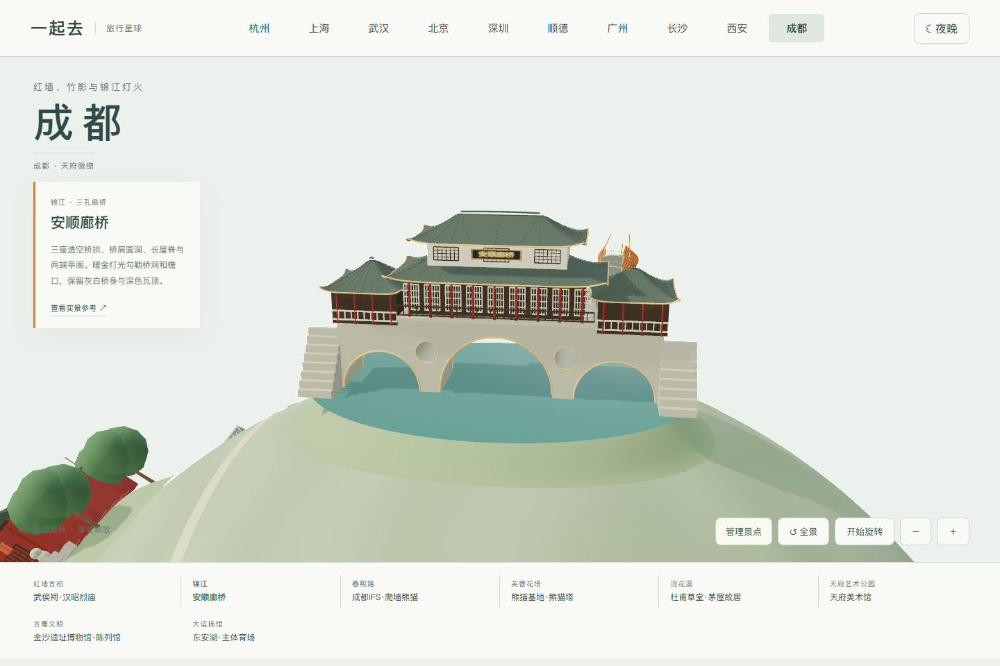
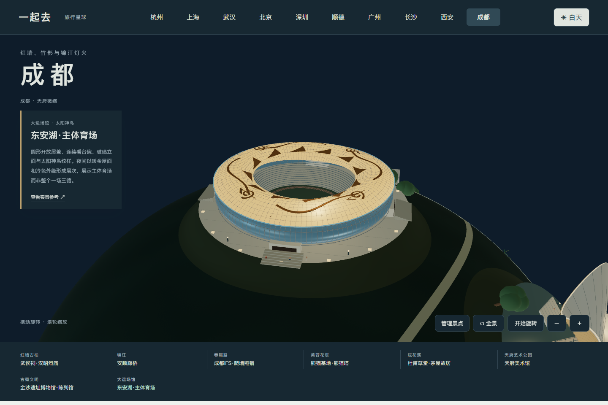
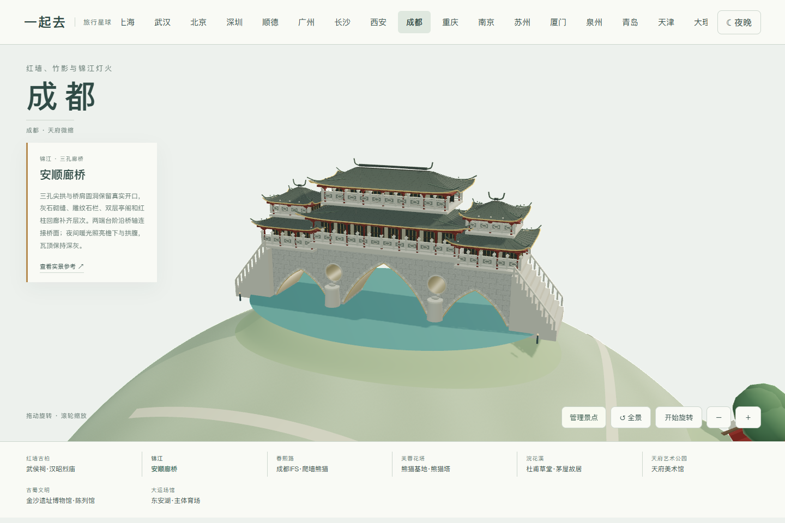
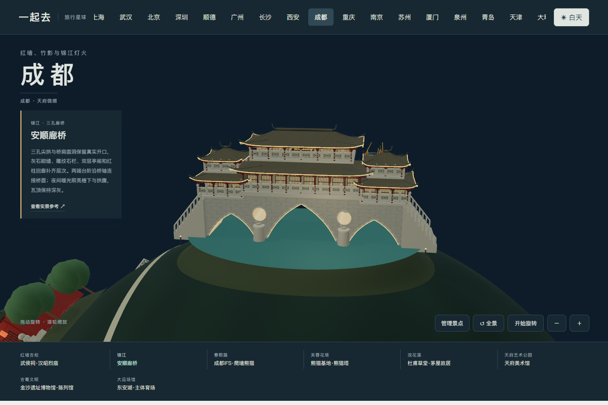
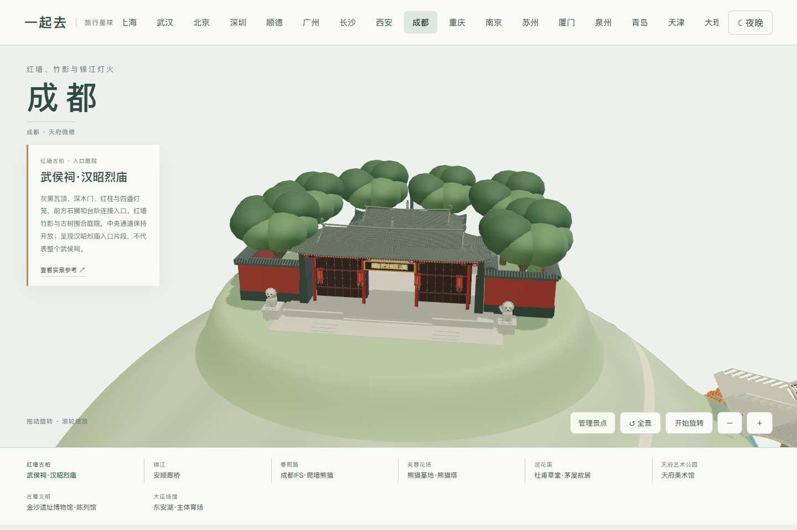
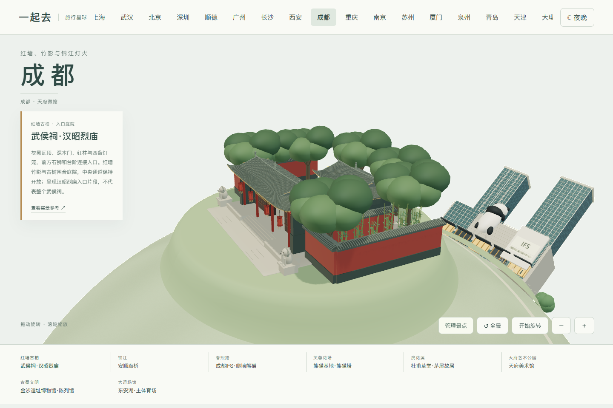
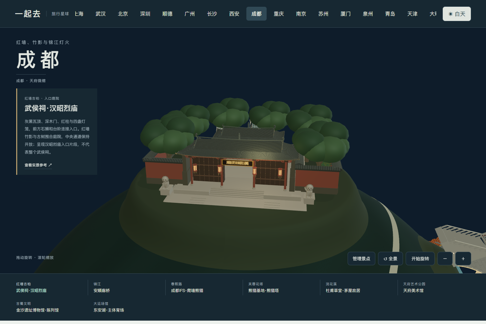
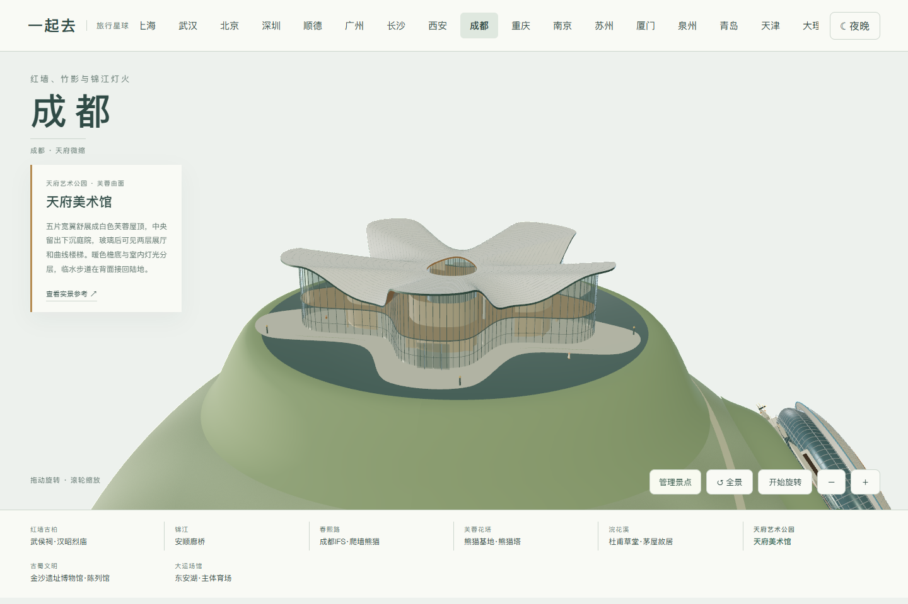
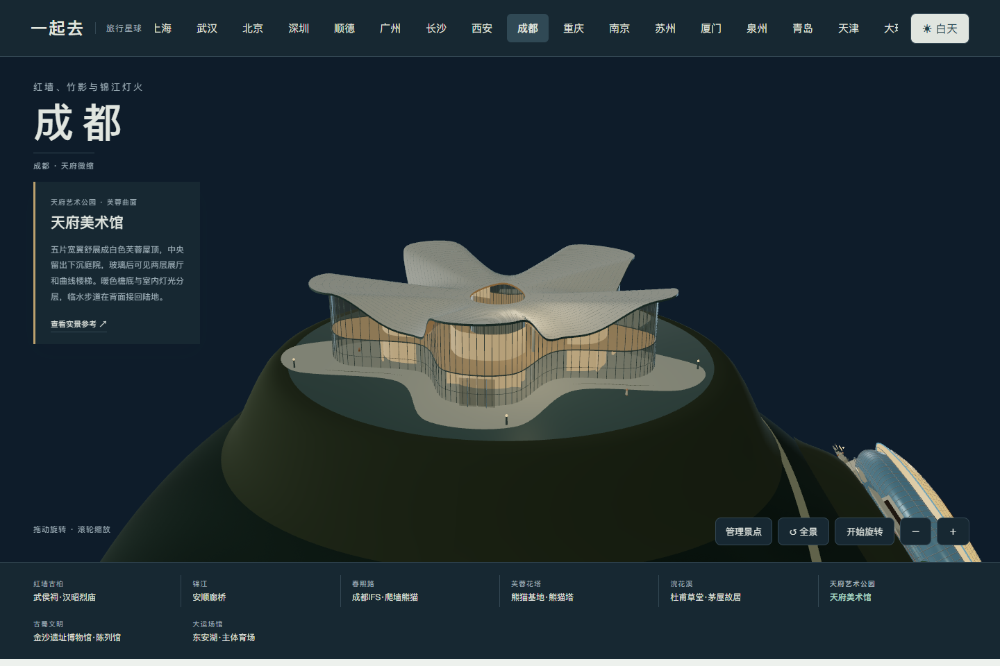
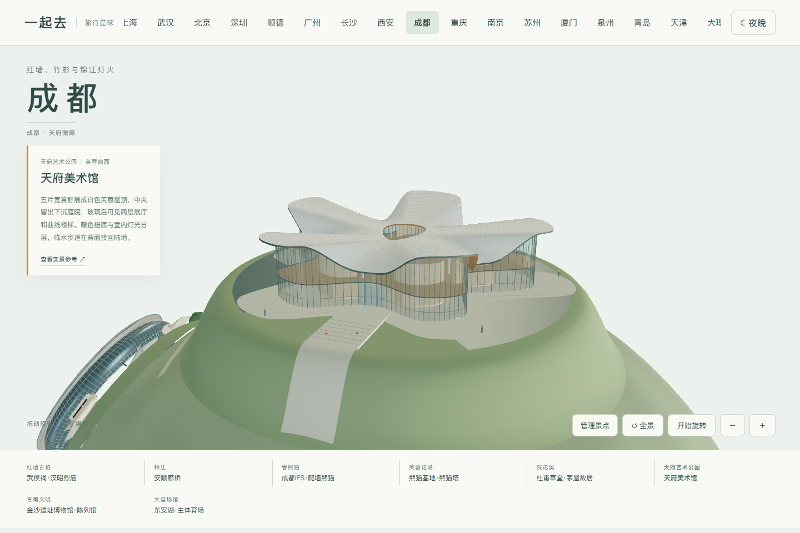

# 成都地标与实拍参考

核看日期：2026-11-04。八组场景以公开实拍观察为依据，使用程序化几何建模。原照片只用于内部研究，不作为贴图或随仓库分发。比例、场地与摆放是便于浏览的艺术化缩微，不是测绘模型。

| 地标 | 已核看的形态 | 参考 |
| --- | --- | --- |
| 武侯祠·汉昭烈庙入口 | 灰瓦五开间门屋、朱红柱墙、石狮、灯笼、红墙竹影与遮蔽院落的树冠 | [四川省情网实拍](https://www.scdfz.org.cn/whzh/slzc1/content_130193)、[国际在线林荫入口实拍](https://news.cri.cn/20230723/399db06e-9fb9-6b3b-66b0-938a43027c0f.html) |
| 杜甫草堂·茅屋故居 | 低矮土墙、细木格栅、厚茅草屋面、长屋脊与竹林；不是把整个草堂博物馆画成一栋房子 | [实景照片](https://you.ctrip.com/sight/chengdu104/4226.html) |
| 安顺廊桥 | 三座真拱洞与两处圆形桥肩孔、两层长屋脊、侧亭、灰白桥身；夜景以檐口和券洞暖光分层 | [Zain Lee 夜景照片](https://unsplash.com/photos/photography-of-building-and-bridge-during-nighttime-ogCzbpkxdK4) |
| 成都 IFS 爬墙熊猫 | 熊猫贴在立面，前爪越过屋顶，黑色后腿悬垂；石材分带、玻璃塔楼与底层暖色商铺 | [香港商报实拍](https://www.hkcd.com.hk/content_p/2024-07/01/content_173280.html)、[九龙仓开业资料](https://www.wharfholdings.com/file/140114%20CDIFS%20Opening%20Chi%20P%20FW.pdf) |
| 熊猫基地熊猫塔 | 十一层平台、逐级收分的铜色花瓣肋、正面通高开口、露出的扶手与支撑、顶端三片尖梢 | [UDG 原作设计与摄影资料](https://www.gooood.cn/panda-tower-in-chengdu-research-base-of-giant-panda-breeding-udg-atelier-alpha.htm) |
| 天府美术馆 | 芙蓉花瓣曲面、白色屋面与暖色檐底、内退玻璃、倒影水院；夜景使用室内面光，不套用办公楼窗灯 | [实拍](https://www.wenxuan.news/huodong/707.html)、[外墙材料项目资料](https://www.lopochina.com/tianfu-art-museum-in-metallic-glazed-terracotta.html) |
| 金沙遗址博物馆陈列馆 | 浅色斜屋面、圆形采光凹口、窄天窗、玻璃入口、前方独立神鸟纪念雕塑 | [陈列馆实拍](https://k.sina.com.cn/article_5864380259_p15d8b576300100gphu.html)、[馆方文化景观说明](https://www.jinshasitemuseum.com/node/188) |
| 东安湖主体育场 | 正圆开放屋顶、连续看台碗、玻璃外圈与太阳神鸟图案；屋顶金色与外缘冷色照明有层次 | [中国建筑设计方介绍、黄昏与夜景实拍](https://www.thepaper.cn/newsDetail_forward_24034888) |

IFS 的「I AM HERE」熊猫雕塑原作由 Lawrence Argent 创作；此处为自建几何提炼，不是官方模型。太阳神鸟图案同样为几何表达，未使用文物扫描或原始摄影纹理。模型灯光用于场景展示，不代表景点实际开放时段。

## 地图与交互

四组放在一个半球，另外四组放在另一半球。可直接点景点名称近看、自由旋转、切换日夜、整组添加和移除。设置保存在当前浏览器。建筑保持刚性，仅周边地面衔接球面；模型间保留净空。成都当前为景观地图，尚未提供成都多人旅行排程，原杭州、上海、武汉业务保持。

## 0.55.15 安顺廊桥

对照[2026 年日景实拍](https://commons.wikimedia.org/wiki/File:Anshun_Bridge_and_Jin_River_20261003124712.jpg)、[石拱及廊檐近景](https://commons.wikimedia.org/wiki/File:Anshunlang_bridge_detail.jpg)与[夜景照片](https://unsplash.com/photos/photography-of-building-and-bridge-during-nighttime-ogCzbpkxdK4)，调整三孔尖拱，补石砌缝、拱圈、桥墩小石兽、雕纹石栏及双层亭阁。两端台阶改为沿桥轴通向桥面，正背廊窗均保留进深。

夜间以暖光表现拱腹与檐下，保留深灰瓦面；灯光衬面不会封住桥洞和圆洞。石雕、瓦纹与照明均为缩微表达，不是文物扫描。参考照片只用于研究，没有作为贴图或收入公开包。

## 0.55.29 武侯祠入口

对照[馆方入口照片](https://en.wuhouci.net.cn/about)、[四川省情网入口全景](https://www.scdfz.org.cn/whzh/slzc1/content_130193)与[馆方供图的林荫、红墙和内院](https://news.cri.cn/20230723/399db06e-9fb9-6b3b-66b0-938a43027c0f.html)，将旧模型的红色格窗改为深木色门板，补灰黑瓦垄、起翘檐角、门钉、红柱、四盏多边形灯笼、石狮与连续入口台阶。

中央门道与红墙夹道保持通透，竹丛收在围墙内，树冠遮蔽院落。庭院采用平整地面并向球面过渡，避免铺地和墙脚悬空；本组稍向外移，为放大的场地留出净空。夜间灯笼分别缓慢变化，保留深木门和灰瓦底色；减少动态效果时保持静态。

只呈现汉昭烈庙入口及压缩的内院片段，不代表武侯祠全院布局。参考照片仅用于研究，雕刻与夜间照明为缩微表达。

## 0.55.30 天府美术馆

对照[设计方提供的项目介绍与日夜、鸟瞰照片](https://www.archiposition.com/items/71382578ed)、[谷德的设计资料和剖面](https://www.gooood.cn/chengdu-tianfu-art-gallery-by-china-southwest-architectural-design-and-research-institute-corp.htm)，重做宽阔的五片曲面翼展、暖色深檐、两层玻璃展厅和中央庭院。原模型只在巨大屋顶下放了窄小玻璃核心，现让展厅跟随各翼展开，并补内部隔墙、楼层和曲线楼梯。

临水步道连成一体，在背面接回陆地；水面保持水平，取消沿球面弯下的水墙。屋顶用圆润而不完全对称的五翼轮廓，开敞中庭以收窄的水滴形表达。灯光来自展厅和檐下，玻璃保持深浅与透明层次；低矮庭灯缓慢变化，减少动态效果时静止。扩大后的组团向外移，与东安湖体育场留出空隙。

建筑、庭院和水岸是实拍指导的几何缩微表达，不是精确测绘；室内布局、岸坡和灯光经过压缩，不代表全部展厅或现实展览。摄影作品只在本地用于研究，未作为纹理或公开文件分发。

