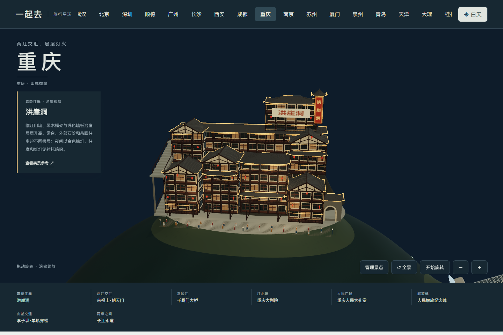
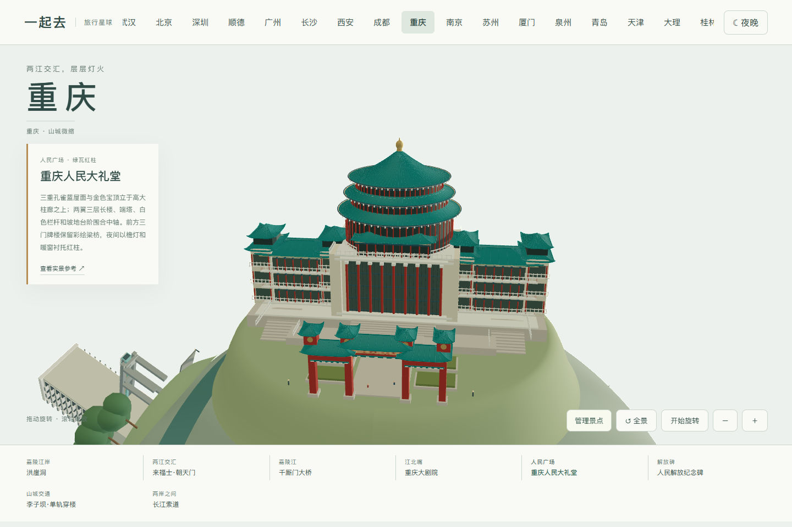
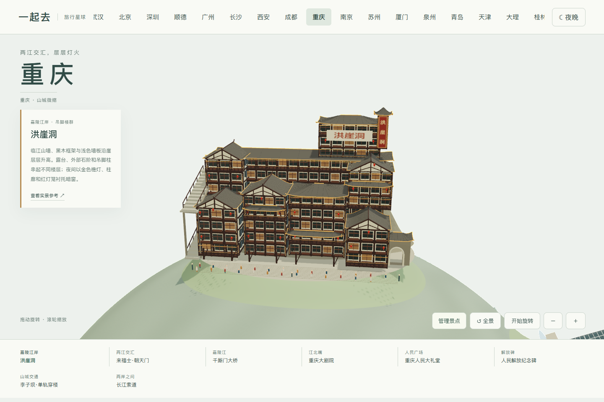
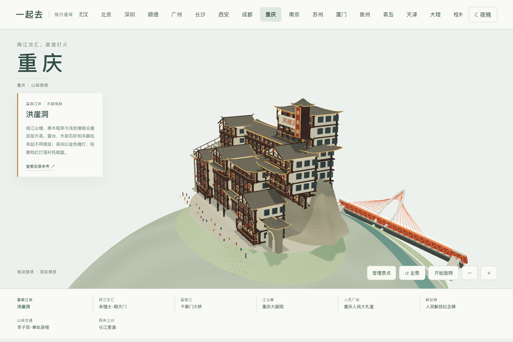

# 重庆地标与实拍参考

核看日期：2026-11-04。八组模型依据实际照片与建筑、桥梁设计单位资料制作。参考照片只供内部观察，不作为公开贴图或打包分发。建筑比例、地形和两江关系是艺术化缩微表达，不是精确地图或工程模型。

| 地标 | 已核看的形态 | 参考 |
| --- | --- | --- |
| 洪崖洞 | 临江三角山墙、黑木框架与浅色墙板、错层开放露台、右侧高阁、暗窗、金色檐灯与红灯笼 | [正面日景报道](https://www.thepaper.cn/newsDetail_forward_28863739)、[游客夜景实拍](https://kr.trip.com/moments/detail/chongqing-158-130928534/) |
| 来福士·朝天门 | 八座塔楼、前排四塔上的圆弧玻璃连廊、两座后排高塔、银灰竖框与深色玻璃、收拢的裙楼 | [Safdie Architects 项目资料](https://www.safdiearchitects.com/projects/raffles-city-chongqing)、[The Crystal 实拍](https://int.design/fr/projets/the-crystal-the-conservatory-raffles-city-chongqing/) |
| 千厮门大桥 | 白色天梭形独塔、塔身中部开口、红色单索面斜拉索、上下两层桥面与钢桁架 | [设计单位资料与照片](https://www.cmct.cn/index.php?c=show&id=557) |
| 重庆大剧院 | 石材平台、倾斜浅绿玻璃壳体、两座较高舞台体量、细密玻璃分缝与折面轮廓 | [gmp 建筑师资料与摄影](https://www.gmp.de/en/projects/472/chongqing-grand-theater) |
| 重庆人民大礼堂 | 三重绿瓦圆殿、红柱白栏、对称翼廊、前方三门牌坊与石阶轴线 | [正面实拍](https://www.hlhbsc.org/spot_detail.aspx?city=22&spot=1009) |
| 人民解放纪念碑 | 米白八角碑身、竖向金色线脚、四面钟、透空冠部、盔形顶与风向标 | [重庆市政府介绍](https://www.cq.gov.cn/zjcq/cycq/jplyxl/dsy/dsjp/202608/t20260826_15982337.html)、[市政府新闻实拍](https://www.cq.gov.cn/ywdt/jrcq/202502/t20250226_14343293.html) |
| 李子坝单轨穿楼 | 住宅层与车站通道分开、双线轨道穿楼、淡灰浅橙立面、阳台与空调、青绿色列车 | [渝中区实拍](https://www.cqyz.gov.cn/zjyz/lyyz/lswh/tk/202201/t20220113_10301063.html)、[正面近景实拍](https://hk.trip.com/moments/detail/chongqing-158-136314677/) |
| 长江索道 | 两岸站房、钢索下垂、悬挂支架、大玻璃窗与黄色轿厢 | [景点实拍](https://you.ctrip.com/sight/chongqing158/109940.html) |

千厮门为独塔，未把东水门的双塔外形移用到此处。索道黄色轿厢与李子坝列车涂装取自实拍，不保证与当前班次一致。夜景是模型照明设计，不代表当天灯光、运营或开放安排。

## 布局与交互

两江以连续主河道和汇入支流表现。八组地标分布在两半球，每个模块包括自身建筑、场地与灯光；可整组添加、移除及恢复，设置保存在当前浏览器。模型有独立近看入口，支持自由旋转、日夜、键盘和手机触控。建筑保持刚性，外围场地衔接球面。

重庆当前为景观地图，尚未接入重庆多人旅行排程。原杭州、上海、武汉业务与数据保留。手机检查使用浏览器模拟，未代替物理手机性能测试。

## 洪崖洞细化（0.55.1）

对照正面日景与沿街夜照，替换重复楼块和沿街小房子：临江屋顶增加前向山墙，后方保留连续退台廊道；木框、浅墙板、深窗、吊脚支撑、转折楼梯和入口券洞分别建模。金色灯光落在檐边、立柱和廊下，减少整面窗墙发亮。模型背面的崖坡是适应球面的连续地形，不声称还原背街道路及精确楼层。

