# 大理地标实拍与模型范围

2026-11-04 核看八组具名景点的实拍。照片仅供内部造型参考，不作为公开贴图或打包素材。模型为艺术化缩微表达，场地距离经过压缩；夜间展示不代表真实开放时间或照明排期。沙溪位于大理州剑川县，与大理古城分属不同地点。

| 模块 | 实拍与资料 | 主要识别点 |
| --- | --- | --- |
| 崇圣寺三塔 | [中国新闻网实拍](https://www.ecns.cn/hd/2018-09-13/detail-ifyxxzwt9219171.shtml)、[大理市政府资料](https://www.yndali.gov.cn/dlsrmzf/c106716/pc/content/1983786516944621568/content_1983786516944621568.html) | 中央方形十六级千寻塔、两侧八角十级小塔，米白砖身、塔龛、密檐收分与倒影池。没有把三座塔做成同一形状。 |
| 大理古城南门 | [正面日景实拍](https://www.feastographyblog.com/blog/dali-ancient-city) | 宽阔双层楼阁、灰瓦、红柱蓝绿梁枋、文献名邦匾额、石墙与贯通门洞。误标为南门的五华楼照片已排除。 |
| 五华楼 | [古城楼阁实拍](https://www.visitourchina.com/dali/attraction/the-ancient-city-of-dali.html) | 三层逐级收分的灰瓦楼阁、红木柱网、回廊与石栏，门洞真实贯通。 |
| 喜洲·严家大院 | [紫荆杂志记者实拍](https://bau.com.hk/web/article/1305292658495438848/web/content_1305292658495438848.html) | 三坊一照壁、蓝边福字照壁、雕花门楼、木窗回廊及后方西式小楼；本版呈现一组代表性院落，不宣称还原全部院落。 |
| 洱海·小普陀 | [岛屿与观音阁实拍](https://touch.travel.qunar.com/comment/5971508) | 不规则石岛、双层灰瓦观音阁、红木开敞前廊、蓝白彩绘墙面、透孔石栏及岸边老树。 |
| 苍山·洗马潭 | [湖岸山脊实拍](https://gs.ctrip.com/html5/you/sight/dalicity1445616/1834533.html)、[新华社山景照片](https://www1.xinhuanet.com/photo/20240608/dd80239b0ac84e0dadf8fc9df1f04156/c.html) | 起伏高山草坡、裸露石块、低缓潭岸与折转木栈道。自然山体夜间保持暗色，不用整片自发光代替夜景；没有模拟索道。 |
| 下关·兴盛大桥 | [桥体与洱河实拍](https://touch.travel.qunar.com/comment/17114421) | 浅色五跨连拱、重复镂空石塔柱、层叠塔檐、金色纹饰与花纹铁栏，桥下保持真实开口。 |
| 剑川沙溪·古戏台 | [完整戏台实拍](https://touch.go.qunar.com/poi/5942814) | 架空戏台、后方高阁、两侧廊房、灰瓦飞檐、木格窗与宽石阶。廊房属于戏台组合，不是随机填充住宅。 |

提供两半球分布、日夜切换、自由旋转、逐景近看、整组增删保存与手机触控。大理当前为景观地图，未接入多人旅行；不复用其他城市的景点目录，不虚构票价、营业时间或预约信息。

## 0.55.11 崇圣寺三塔精修

依据[大理市政府的塔体说明](https://www.yndali.gov.cn/dlsrmzf/c106716/pc/content/1983786516944621568/content_1983786516944621568.html)、[景区运营方的照片与结构资料](https://www.dalitravel.cn/content/read/162.html)，保留十六层千寻方塔在前、十层八角双塔在后的关系。结合[近景历史影像](https://gujianzhu.wiki/architecture/dali-chongshengsi/)观察塔檐和塔龛，现代全景用于核对米白材质及总体轮廓；没有把历史树木、破损与围墙照搬为现状。

重做塔身收分曲线、多层叠涩塔檐、真实窗洞与凹入佛龛。八角小塔加入角柱、莲瓣平座和部分层级的斗拱；主塔底部保留「永镇山川」，顶部为简化金属塔刹。小塔高度约为主塔的 0.617，与官方约 42.19 米和 69.13 米的比例接近。雕像和金属鸟为微缩简化，不宣称逐件复原。夜间采用柔光展示，不代表真实夜游安排。参考照片没有进入公开贴图或提交包。

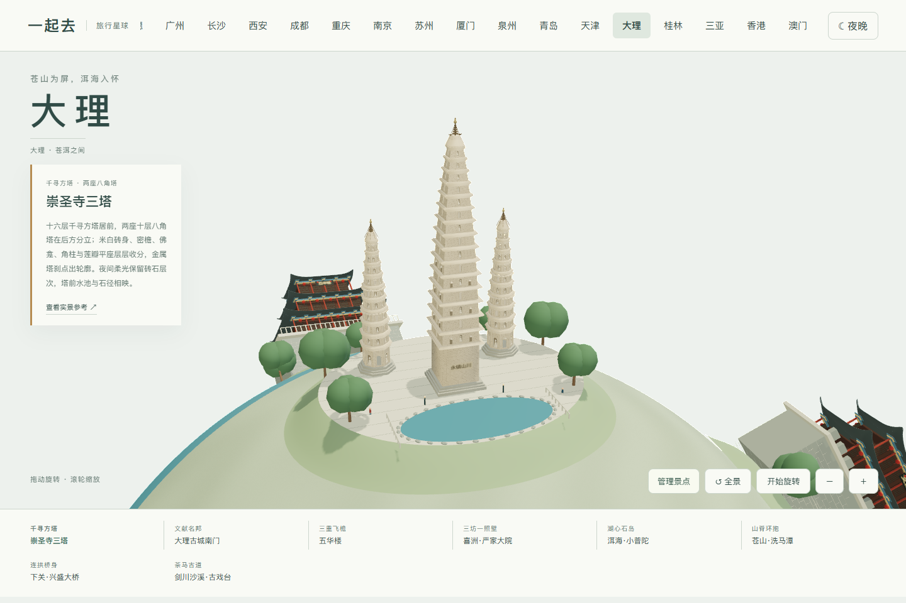

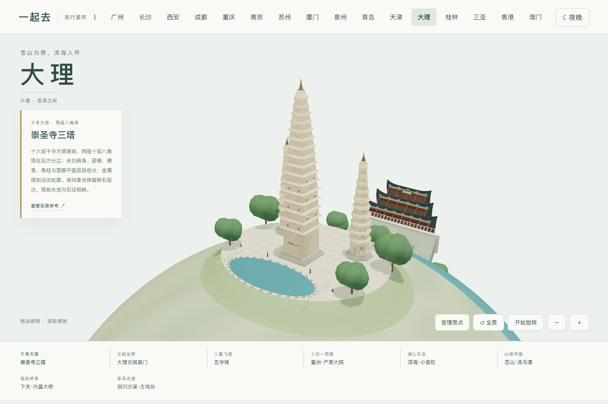

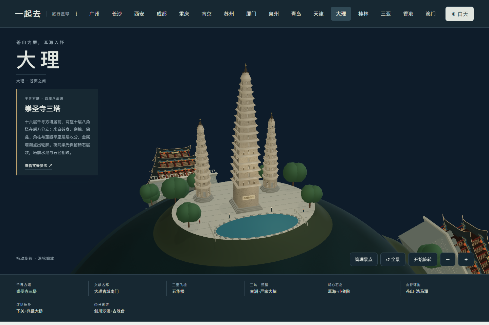

## 0.55.64 五华楼

根据 [2026 年正面实拍](https://commons.wikimedia.org/wiki/File:Wuhua_Tower_20260220_135004.jpg)、[楼阁与城台细部](https://pc.dllyjszx.com/article-466.html) 和 [日夜照片](https://www.sightunpacked.com/destinations/china/dali/dali-old-town/)，补出三层彩绘梁枋、层叠斗拱、木格门窗、石栏、拱门饰圈与屋顶宝瓶。回廊退进柱网，门洞保持真实贯通。

保留红柱、蓝绿彩绘与灰瓦的日间颜色，夜间暖光集中在檐下和门洞。模型为缩微表达，后侧细节依据可见构件补全，不宣称每面均有照片佐证；参考照片不随项目分发。

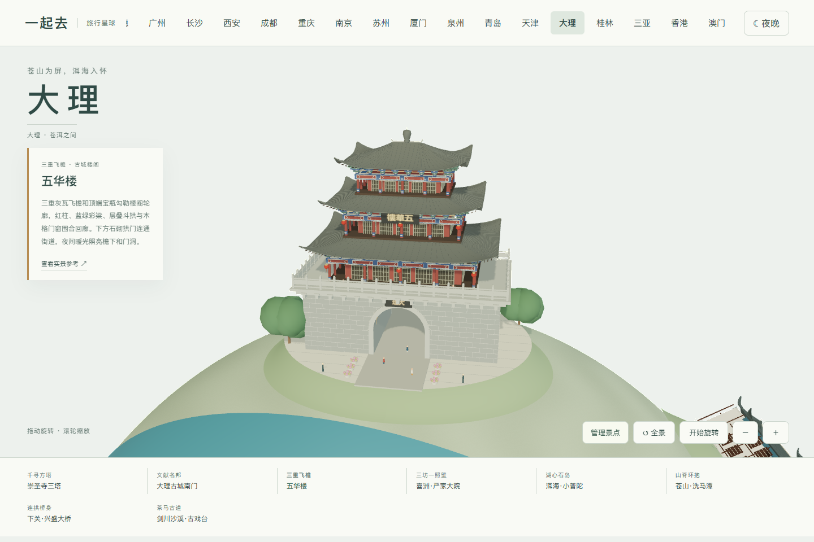

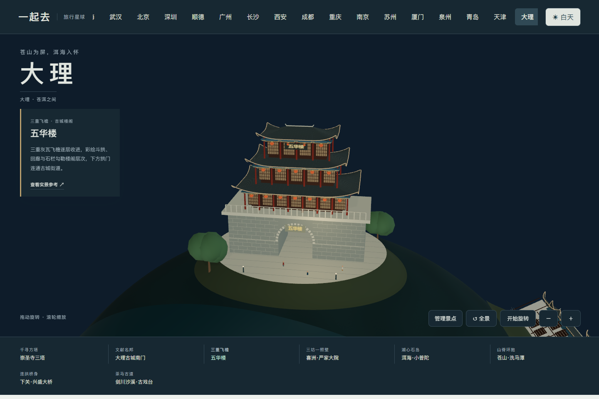

## 0.55.65 大理古城南门

对照[正面日景实拍](https://www.feastographyblog.com/blog/dali-ancient-city)、[夜间斜俯视照片](https://www.loongwander.com/article/dali-ancient-town)和[城门与广场照片](https://h5.ifeng.com/c/vivoArticle/v002oEry0CoaqSklCrsofWI0XUouEj00JOOAWniIbpliAbM__?isNews=1&showComments=0)，补出宽石墙、中央与侧门、双层挑檐、蓝绿彩绘斗拱、红柱木窗、灯笼、花坛和四块独立的「文献名邦」匾额。匾额沿传统方向从右向左排列，字形为简化表达。

入口采用贴合球面地形的连续缓坡，门洞内铺地保持平整；修复承托沉入球面、坡道与广场重叠以及单字被横版贴图压窄的问题。夜间暖光照向檐下和砖石，不改变日间材质。参考照片不随项目分发；模型为缩微景观，不代表测绘复原。五华楼的 0.55.64 修改合并于此版本交付。

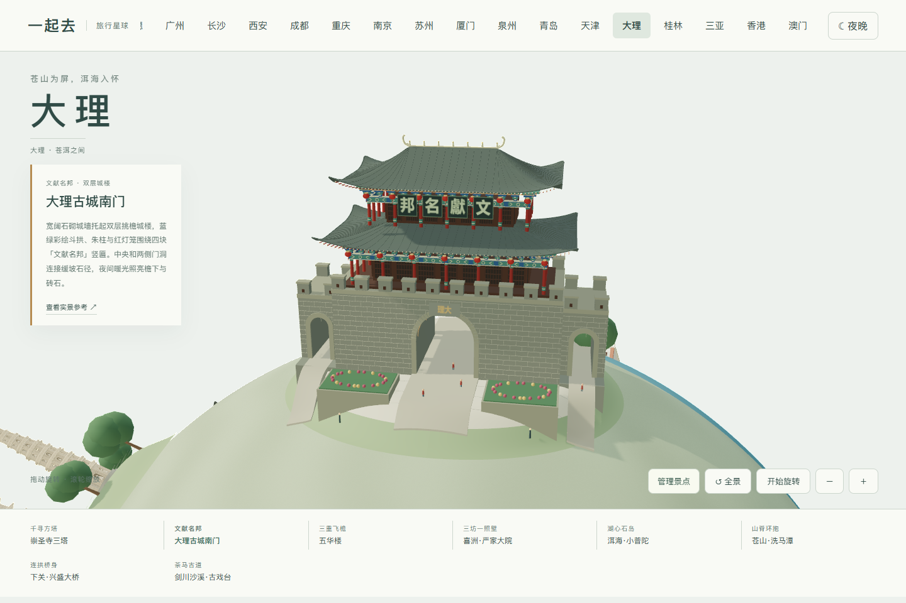

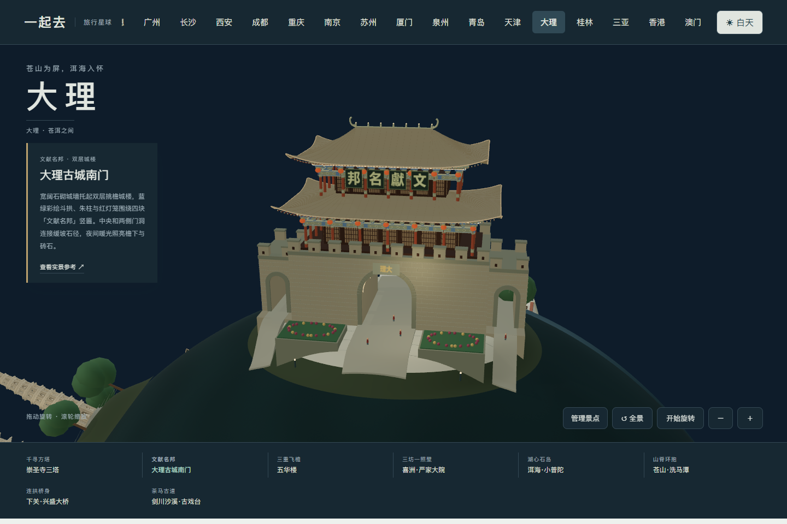

## 0.55.66 沙溪古戏台

对照[近景实拍](https://touch.go.qunar.com/poi/5942814)、[正面照片](https://www.trip.com/moments/theme/destination-shaxi-ancient-town-2032362-attraction-993137/)与[2025 年完整立面](https://cj.sina.com.cn/articles/view/2393857144/p8eaf5c78027012tv8)，重做石砌高台、开放舞台、蓝金梁枋、木格门窗、后方魁星阁及相连铺面。屋檐、纹饰与背景彩绘采用缩微简化，不宣称逐件复原。

后台两侧阶道接入舞台；修复末级台阶与木地板的高差、上层柱脚悬空和后墙挡住入口的问题。夜间暖光集中在木构和檐下；没有添加虚构演出、票价或夜游时间。

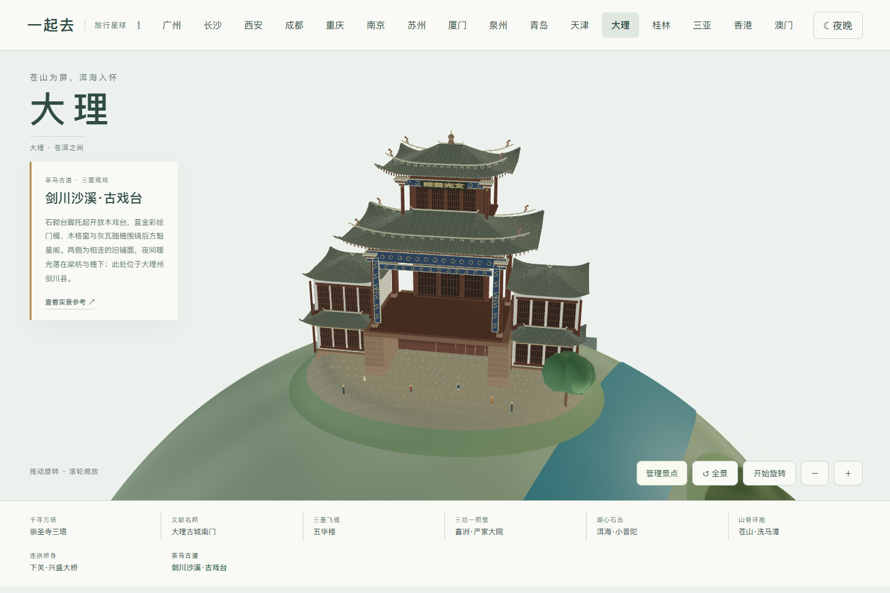

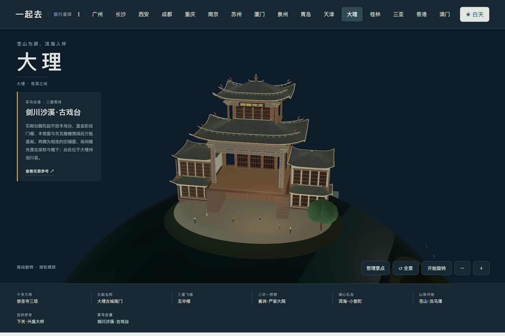

## 0.55.67 喜洲严家大院

对照[紫荆杂志记者的门楼、回廊、照壁与洋楼实拍](https://bau.com.hk/web/article/1305292658495438848/web/content_1305292658495438848.html)及[庭院全景](https://www.asiaodysseytravel.com/yunnan-tours/6-days-dali-shaxi-lijiang-tour.html)，重做层叠门楼、蓝白纹饰照壁、红木双层回廊、窗格、栏杆、灯笼与小洋楼的拱窗阳台。福字使用正方形贴图，修复旧版压窄的问题；参考照片不作为贴图分发。

重新整理门楼入院通路，分开传统屋顶与洋楼露台，移开挡住通路的盆栽。院落只表达代表性组合，不宣称还原全部严家大院或精确测绘位置。夜间暖光为展示设计，不代表实际开放时间。沙溪古戏台的 0.55.66 修改合并于本次交付。

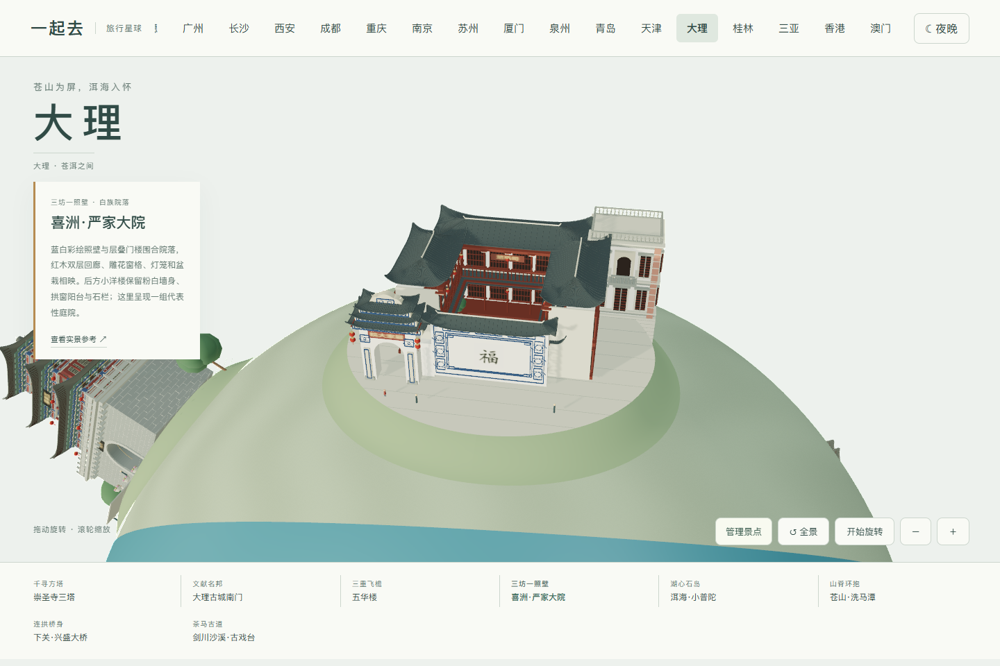

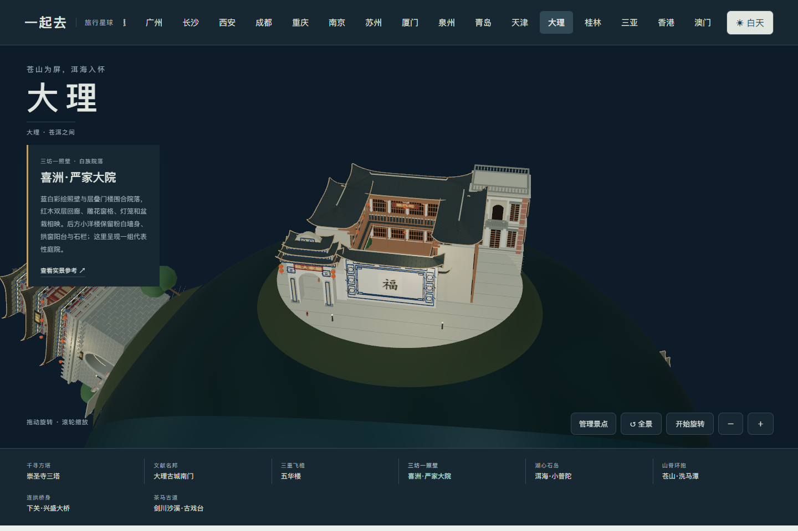

## 0.55.68 洱海小普陀

对照[岛屿侧面与码头实拍](https://touch.travel.qunar.com/comment/5971508)及[2019 年参访者的正面和岛岸照片](https://miaochuehtang.wordpress.com/2019/06/11/朝聖之行-觀音拋入洱海中的鎮海大印-小普陀/comment-page-1/)，重做不规则石灰岩岛岸、双层灰瓦观音阁、红柱木窗、蓝白圆形彩绘、镂空石栏和连续码头台阶。第二稿降低楼阁与屋脊，避免过度瘦高。

前廊为真实开口，台阶与岛面相连；侧后部依据可见构件作简化补全，不宣称全部立面均有实拍或准确测绘。夜间暖光用于展示，不代表夜游开放；参考照片不进入公开素材。

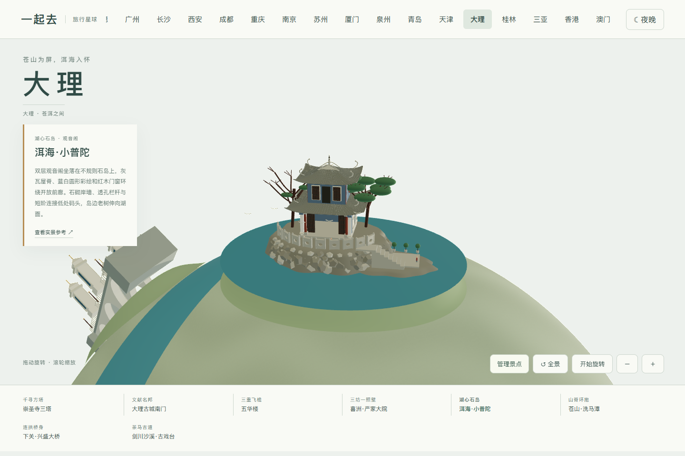

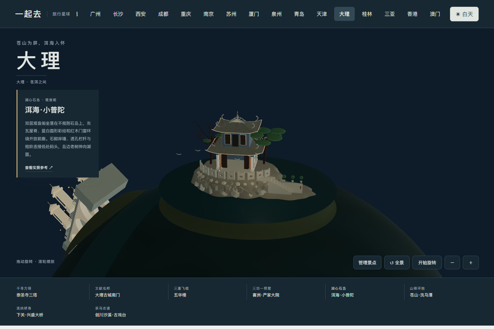

## 0.55.69 下关兴盛大桥

依据 [Kcx36 于 2023 年拍摄的完整桥景](https://commons.wikimedia.org/wiki/File:大理兴盛大桥_202307_01.jpg)及[桥塔与拱肋近景](https://touch.travel.qunar.com/comment/17114421)，将旧版三孔简化桥身改为五跨拱肋，补出拱上支撑、镂空塔柱、石材分缝、层叠塔檐、金色装饰、卷臂路灯和曲线铁栏。修正旧文案把开口误写成蓝色窗面的描述。

参考[大理日报对夜景的描述](https://dalidaily.dlzrm.cn/202603/31/content_79352.html)，暖光集中在拱肋、石檐与路灯；没有宣称还原灯光排期或完整动态灯光秀。桥头以缩微台阶连接岸边，未复刻完整道路立交；装饰纹样为几何简化。参考照片没有作为公开贴图分发。小普陀的 0.55.68 修改合并于此版本交付。

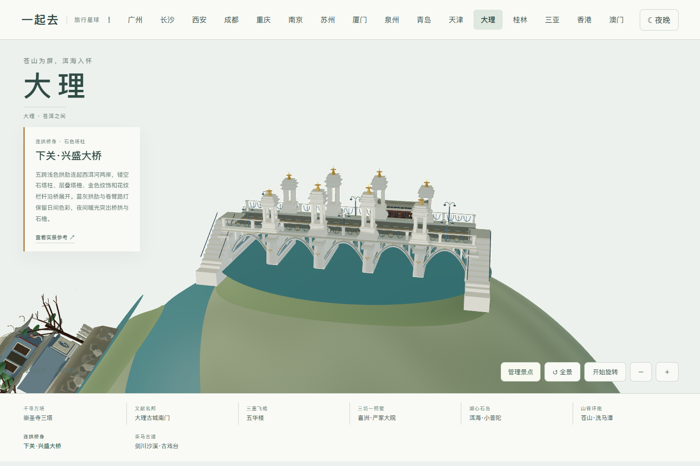

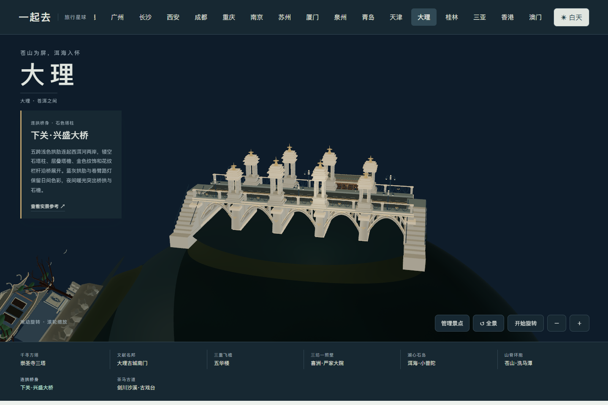

## 0.55.70 苍山洗马潭

对照[洗马潭山脊与栈道实拍](https://gs.ctrip.com/html5/you/sight/dalicity1445616/1834533.html)及[云南网刊载的高山杜鹃照片](https://m.yunnan.cn/system/2020/06/16/030723793.shtml)，用有高差和岩面起伏的山脊替换光滑山包，湖岸改为不规则轮廓，低矮灌丛与浅色花簇沿坡分布。花色采用花期的艺术化表达，不代表全年景色或实时花情。

栈道随地形逐级变化，保留栏杆、支柱和观景平台。实测步道中心及两侧均高于地面、没有断口，湖心高于湖床且没有方形水面越出岸线。夜间取消步道和栏杆自发光，让自然山地保留暗部；没有增设虚构灯光秀。模型没有复制精确地形或完整索道线路，参考照片没有作为公开贴图分发。

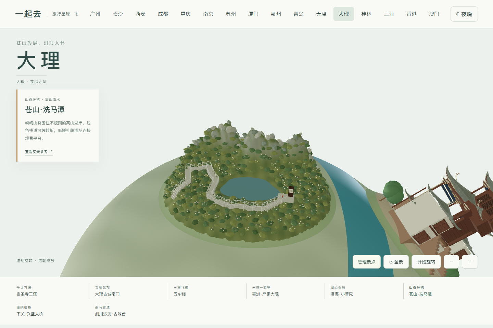

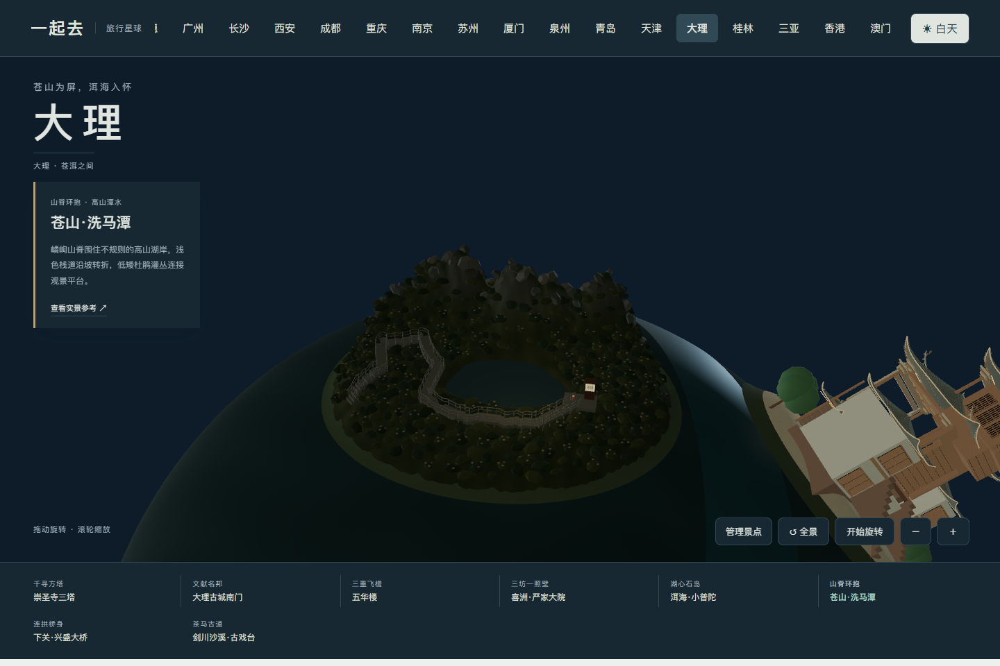
