# 广州地图与造型参考

广州入口为 `guangzhou.html`，含十一组可独立增删的地标。当前为景观地图，未接入广州多人旅行目录；杭州、上海和武汉旅行保持。

## 实景与模型

| 地标 | 实际观察与模型特征 | 来源 |
| --- | --- | --- |
| 广州塔 | 银白色镂空网架、偏上部收腰、观光平台和天线；夜间彩光沿网架变化 | [广州市政府建筑介绍](https://www.eguangzhou.gov.cn/globalgzpastandpresence/content/post_31123.html)、[白天实拍](https://www.52hrtt.com/fr/n/w/info/G1685709784443) |
| 珠江新城东西塔 | 西塔弧面三角平面、菱格结构；东塔浅色竖向构件、分段退台与高低冠顶 | [WilkinsonEyre 西塔](https://wilkinsoneyre.com/projects/guangzhou-international-finance-center)、[KPF 东塔](https://www.kpf.com/project/ctf-finance-centre)、[东塔实拍](https://www.toshiba-airconditioning.com.cn/dongzhi/case/detail?case_id=60373912c8894504fc4a3e44)、[夜景实拍](https://www.baike.com/wiki/%E5%B9%BF%E5%B7%9E%E4%B8%9C%E5%A1%94) |
| 广州大剧院 | 大小两块非规则砾石体量、灰色石材三角面、通透玻璃幕墙与前方水面 | [广州社科院资料](https://www.gzass.gd.cn/whzc/wenhuasheshi/yingjuyuan/120.html)、[夜间实拍](https://jp.trip.com/travel-guide/attraction/guangzhou/guangzhou-grand-theatre-15066938/) |
| 广东省博物馆 | 灰色悬挑盒体、深红凹槽、收进的底层入口和石板立面 | [Rocco 建筑项目资料](https://www.archdaily.com/127122/guangdong-museum-rocco-design-architects)、[外观照片](https://finance.sina.com.cn/wm/2024-08-04/doc-inchmtfq2329372.shtml) |
| 中山纪念堂 | 蓝色层叠八角屋顶、红柱宽门廊、彩绘梁枋与天下为公匾额 | [正面照片](https://dp.pconline.com.cn/photo/list_3205165.html) |
| 陈家祠 | 三进三路厅堂、六个院落、灰砖硬山屋顶与彩色陶塑屋脊 | [广州文旅资料](https://wglj.gz.gov.cn/ztmb/gzhyn/ajjq/4a/content/post_9773088.html)、[航拍](https://huacheng.gz-cmc.com/pages/2022/10/26/3034a897ffc64513872b5c4a4138686b.html) |
| 石室圣心大教堂 | 双尖塔、花岗岩立面、玫瑰窗、尖拱门和长向中殿 | [越秀区资料](https://www.yuexiu.gov.cn/zjyx/yxjd/zjwh/content/post_8665100.html)、[实拍照片](https://www.synotrip.com/sites/default/files/107923/timg_29.jpg) |
| 五羊石像 | 一只高立的主羊和四只姿态不同的石羊、岩石底座及花坛林荫 | [广州社科院资料](https://www.gzass.gd.cn/whzc/wenhuaziyuan/wenhuajingguan/129.html)、[近景实拍](https://newbbs-fd.zol-img.com.cn/t_s1200x5000/g5/M00/03/09/ChMkJlg-Xg-IfuWuAAcNs1dIREwAAYLMwAKQmkABw3L452.jpg) |
| 海心桥 | 一道白色斜拱、弯曲桥面、细钢索与两端分叉坡道；桥拱冷白光、木栏杆暖光 | [海珠区资料](https://www.haizhu.gov.cn/hzdt/ztlm/tzhz/rjhj/lyjd/csmp/content/post_9195706.html)、[设计方项目实拍](https://www.archcollege.com/52974.html)、[广州日报现场图](https://huacheng.gz-cmc.com/pages/2021/06/25/798a5c060bf24462b142ff65b09d01e3.html) |
| 花城广场 | 林荫轴线、棕榈树阵、喷水广场、浮岛水景和两侧花坛；地灯与树下暖光，保留行走空间 | [广东省外办资料](https://www.gdfao.gov.cn/zwgk/zdly/gzscfd/content/post_1333472.html)、[广场与林荫夜间照片](https://m.urbanlight.cn/photosdetail/0771aef4-57eb-4c3e-9a8d-2f3139ada685) |

上述照片已在制作前查看，仅用于造型参考，没有作为贴图或打包至仓库。外站可用性由原网站决定，不依据这些资料提供票价、开放时间或预约承诺。

## 表达边界

建筑按辨识度保留主要轮廓和材质，并非精确测绘。球面位置、河道、比例和朝向经过艺术化重排；古建筑陶塑和雕像是简化模型。灯光用于表现夜景层次，不代表真实场馆当前照明、演出时段或完整灯光节目。

四组现代地标、海心桥、花城广场与四组历史文化景点分布于两个半球。大剧院、博物馆和东西塔安排在同一岸；海心桥跨江，其余模型避开河道。连续江岸步道与场馆之间的步道属于公共景观，删除某个地标后保留。所属灯光、植物、台阶和广场随整个景点增删。系统减少动态效果时，彩光变化与窗灯动画停止。

`npm test` 覆盖完整几何、水面避让、球面落地、模块间距、整组管理、资源释放和夜间底色；`python tools/destination-check.py guangzhou` 使用独立内存服务检查日夜近看、触屏、键盘、窄屏布局、保存恢复和 WebGL 故障重试。手机模拟不等同于物理手机性能验收。

## 实际网页画面

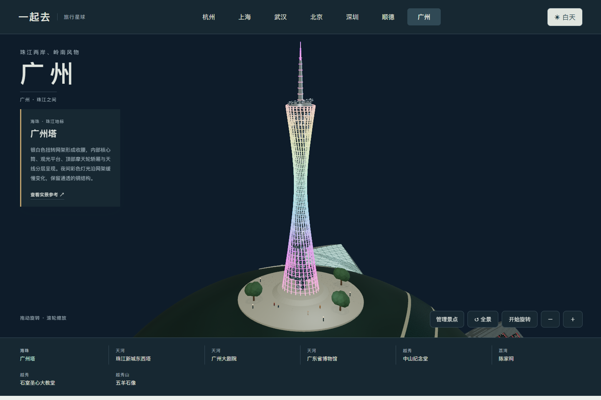

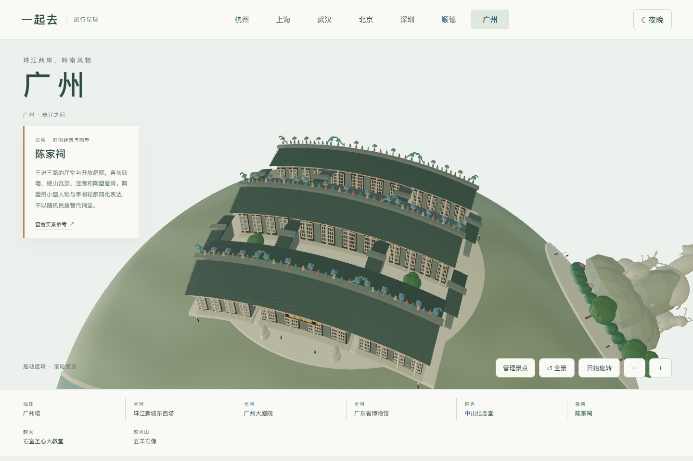

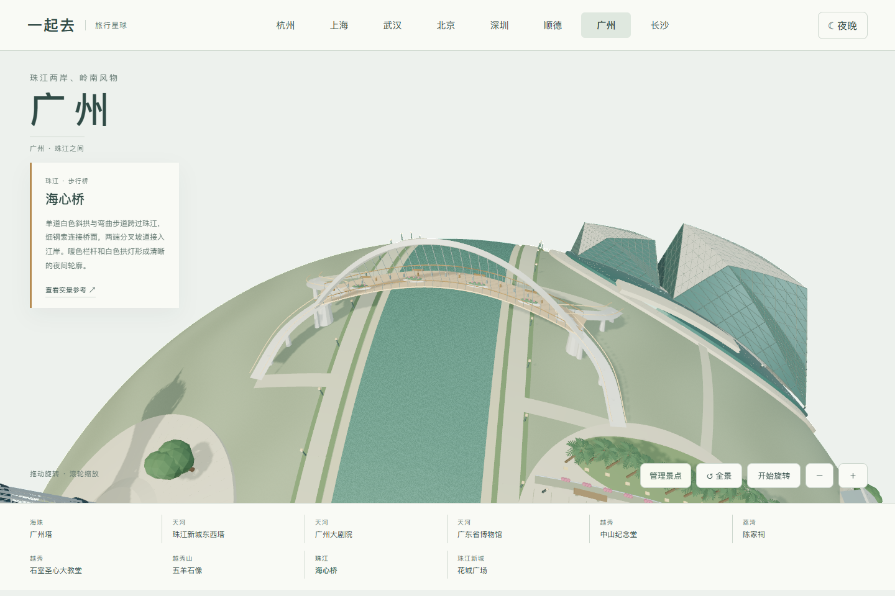

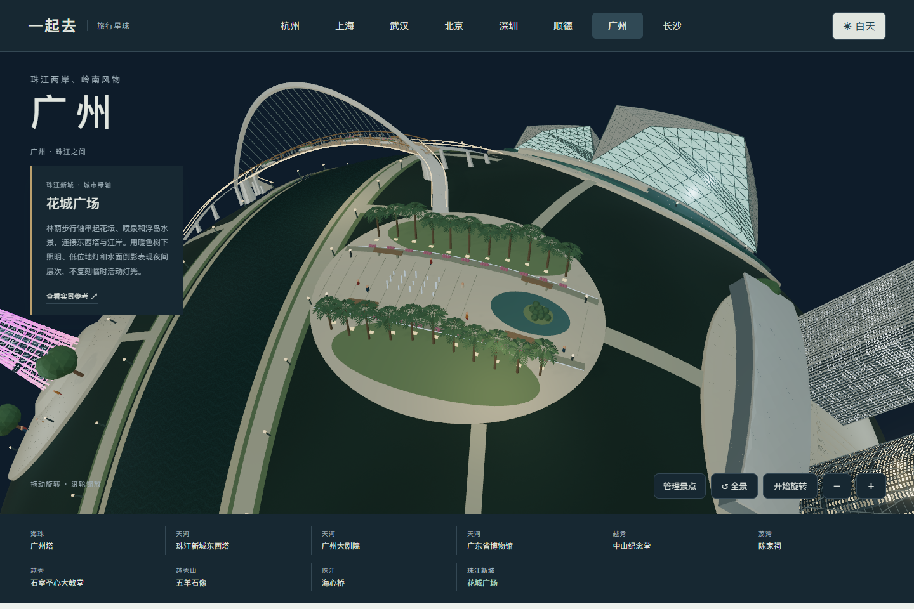

0.28.0 对照 [ZHA 设计团队大剧院照片](https://www.zha.com/projects/architecture/guangzhou-opera-house?disclaimer=true)及[整体航拍](https://artswise.blogspot.com/2012/10/zaha-hadid-sings-guangzhou-opera-house.html)，重做深灰大砾与浅色小砾、圆角石壳、倾斜玻璃带、三角框架和低位步道灯光。水池与铺装分开建模，修正球面贴合后的放射状交错；入口步道连通两座场馆，人物站在铺装表面。模型保留主要外观关系，未复刻完整建筑结构与内部空间；观众厅照片没有作为外观依据。

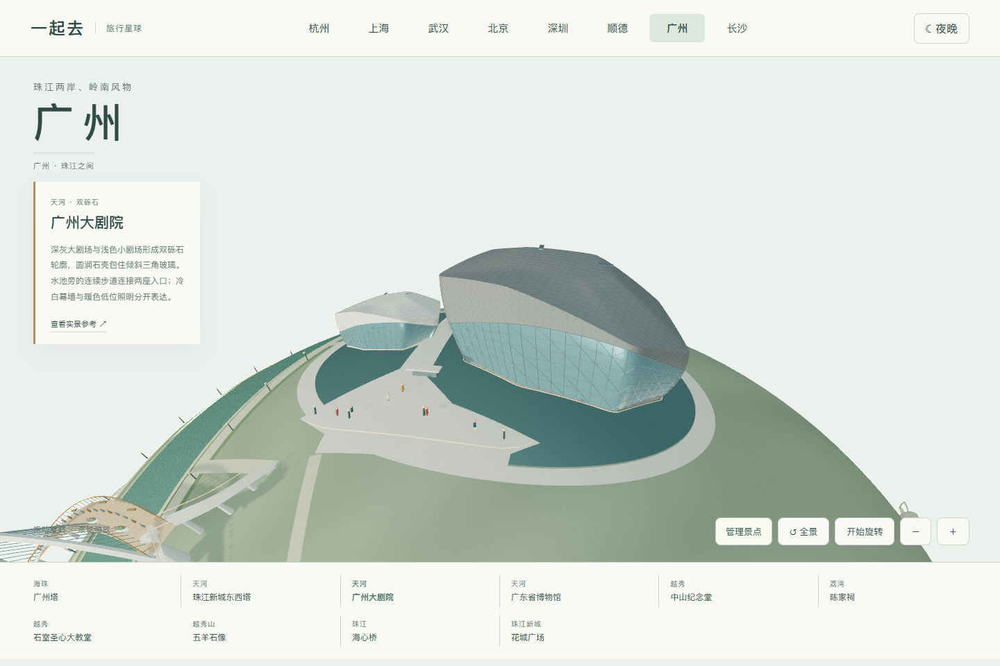

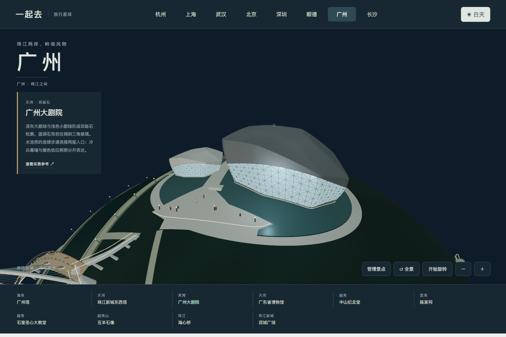

0.29.0 对照[越秀区政府的石室圣心大教堂实拍](https://www.yuexiu.gov.cn/zjyx/yxjd/zjwh/content/post_8665100.html)，补齐低位侧廊、上层高窗、开放飞扶壁、尖柱与玫瑰花窗。保留灰暖花岗岩、深色坡屋面和暗红木门；夜间分区照亮石柱与窗，所属灯光随整栋建筑增删。修正两侧支撑前后错位与柱脚悬空。仅复现照片可见的主要外观，不宣称完整测绘或真实当晚照明。

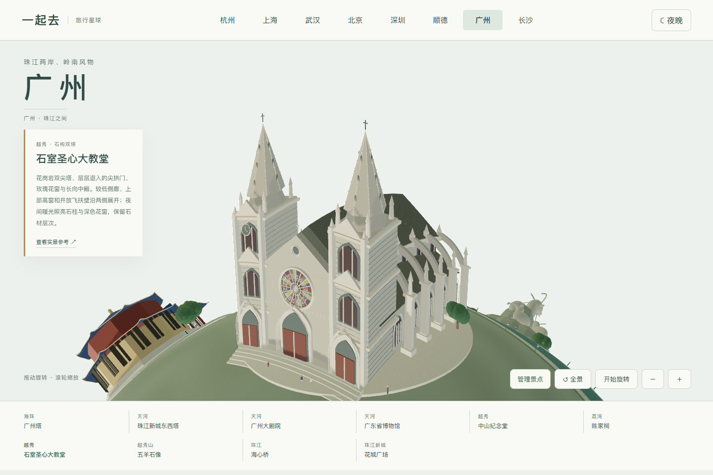

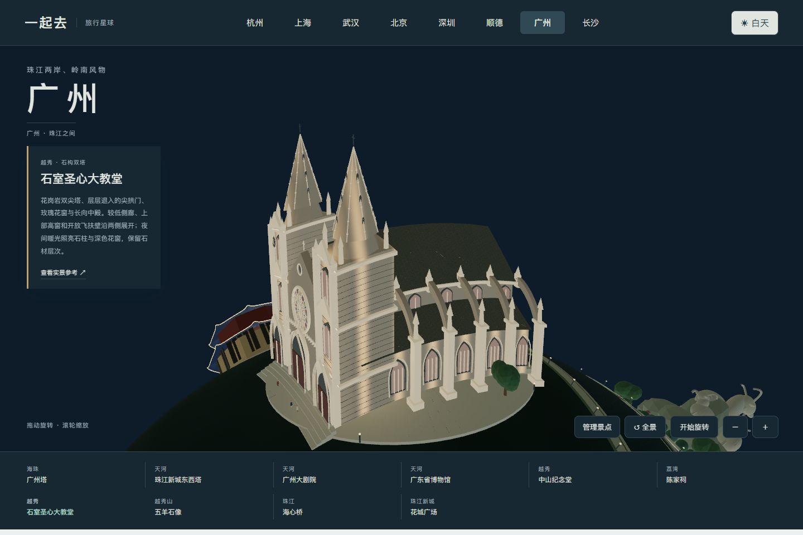

0.35.0 新增沙面历史街区，对照[广州市政府露德圣母堂实拍](https://www.gz.gov.cn/zlgz/gzly/wzgz/zjcs/tzj/content/post_7760626.html)、[南方都市报海关红楼照片](https://www.sohu.com/a/354692892_161795)及[红楼外廊细节照片](https://www.chinajourneyguide.com/tw/shamian-island/)，提炼浅米黄单尖塔、圆窗、尖拱、深灰坡屋顶和红砖三层外廊。深色铁栏、白色线脚和有进深的入口保持可见，低位暖光沿林荫步道分布。两座代表建筑经过位置压缩，不宣称为沙面岛完整平面；未采用另一座沙面堂的误标照片。

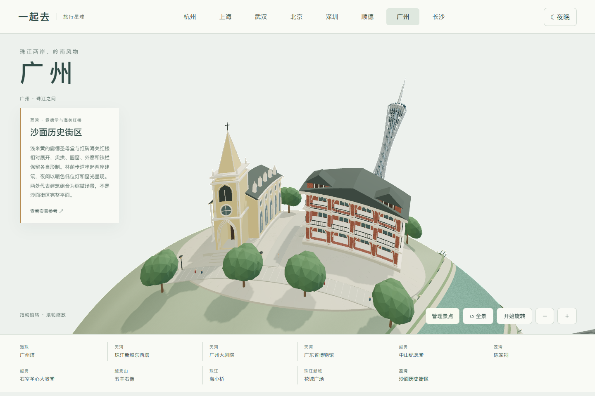

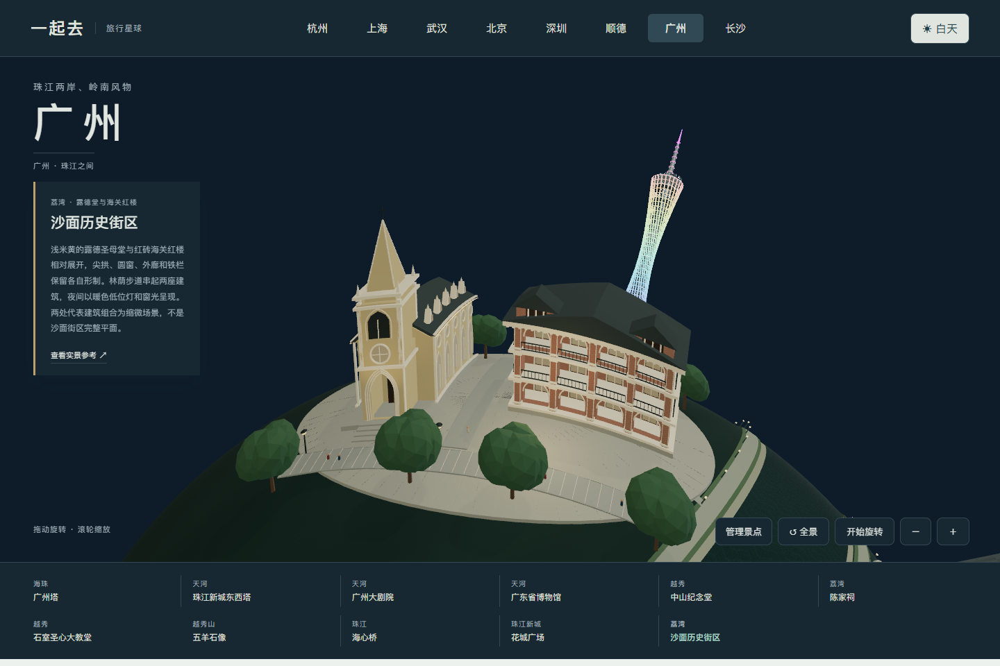

0.40.0 对照[设计方供稿的广东省博物馆落成实拍](https://www.gooood.cn/guangdong-museum-by-rocco-design-architects-ltd.htm)，重做方正悬挑主体、石材板缝、带真实进深的深红切口、突出玻璃展廊、内退底层和入口缓坡。建筑主体保持刚性，地面随星球弯曲，屋顶不再变成拱面。玻璃中庭结合室内实拍与设计示意提炼；设计鸟瞰图没有当成落成照片。夜间红色内壁和柔和室内光是艺术化表达，未复刻真实运营照明。

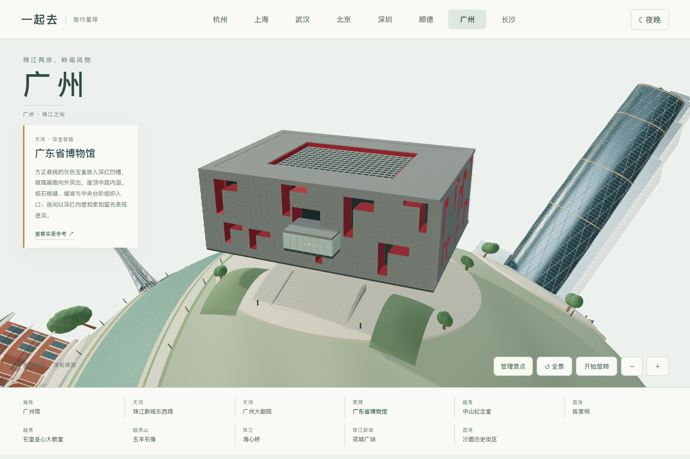

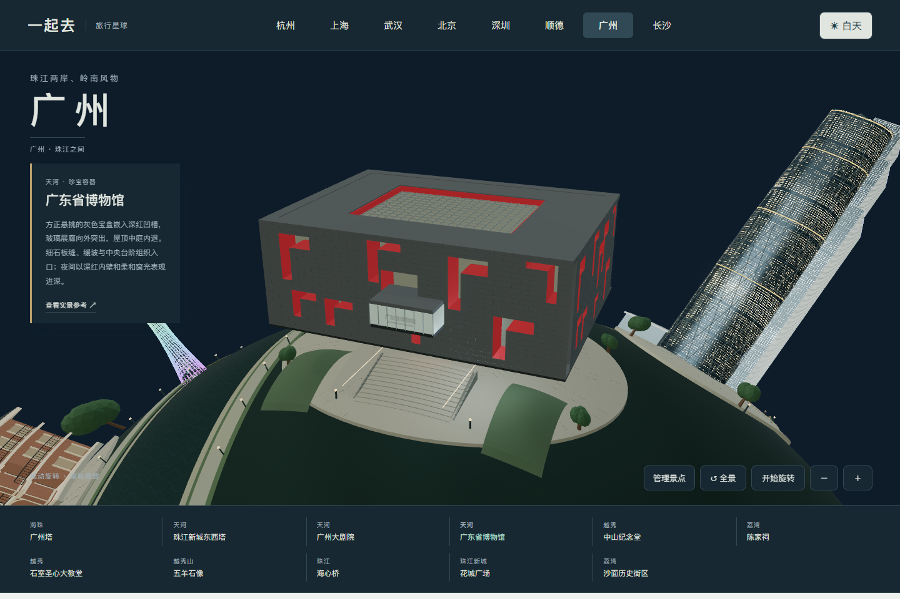
