# 桂林地标实拍与模型范围

2026-11-04 核看以下八组景点的实拍，区分桂林城区、阳朔和龙胜的地形与建筑。照片只作内部造型参考，不进入公开贴图或源码包。模型是风格化缩微表达，场地距离经过压缩；灯光不代表实际开放时间和照明排期。

| 模块 | 实拍与资料 | 主要识别点 |
| --- | --- | --- |
| 象鼻山·水月洞 | [漓江水岸实拍](https://www.pelago.com/en-AU/activity/p0zy70bfn-private-guilin-half-day-tour-fubo-mountain-reed-flute-cave-and-elephant-hill-guilin/) | 灰白石灰岩崖面、绿色山顶、向水面垂落的象鼻轮廓与贯通水月洞，顶部保留小型普贤塔。洞口为完整山体上的实际开口。 |
| 杉湖·日月双塔 | [日景实拍](https://www.travelchinaguide.com/cityguides/guangxi/guilin/weather-june.htm)、[两江四湖官方夜景](https://www.glljsh.com/tms/ticket/81.html)、[官方塔体资料](https://www.glljsh.com/tms/ticket/81.html) | 九层铜色日塔、七层青灰月塔，八角回廊、细柱和逐级收分的翘檐；夜间分别用金色和冷白灯光。本模型依据既有照片，不提供入塔营业或预约承诺。 |
| 靖江王府·独秀峰 | [王府门楼近景](https://gs.ctrip.com/html5/you/sight/guilin28/5066548.html)、[独秀峰摄影](https://dp.pconline.com.cn/dphoto/2375124_17.html) | 黄色门楼、深灰瓦顶、红木格窗、竖向匾额与贯通门洞；独秀峰在门楼后方拔地而起，峰顶有小亭。只表现代表性门楼与孤峰，不宣称复原整个王府。 |
| 逍遥楼 | [完整立面实拍](https://k.sina.cn/article_1608094690_5fd993e200100xofg.html) | 三重深灰屋檐、深色木柱、入口门廊、白石栏杆和宽石阶，保留底层开敞空间。 |
| 阳朔·兴坪漓江 | [兴坪峰林摄影](https://www.traveliszen.com/stories/2018/four-days-in-yangshuo-guangxi-china) | 高低、宽窄不同的石峰、绿色山脊与石灰岩断面，宽阔江面与小尺度竹筏；没有用普通村屋代替山水。 |
| 阳朔·富里桥 | [石拱与竹筏实拍](https://you.ctrip.com/sight/yangshuo702/52541.html)、[侧面完整实拍](https://www.sohu.com/a/433593049_120792640) | 单孔高拱、放射状拱石、逐级抬高的石阶、低石护沿与桥边古树。桥洞真实贯通，没有把它做成悬索桥或平桥。 |
| 龙胜·龙脊梯田 | [梯田全景实拍](https://gs.ctrip.com/html5/you/sight/longsheng1445120/137435.html) | 多层弯曲田面和土埂形成高差，金绿稻田沿山势收进，木质观景台面向田坡。这里采用稻田季节的艺术化配色，不代表全年景色。 |
| 阳朔·月亮山 | [山脊与天然石拱实拍](https://www.visitourchina.com/yangshuo/attraction/the-moon-hill.html) | 连续山体上部的月形石洞、灰白崖壁与绿色坡面；洞口穿过整个山体，不是贴在表面的黑色圆片。 |

提供两半球布局、逐景近看、日夜、自由旋转、整组增删保存和手机触控。桂林当前是景观地图，尚未接入多人旅行；未套用其他城市的旅行目录、门票、开放时间或预约信息。

## 0.55.12 日月双塔精修

依据上表日夜实拍及两江四湖官方结构资料，重做九层铜色日塔与七层琉璃月塔。日塔采用暗铜瓦面、浅铜构件；月塔保留青绿瓦与浅色栏杆。八角回廊增加独立柱、格窗、栏板、简化斗拱、瓦脊与塔刹，底部设置石质八角台座。两塔几何高度之比约 0.853，接近官方 35 米与 41 米的关系。

夜间金色与冷白色照明缓慢变化，湖面增加随视角调整的双色水纹光影。水纹属于简化光影表达，不是真实镜面倒影，也不代表景区灯光秀排期；「减弱动态」会固定动画时间。参考照片没有进入公开贴图或提交包。此前夜景介绍页失效，现已改为仍可访问的官方景点页。

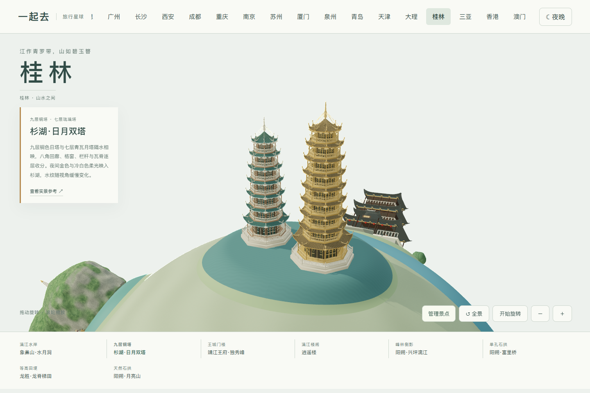

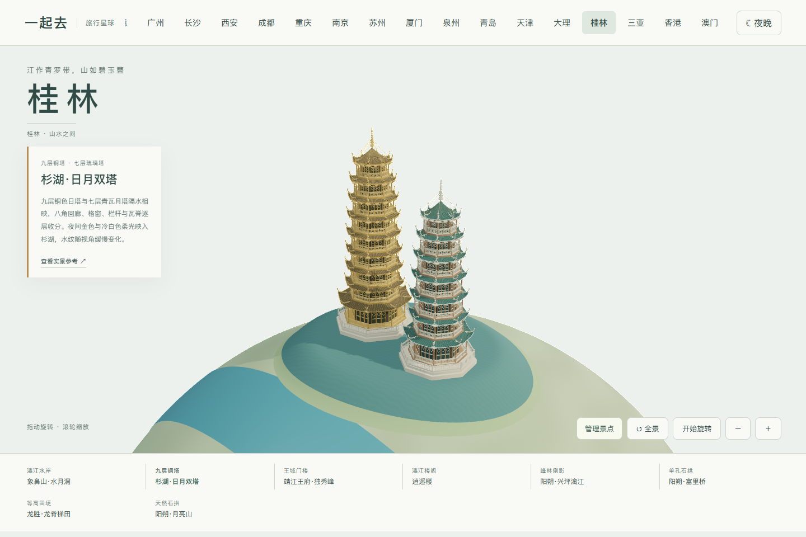

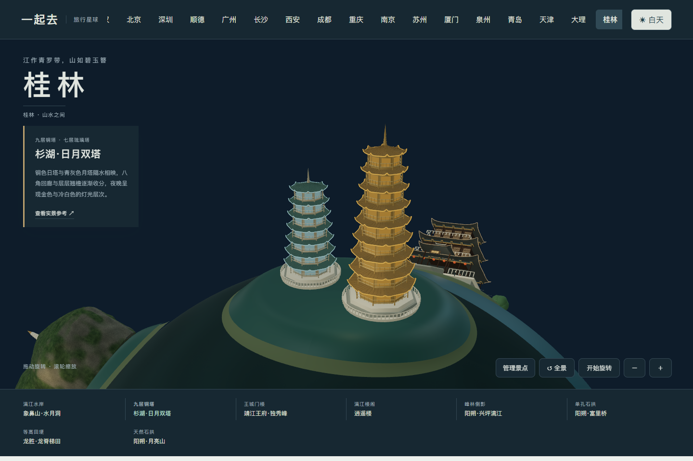

## 0.55.71 靖江王府与独秀峰

核看[桂林日报的承运门实拍](https://epaper.guilinlife.com/glrbh5/glrb/20240919/Articel05001NR.htm)、[完整门楼照片](https://www.zhangjiajietravelguide.com/guilin/attraction/jingjiang-palace.html)与上表独秀峰摄影。承运门改为向两翼逐级降低的黄色门楼，补充三层拱石、红木格窗、竖向金色匾额和白石平台；中央石坡与两侧石阶连接前庭，门后石阶通向庭院。拱洞保持真实贯通。

独秀峰改为顶部钝圆、侧壁较陡的灰白石灰岩山体，保留不规则崖纹、局部苔色、稀疏树丛与峰顶小亭。移除了草稿里过于规整的横向接缝。日景保持黄色墙身和深灰瓦，夜间只加强门楼暖光与檐口；山体保持暗部。场地是压缩的代表性组合，不是整个王府的测绘复原。

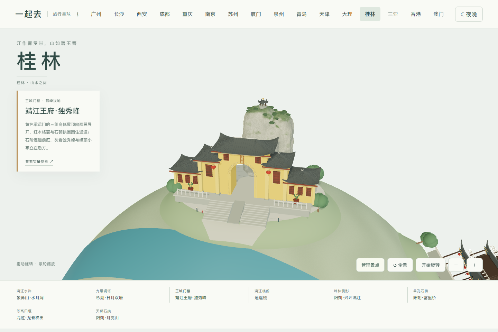

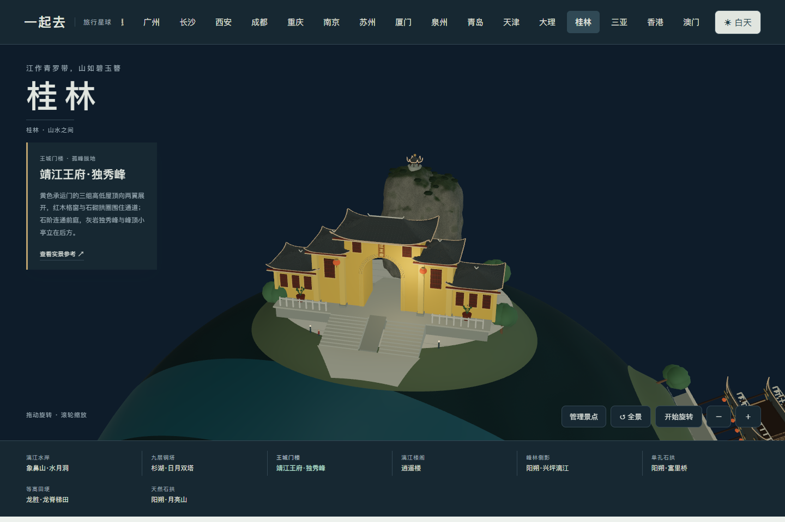

## 0.55.72 逍遥楼

在原日景实拍基础上，核看[广西广播电视台的航拍报道](https://news.gxtv.cn/article/detail_2ada88bda3e249cb9f2c3cc0c9182c02.html)与[夜景照片](https://commons.wikimedia.org/wiki/File:桂林逍遥楼夜景.jpg)。楼体改为两层主体与低矮阁层、三重深檐；底层保持开敞，补齐简化斗拱、木格窗、上层通透回廊、白石台基栏板和入口山花门廊。台阶与随坡入口连续衔接。

白天保留深灰瓦与深色木构；夜晚参照照片的金暖照明，木构、檐口和门廊较亮，石台与环境保持暗部。照片仅用于内部核对，夜间照明不代表实际开放时间或灯光排期。

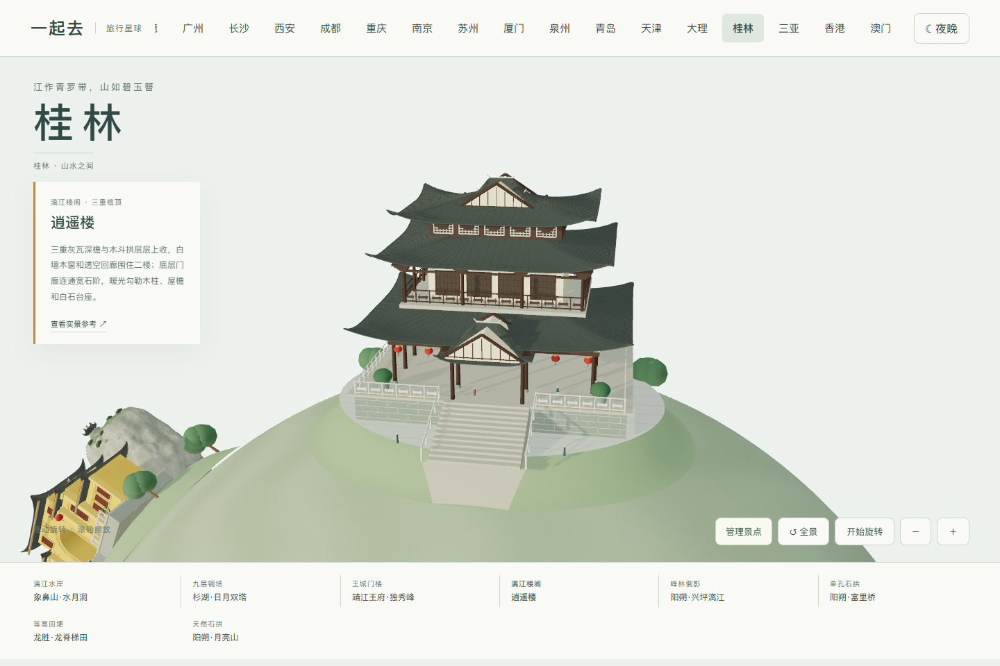

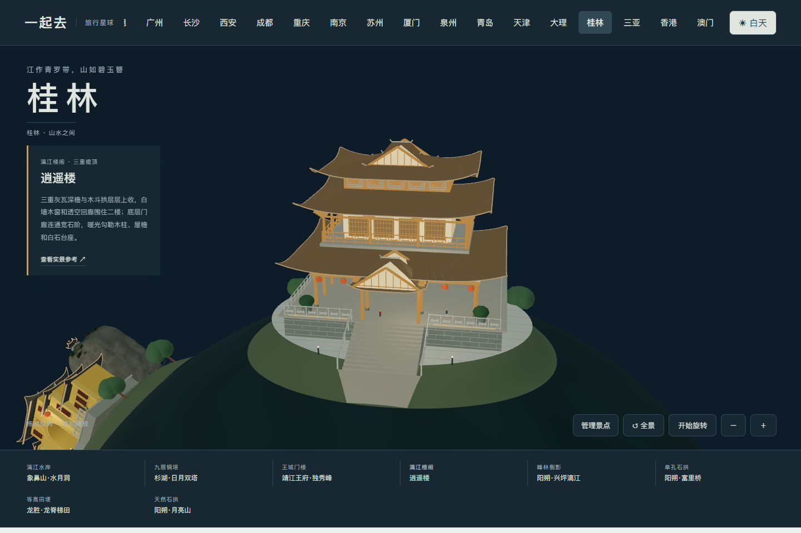

## 0.55.73 富里桥

对照[中国天气网广西 2020 年现场图集](https://www.weather.com.cn/guangxi/gxgqtp/3306066.shtml)的远景、桥侧和砌石近景，重做厚石拱、连续石阶、拱券砌石、桥头古榕及竹筏。入口铺面贴合河岸；夜间保持自然石色和暗部，不虚构整桥灯光秀。图片仅作造型参考，不随源码转载。

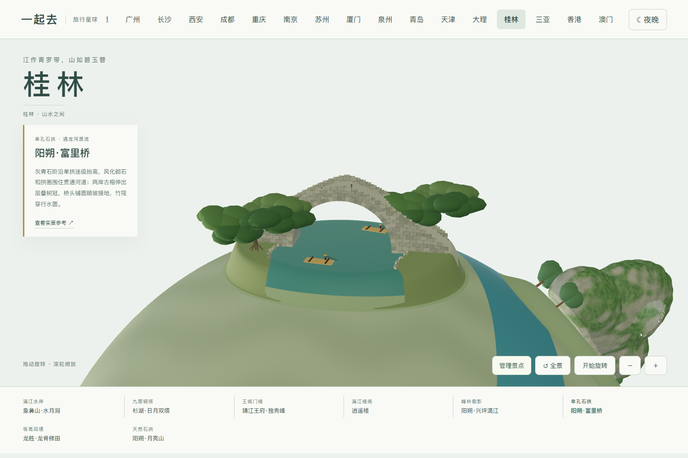

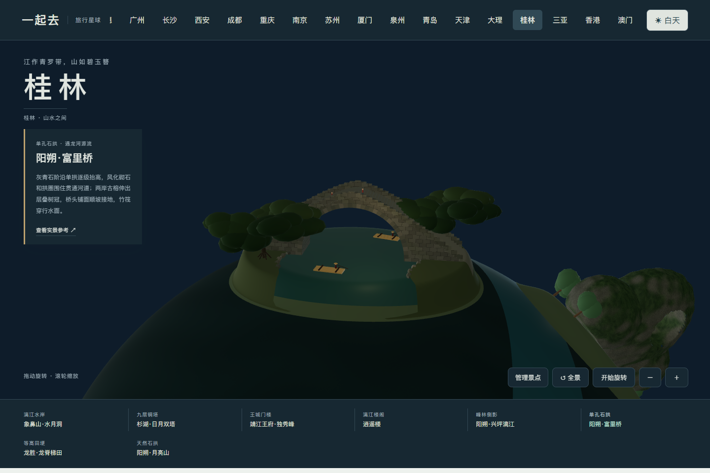

## 0.55.74 龙脊梯田

对照[新华社 2026 年秋季航拍](https://www.news.cn/photo/20261015/91606c04821f40df9dab9de3b2d471a5/c.html)，将规则层叠圆盘改为沿三道山脊展开的等高田面，补充土埂、稻穗和随坡木阶。连续步道通向峰顶观景台；夜间只保留平台灯光，稻田保持自然暗部。金黄配色表现收获季，不代表全年景色；照片未进入公开资源。

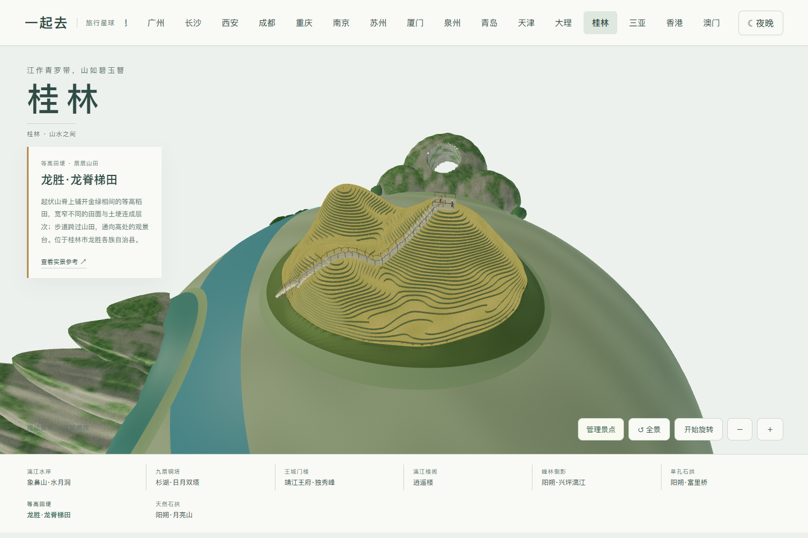

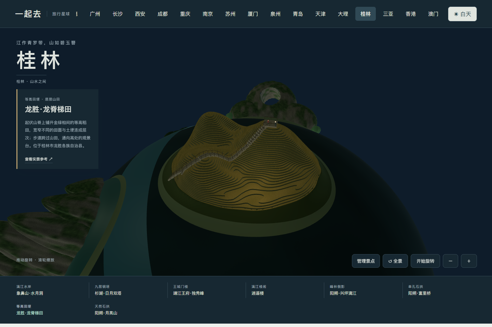

## 0.55.75 兴坪漓江

核看[新华社兴坪航拍](https://www.news.cn/photo/2022-10/10/c_1129058493_3.htm)、[新华社漓江岸线照片](https://www.news.cn/20240425/1ed2fb3d4d5546349ffed4d171209ff2/c.html)及此前峰林摄影。峰林改为宽肩陡壁的灰岩山体，七座峰体高度和轮廓不同，补充石纹与斑驳绿意；连续弯曲岸线配成簇竹林，保留开阔前景江面和竹筏。夜间保留自然暗部，没有虚构山体灯光秀。

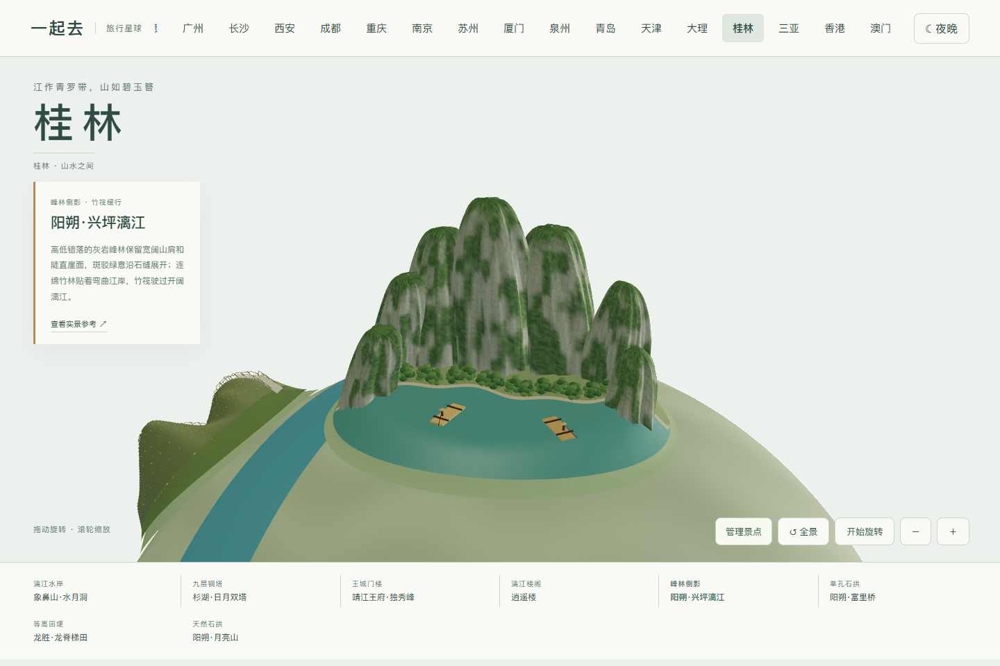

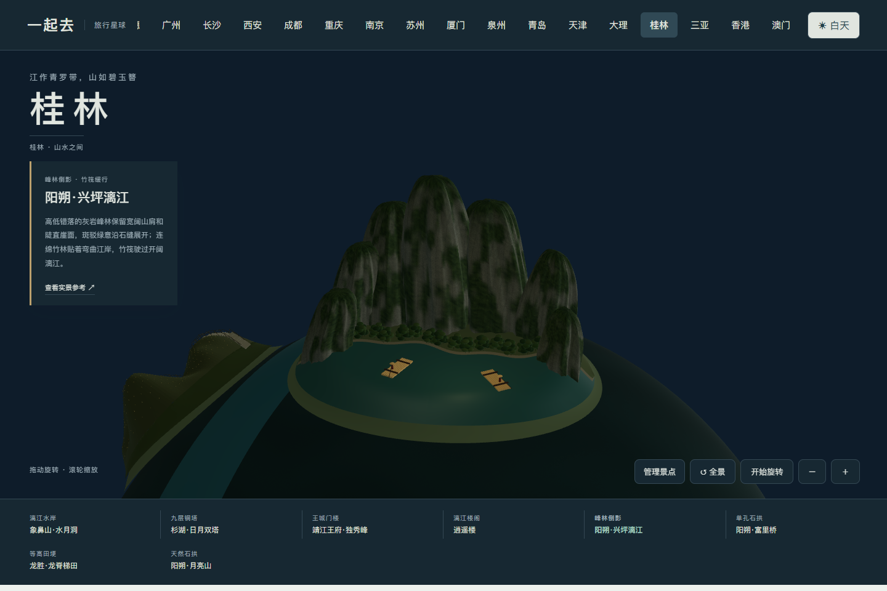
