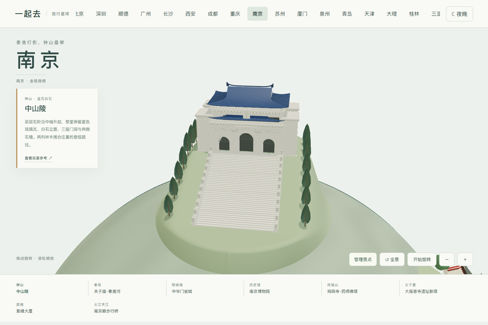
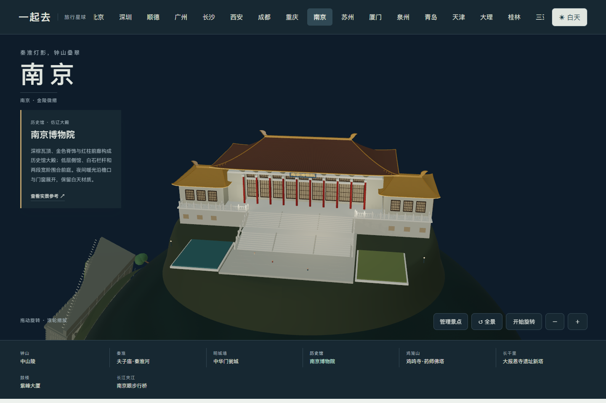
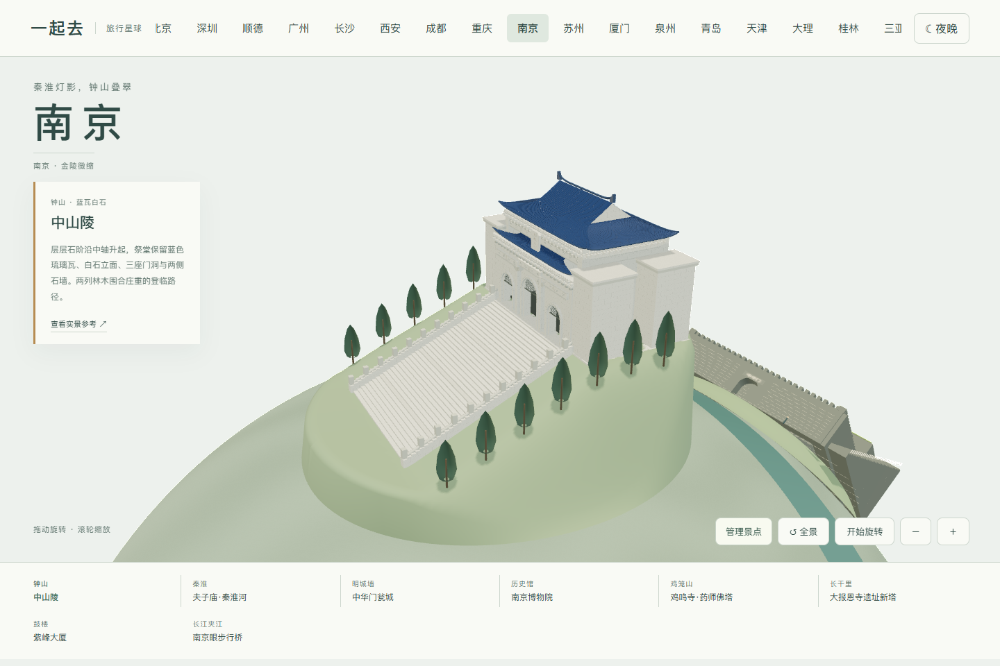
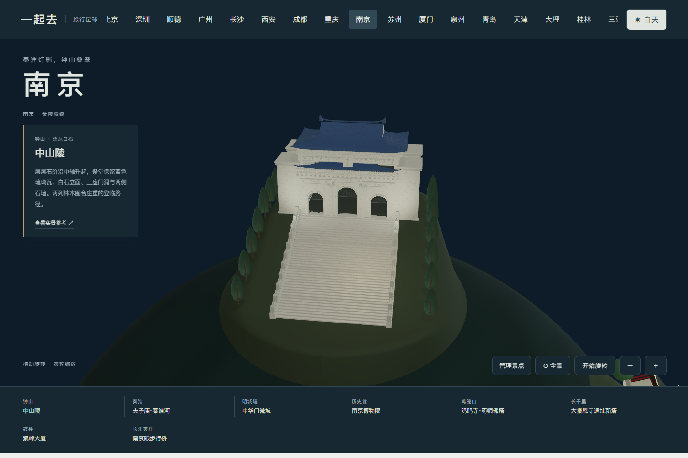

# 南京地标与实拍参考

核看日期：2026-11-04。八组模型以实际照片、设计单位及管理单位资料为依据。原照片只作内部参考，公开包只包含程序化模型和自己的网页截图。地形、距离与建筑尺寸经过艺术化压缩，不是实地导航或工程复原。

| 地标 | 观察与建模重点 | 参考 |
| --- | --- | --- |
| 中山陵 | 蓝瓦白石、三座拱形入口、低矮侧墙、屋檐支承与连续中轴台阶 | [钟山风景区资料](https://zschina.nanjing.gov.cn/lyzx/202504/t20250425_5135983.html)、[祭堂正面实拍](https://activity.eztravel.com.tw/detail/TKNKL-200655) |
| 夫子庙·秦淮河 | 深灰重檐、红柱木格门窗、白石临水栏杆、画舫、照壁与两侧殿廊 | [央广网秦淮实拍](https://js.cnr.cn/whly/20220418/t20220418_525798755.shtml)、[秦淮区大成殿介绍](https://www.njqh.gov.cn/dmqh/yzqh/fzmzlg/) |
| 中华门瓮城 | 三重内瓮城、四道贯通门洞、双层城台、藏兵洞、两侧长马道与城垛 | [南京文旅现状资料](https://wlj.nanjing.gov.cn/ztzl/mcq/gzqk/202302/t20230228_3838766.html)、[Lonely Planet 航拍](https://www.lonelyplanet.com/articles/jiangsu-province-nanjing-city-wall) |
| 南京博物院 | 仿辽历史馆大殿，宽缓棕色瓦面、金色脊线、红柱木门、白石台阶和对称配殿 | [南京大学页面实拍](https://zfgbpx.nju.edu.cn/7c/d1/c46023a556241/page.htm)、[大殿介绍](https://shpx.nju.edu.cn/9a/aa/c59556a694954/page.htm) |
| 鸡鸣寺·药师佛塔 | 黄墙殿堂、逐级抬升的院落、七层八角塔、宽展深色翘檐、短金色塔刹 | [游客实拍](https://you.ctrip.com/sight/nanjing9/1677.html) |
| 大报恩寺遗址新塔 | 现代八角玻璃保护塔、细白框、层间平台、环状塔刹、两侧低矮玻璃翼体和冷暖分层灯光 | [照明设计供应商资料与实拍](https://www.waclighting.com.cn/cases-detail/27) |
| 紫峰大厦 | 银灰竖片、上下错位塔身、露出的设备层、圆弧侧面、非对称冠部与细尖塔 | [AS+GG 建筑师项目与 James Steinkamp 摄影](https://www.smithgill.com/work/zifeng_tower/) |
| 南京眼步行桥 | 倾斜双椭圆钢塔、双索面、穿环步行桥面、细栏杆与冷白轮廓灯 | [南京市河西新城资料](https://gjzx.nanjing.gov.cn/xmqk/qabxq/202509/t20250903_5641986.html)、[桥梁实际照片](https://bbs.zol.com.cn/dcbbs/d33510_32495.html) |

中华门按现存城台建模，不添加已经毁失的木构城楼。大报恩寺表现遗址上的现代保护塔，不冒充明代琉璃塔复原。紫峰以日景摄影校正银灰色材质，夜间窗灯为本项目的简化照明设计，不声称重现当天灯光节目。

## 模块与验收边界

八组模块分布在两半球，建筑、场地与灯光可整组添加或移除，支持日夜、近看、自由旋转和手机触控。门洞、桥环是真实几何开口；建筑保持刚性，外围地面与球面衔接。

南京目前提供景观地图，尚未接入南京多人旅行排程。原杭州、上海、武汉业务保留。手机检查采用浏览器模拟，未代替物理手机性能验证。

## 0.55.5 中山陵祭堂精修

对照[祭堂正面近照](https://res.klook.com/image/upload/activities/ocvrupljaddkt5kmpfc9.jpg)、[石雕斗拱侧向近照](https://res.klook.com/image/upload/activities/sfhuuoocd5pxhjjwtbmr.jpg)及[周学鹰、达志翔、马晓的建筑分析](https://m.thepaper.cn/newsDetail_forward_28204567)，补齐歇山蓝瓦、前披檐、原色石斗拱与菱角牙子、卷草石雕和青铜花窗。三座门洞采用真实开口，中间门洞高于两侧；题字按照片位置呈现。四角阙形石块、连续石阶、柏树和承托坡面保持中轴关系。另检索到的「天下為公」照片属于陵门，未混用为祭堂。

屋面和石雕为微缩概括，石阶数量与场地距离经过压缩，不宣称工程测绘精度。管理方图纸链接本轮返回 403，未取得图纸，不以其尺寸声称复原。夜间白光是本项目的展示照明，未声称现实开放或夜游状态。未增加祭堂内部展陈或现实票价信息。

