# 青岛地标实拍与模型范围

2026-11-04 逐张核对八组景点日景，以及青岛站夜景。实拍只用于内部观察，不作为公开贴图或下载包素材。地图是艺术化缩微表达，场地距离经过压缩，不是测绘模型；夜间不表示实际开放或灯光表演时段。

| 模块 | 实拍与资料 | 保留的识别点 |
| --- | --- | --- |
| 栈桥回澜阁 | [凤凰网青岛实拍](https://qd.ifeng.com/c/8K6MrGMvQE8) | 海上石堤、半圆平台、蓝色细栏、双层八角亭、黄琉璃瓦和蓝绿彩绘梁枋。 |
| 五月的风 | [界面新闻实景照片](https://m.jiemian.com/article/14133576.html) | 下部收紧、上部展开的红色钢带螺旋，宽带棱边和透空层间，保留圆形石基与绿地。没有做成圆管弹簧。 |
| 圣弥厄尔大教堂 | [游客正面实拍](https://you.ctrip.com/sight/qingdao5/5320.html) | 浅黄石墙、双座方塔与红尖顶、十字架、圆拱、玫瑰花窗、三扇入口和后方长中殿。区别于广州的尖拱石塔。 |
| 奥帆中心 | [景区资料](https://www.qosmcareas.com/scenic.html)、[信网海岸照片](https://m.qdxin.cn/picture/3190.html)、[火炬码头近照](https://touch.travel.qunar.com/comment/4822262?ie=utf-8) | 分开的火炬码头与白灯塔、旗杆、石砌堤岸、具备独立船体与风帆的帆船。保留港池，不以无名楼群代替景区。 |
| 花石楼 | [独立摄影](https://dp.pconline.com.cn/photo/list_2302125.html) | 花岗岩墙、圆塔、白框拱窗、城垛、入口柱廊与平台。石材斑驳为程序纹理，未复制摄影素材。 |
| 青岛站东立面 | [青岛日报历史建筑照片](https://www.dailyqd.com/arc/2016-09/22/content_352743.htm)、[夜景照片](https://www.chinaairlinetravel.com/trains/qingdao-to-shanghai/) | 偏置钟楼、红瓦斜屋面、表盘、屋顶五角星、阶梯山花和连续拱窗。保留旧站房识别点，不等同整个站区。 |
| 信号山观景楼 | [独立摄影](https://www.qingdaonese.com/signal-hill-%E4%BF%A1%E5%8F%B7%E5%B1%B1-qingdao/)、[三座观景楼实拍](https://you.ctrip.com/sight/qingdao5/143748760.html) | 三座高低错落的红色球体、环形玻璃窗带、白支撑和石砌圆筒；日夜保留红色，避免暖色发光将球体洗成奶白。 |
| 崂山太清宫 | [山门实拍](https://sg.trip.com/travel-guide/attraction/qingdao/bay-of-taiqing-palace-24653096/)、[三清殿实拍](https://www.trip.com/travel-guide/attraction/qingdao/laoshan-taiqing-palace-76762/) | 蓝绿瓦三段山门、红墙、石狮、灰瓦殿堂、山石与古树。官方图片超时，改用上述游客实拍核看；未将网络介绍当作已看过图片。 |

提供日夜、自由旋转、两半球分布、景点近看、整组增删保存与手机触控。青岛目前为景观地图，未接入多人旅行，不套用原三城目录，也不虚构票价、营业时间和预约信息。

## 0.55.9 圣弥厄尔大教堂精修

对照[摄影方的正侧背资料、钟楼与后殿近照](https://beyondvision.cn/show/956.html)及既有正面实拍，补全十字形侧翼、两侧低廊和两级半圆后殿。双塔改为红褐色百叶，补石砌转角、山花与金属十字架；入口采用三组凹入门洞、拱饰、红木门扇和石柱。中央玫瑰窗有实际墙洞和下沉玻璃，钟楼百叶与石柱保持进深。

红瓦、浅黄色墙面和灰白石材保留日夜差异，展示照明只做低亮柔光。模型属于微缩表达，未逐块复原石雕，也不代表真实夜游或灯光活动。照片仅供内部观察，没有作为贴图或公开资源分发。

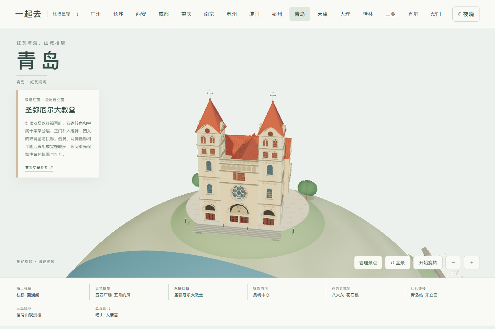

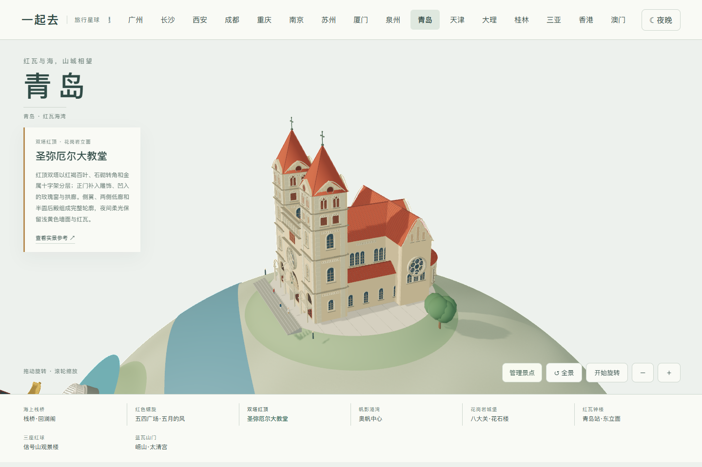

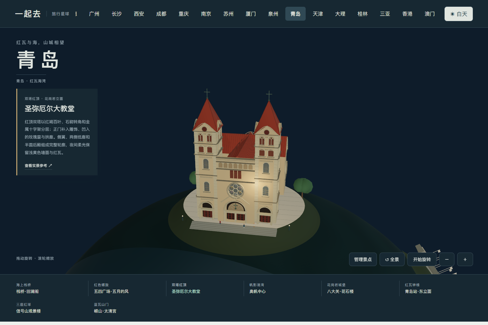

## 0.55.53 花石楼实拍校正

2026-11-05 核看携程游客三张入口近照、摄影作者一张正面照片，以及青岛日报四张正面、柱廊、顶部和背部航拍。旧模型缺少右侧多角楼体且背面为空墙，本轮补齐圆塔和多角楼的层次、上部通透拱廊、石砌肌理、白框彩窗、凹槽双柱、七级阶道、背部红瓦坡顶与小尖塔。窗洞和门洞使用真实开口，241 点阶道采样检查入口连通。夜景是克制的展示灯光，不冒充现场灯光方案。

- [青岛日报建筑与航拍实图](https://www.dailyqd.com/image/2017-03/07/content_377955.htm)
- [花石楼摄影记录](https://dp.pconline.com.cn/photo/list_2302125.html)
- [携程游客实拍](https://you.ctrip.com/sight/qingdao5/1278.html)

保留微缩比例调整；具体窗数、屋内和隐蔽结构不宣称测绘级还原。研究照片只在本地，不随源代码或提交包分发。

## 0.55.54 青岛站实拍校正

2026-11-05 对照既有老站正面、夜景照片及青岛日报九张站区航拍，重做偏置钟楼、四面钟盘与连续收分红尖顶、窄长凹窗、高低候车厅、曲线山花、老虎窗和侧后立面。航拍中邻近酒店的金色穹顶不属于老站，未混入模型。入口平台、六级台阶和门槛连通，修复底阶悬高和门槛落差。

- [青岛日报老站建筑照片](https://www.dailyqd.com/arc/2016-09/22/content_352743.htm)
- [青岛日报站区航拍](https://www.dailyqd.com/image/2016-12/27/content_367904.htm)
- [青岛站夜景照片](https://www.chinaairlinetravel.com/trains/qingdao-to-shanghai/)

保留浅褐石墙、红瓦与灰绿门窗，夜间主要照亮钟盘、山花边饰和檐口。属于微缩老站房表达，站区整体、内部空间和实际灯光活动不在还原范围内。参考照片仅留本地，不作为贴图分发。

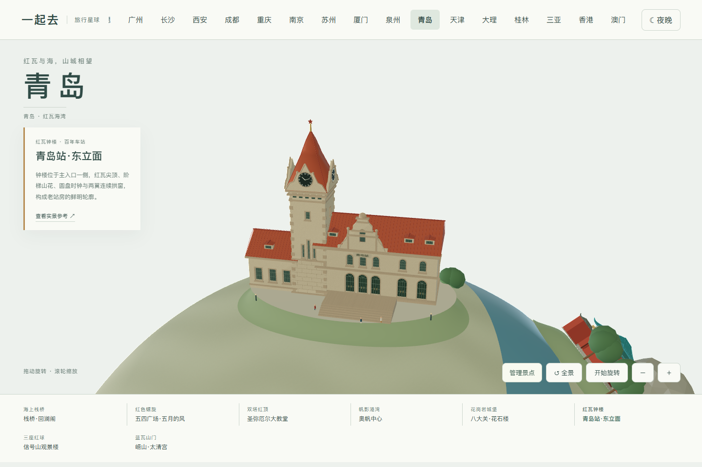

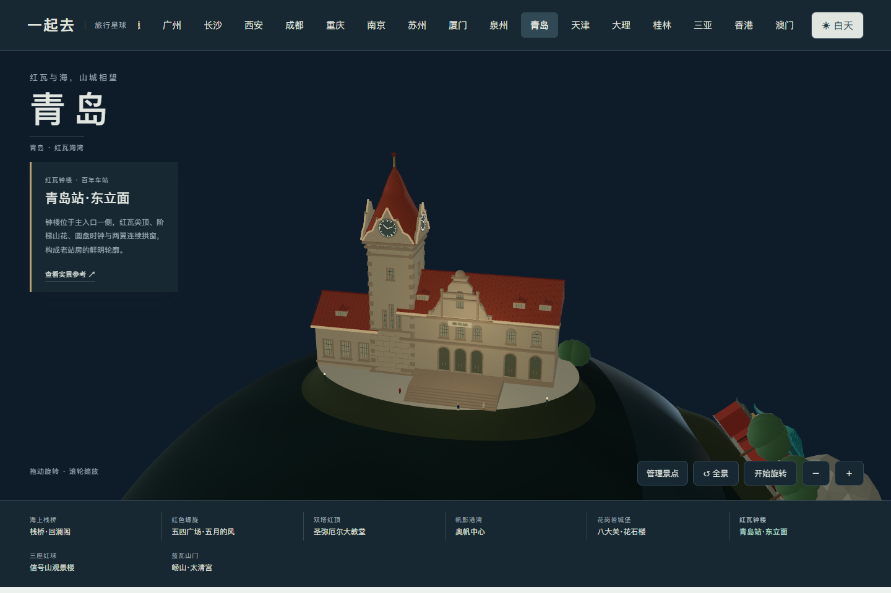

## 0.55.55 太清宫入口与院落精修

对照两张游客山门和三清殿近照、青岛日报山门全景、景区官网院内古树照片，并核对官方三清殿院落说明。山门改为三间高低灰蓝琉璃顶，保留关闭的中央红门及通透侧门；补石柱、梁枋、门环、瓦陇、脊饰、石狮和三路石阶。三清殿改为灰瓦硬山、前廊与红格门，两侧配殿围合院落。低矮碎岩、错落树冠替换突兀的巨大石块。

- [青岛日报山门全景](https://www.guanhai.com.cn/p/254195.html)
- [景区官网古树与建筑](https://qdlaoshan.cn/New-Guide-info-gid-1151.html)
- [景区官网三清殿布局说明](https://qdlaoshan.cn/53.html)

表达范围是山门及三清殿代表性院落，不冒充整个太清宫的精确总平面。梁上图案为程序绘制的简化装饰，没有复制壁画；展示照明不代表现场夜游活动。研究照片仅留本地。

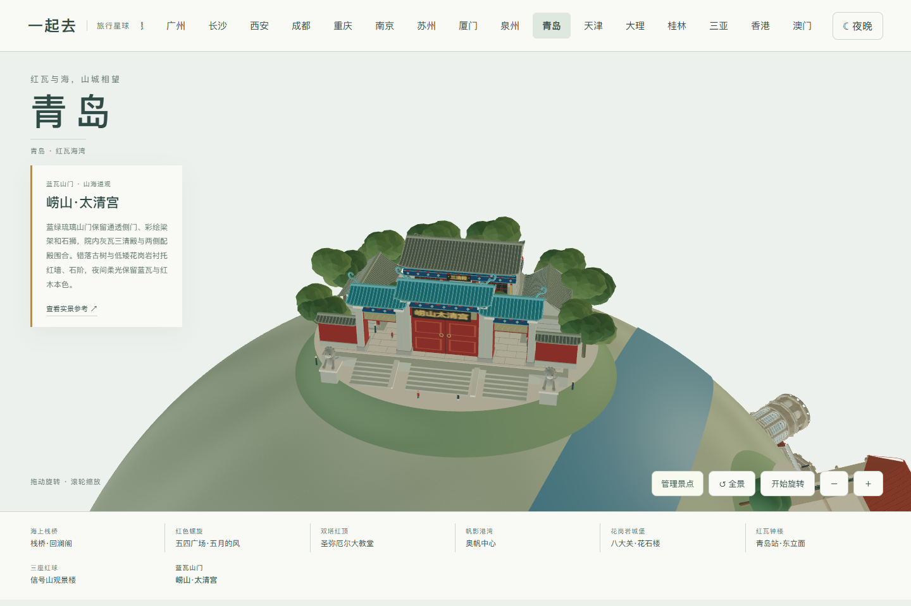

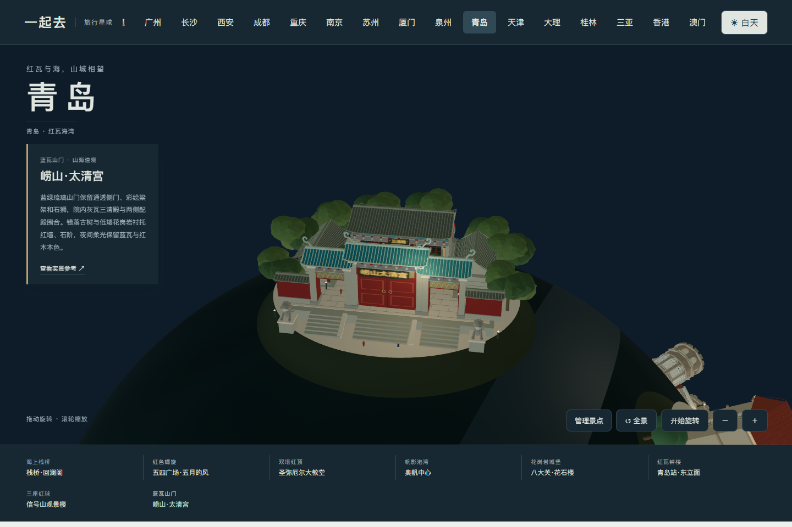

## 0.55.56 奥帆中心灯塔、火炬与帆船

2026-11-05 对照白天港湾、火炬近照、灯塔紫色夜景与暖白暮色照片，修正错误红顶。白色塔身增加收分、叠涩环台、金属栏杆、分格灯室与灰绿塔帽，圆形基座外补消波块。火炬改为近半高银色云纹上段与红色下段，增加阶台与保护栏。帆船改为弧形低船舷、甲板、舱窗、双帆及索具，码头补石板接缝与低位灯光。

- [信网港湾日景](https://m.qdxin.cn/picture/3190.html)
- [火炬近照](https://touch.travel.qunar.com/comment/4822262?ie=utf-8)
- [情人坝灯塔紫色夜景照片](https://you.ctrip.com/sight/qingdao5/114419.html)
- [灯塔暖白暮色照片](https://us.trip.com/moments/detail/qingdao-5-147802222/)
- [大众网夜间步道照片](https://qingdao.dzwww.com/shinan/201905/t20190527_16927165.htm)

范围是港湾、火炬码头与情人坝的微缩组合，不代表奥帆中心全区或完整城市天际线。灯光取实拍中的一种展示状态，不承诺现场节目时间；云纹由几何生成，照片不作为贴图分发。旗帜为简化装饰色块，不表示特定国家阵列。

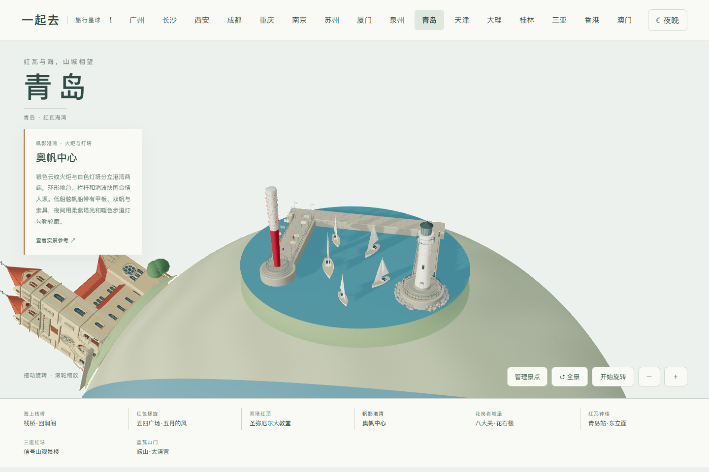

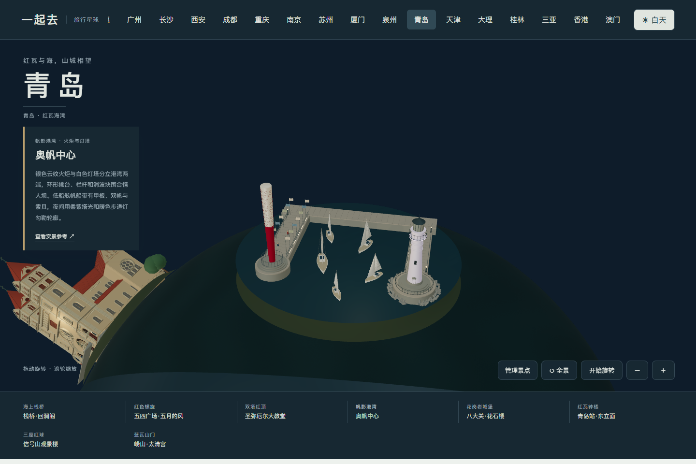

## 0.55.57 信号山观景楼

2026-11-05 对照四张不重复的近照与全景，缩短过长塔身、扩大红球下半部、缩窄连续窗带，并补球顶小拱窗、宽白色径向支撑肋、投光灯架与石砌墙面。主塔两层拱窗均开在实体墙中，玻璃后退，三塔共用石铺平台。阶道沿实际地形逐级上升，修复首阶落差与草地穿过踏步的问题。

- [观景楼近照](https://touch.go.qunar.com/poi/716386)
- [塔身与红球近照](https://k.sina.com.cn/article_6886270846_p19a74277e00100gssc.html)
- [旅行者塔身照片](https://www.tripadvisor.com/Attraction_Review-g297458-d1810652-Reviews-Signal_Hill_Park-Qingdao_Shandong.html)
- [三塔航拍参考](https://you.ctrip.com/sight/qingdao5/143748760.html)

保留红球、深色玻璃、米褐石墙，夜景不把红球染白。范围为三座观景楼与紧凑平台，不复制背景城区或通信设备。石纹为程序材质，研究照片不分发；既有全景与新增航拍是同一图片，不重复计数。

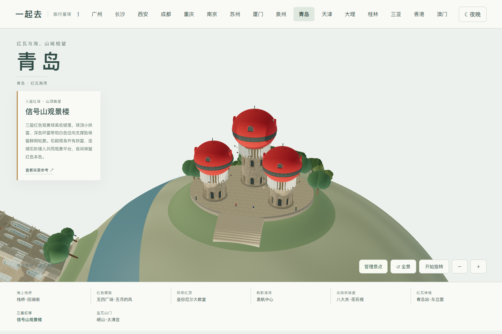

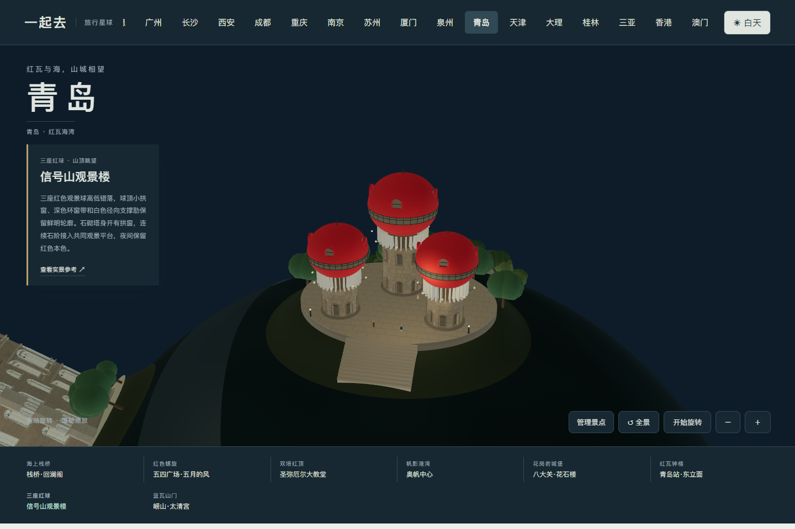
