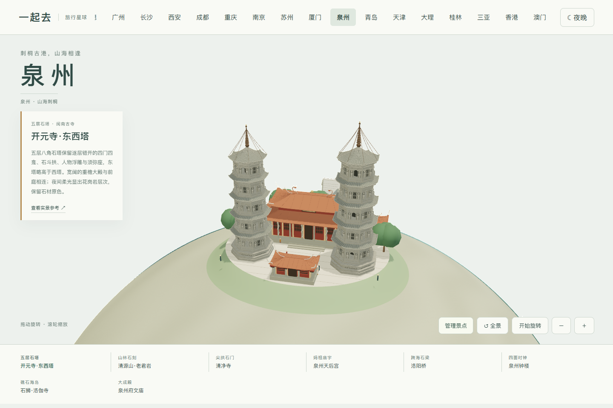
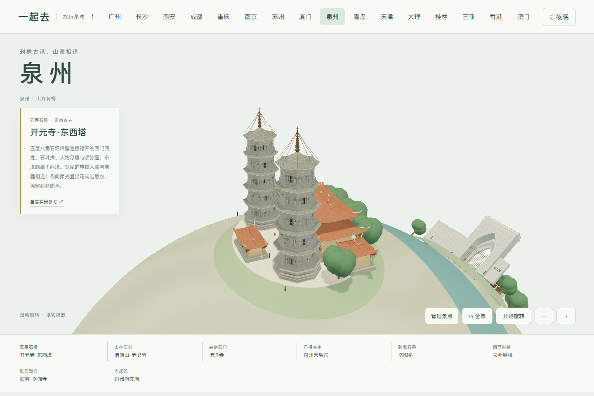
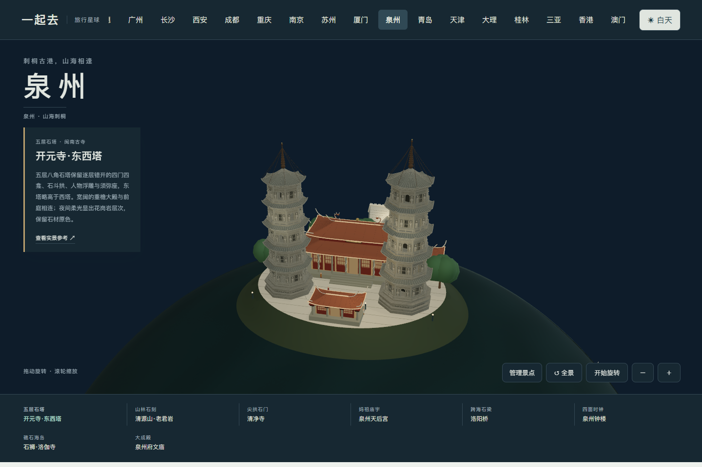

# 泉州地标参考与模型范围

2026-11-04 逐张核看八组景点实拍。照片仅供内部观察，未加入公开贴图或下载包；公开场景是程序化缩微模型，不是测绘复原。老君岩是风格化石刻表达，人物细节仍有继续改进空间。

| 模块 | 实拍和资料 | 保留特征与取舍 |
| --- | --- | --- |
| 开元寺东西塔 | [航拍实景](https://k.sina.com.cn/article_1249458720_4a793a200200176l1.html) | 五层八角石塔、塔刹链索、石色与高低差；中间保留闽南寺院和庭院。 |
| 清源山老君岩 | [闽南文化生态保护区实拍](https://www.mnwhstq.com/bhjg/202111/t20211127_208789.htm)、[泉州市政府说明](https://www.quanzhou.gov.cn/lyb/lswh/zdww/201609/t20160913_372298.htm) | 长髯、垂耳、依膝与凭几的席地坐像；灰色天然岩体、背后山石林冠。没有凭空加一座殿堂。 |
| 清净寺 | [游客实拍](https://you.ctrip.com/sight/quanzhou243/8875.html) | 双层尖拱石门、灰白石墙、垛口与露天礼拜殿遗存；门洞为真实几何开口。排除了照片搜索中误标的普通中式寺门。 |
| 天后宫 | [游客实拍](https://you.ctrip.com/sight/quanzhou243/8877.html) | 山门、正殿、两侧院廊、石柱、燕尾脊和龙饰、红灯笼。 |
| 洛阳桥 | [石梁桥实拍](https://k.sina.cn/article_5864380259_p15d8b576300100fxf5.html)、[泉州发布资料](https://www.thepaper.cn/newsDetail_forward_29703375) | 石梁、尖舟形桥墩、石栏和桥亭；压缩为七座桥墩表现结构，不声称还原真实长度与桥墩总数。 |
| 泉州钟楼 | [晋江新闻网建筑资料](https://news.ijjnews.com/system/2019/12/31/030004231.shtml)、[游客照片](https://you.ctrip.com/sight/quanzhou243/1477922.html) | 白色四柱底座、四面罗马数字钟盘、八角透空塔冠与风向标。时针为固定造型，不显示实时时间。 |
| 石狮洛伽寺 | [闽南网航拍](https://www.mnw.cn/shishi/news/2946517.html) | 礁石岛基座、海上步桥、黄色墙面、橙红屋顶，以及低侧殿与高塔的不对称关系。属于近现代寺院，未将全部八组景点宣称为世界遗产。 |
| 泉州府文庙 | [大成殿实拍](https://touch.travel.qunar.com/comment/10163546063)、[闽南网泮池照片](https://www.mnw.cn/quanzhou/licheng/3057699.html) | 重檐大成殿、石柱、红木门窗、院廊、泮池与小桥。官方原图连接超时后改看媒体和游客照片。 |

地图提供两半球浏览、日夜、自由旋转、整组增删和手机布局。夜间采用克制暖光，灯笼缓慢变化，不冒充真实景区夜游或灯光节目的承诺。泉州尚未接入多人旅行；原杭州、上海、武汉目录和行程保持独立，不虚构票价与开放时间。

## 0.55.8 开元寺东西塔石构精修

对照[泉州市海上丝绸之路申遗中心资料与东西塔、大殿近照](https://www.quanzhou.gov.cn/zfb/xxgk/ztxxgk/ggwhty/whssml/202305/t20230516_2880608.htm)，重做五层八角石塔立面。每层四门四龛，逐层转过 45 度；门洞真实贯通，门边仍保留厚实石墙。补入石斗拱、简化人物浮雕、须弥座、石栏、屋面细肋和九层塔刹环叠，东塔略高于西塔。

大殿扩展横向体量，保持闽南重檐红瓦、入口台阶和前庭。夜间不把花岗岩染成金色，只用低亮暖白光显示石雕与层檐。照片仅用于内部观察，没有作为贴图分发。浮雕采用简化姿态，不声称逐尊复原文物；庭院与距离仍为微缩布局，灯光是展示设计，不代表真实夜游活动。

