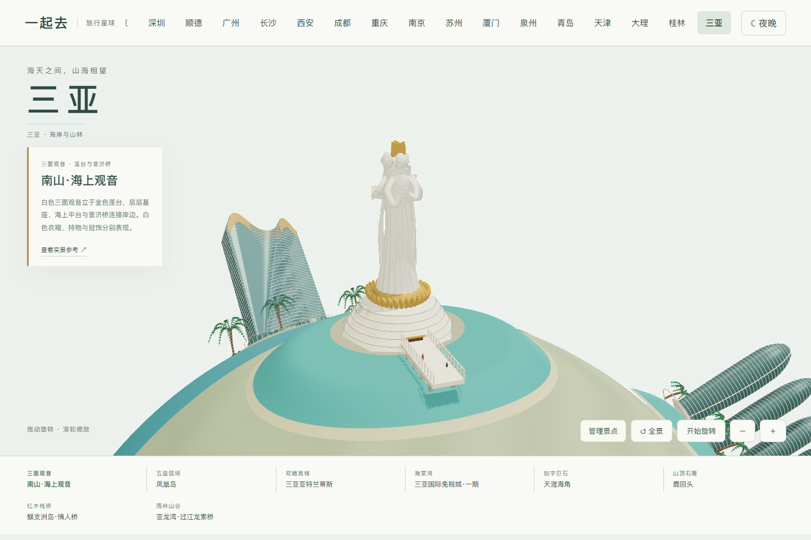
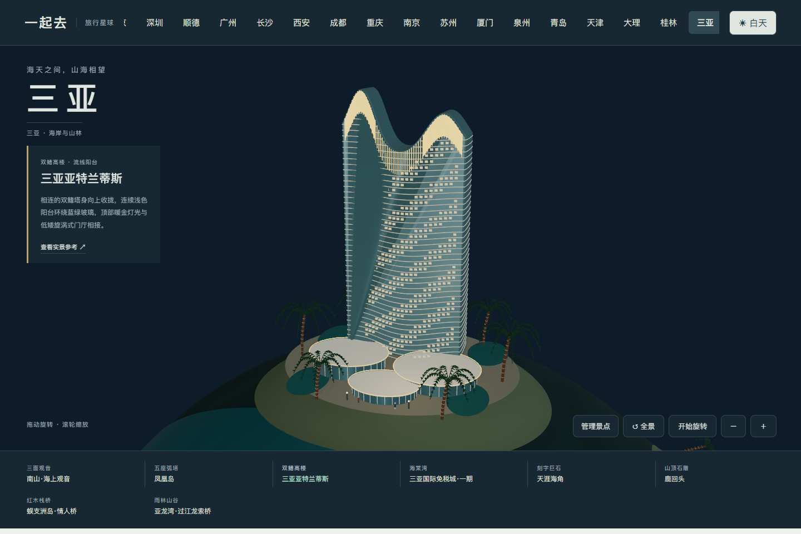
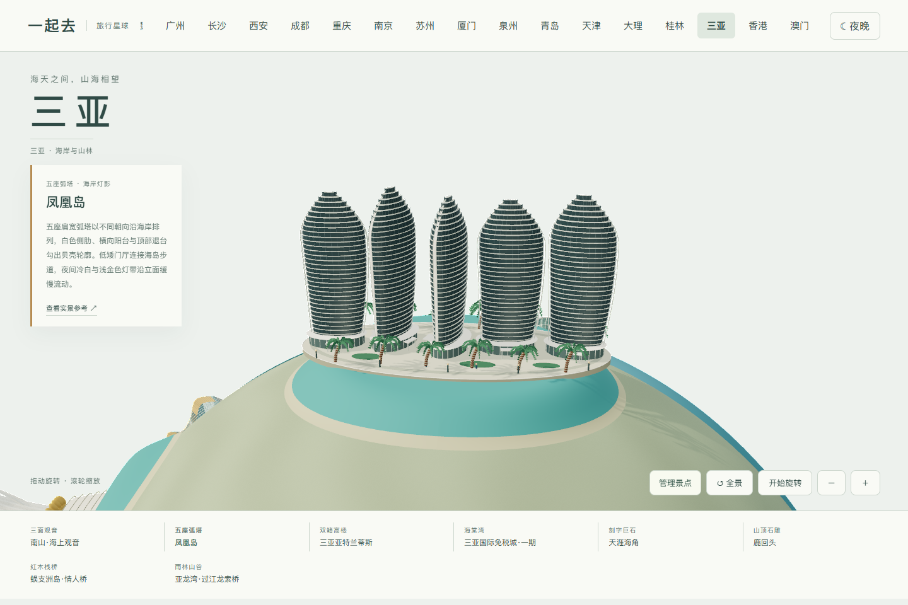
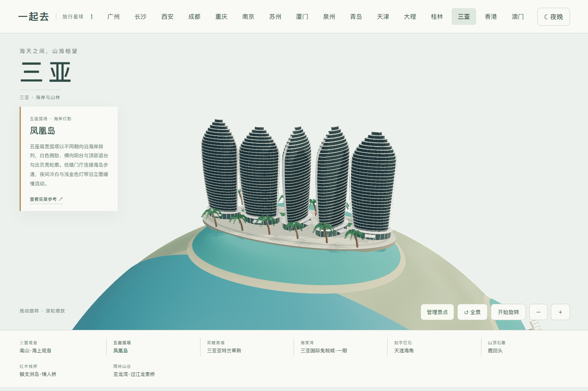
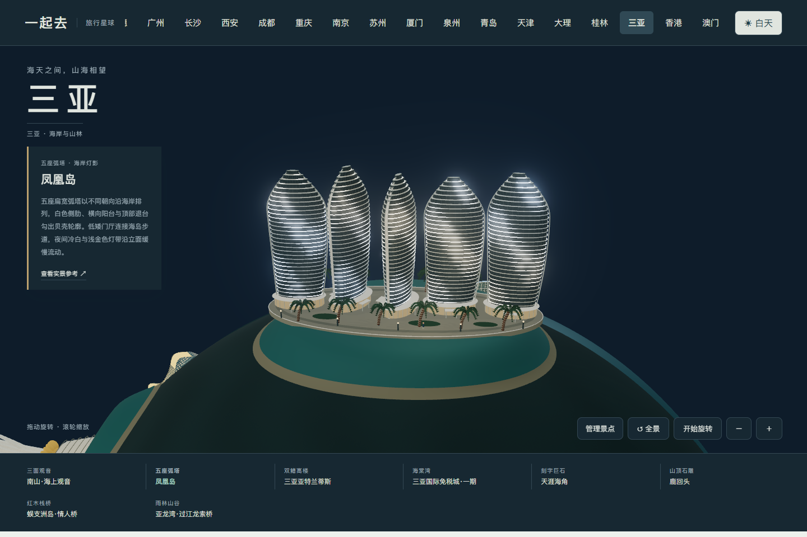

# 三亚地标实拍与模型范围

2026-11-04 核看以下八组景点的实拍，区分海上雕像、海岛高楼、度假建筑、刻字巨石和雨林索桥。照片只作内部造型参考，不作为公开贴图或随源码包发布。模型是风格化微缩表达，不是测绘复原；日夜灯光不代表实际营业时间、灯光秀内容或演出排期。

| 模块 | 实拍与资料 | 主要识别点与取舍 |
| --- | --- | --- |
| 南山·海上观音 | [三亚旅文官方景点与全景](https://www.visitsanya.com/zh/destination/南山文化旅游区)、[游客近景](https://gs.ctrip.com/html5/you/travels/61/4047875.html) | 三面相连的白色观音、持物、衣褶与金色冠饰，金色莲瓣、八角层台和普济桥。人物与纹饰采用风格化几何，不宣称逐件复刻雕塑细节。 |
| 凤凰岛 | [官方夜景](https://www.visitsanya.com/destination/fenghuang-island)、[五座楼完整日景](https://www.sohu.com/a/427070231_100250) | 五座朝向和高度略有差异的弧塔，细密浅色横肋、深色玻璃与竖向弧线。排除被水上飞机遮住的照片作为主体依据；夜间采用缓慢变化的分组灯带，不仿制具体商业灯光秀。 |
| 三亚亚特兰蒂斯 | [建筑设计方 HOK 的实拍和设计说明](https://www.hok.com/projects/view/atlantis-sanya-resort/) | 相连双鳍轮廓、曲面浅色阳台、蓝绿玻璃、顶部金色灯笼结构、旋涡式低矮门厅和水池。不把主楼做成两根独立圆柱；园区只表现代表性门厅和水景。 |
| 三亚国际免税城·一期 | [运营方介绍与夜景](https://www.cdfg.com.cn/5257/5257.html)、[海南日报一期日景](https://news.hndaily.cn/html/2019-11/04/content_3_2.htm) | 两座双叶形馆体、四处圆弧玻璃采光顶、白色连续屋盖、中间开敞庭院和连桥。明确只表现一期，不将后建商场混入同一建筑。 |
| 天涯海角 | [刻字巨石实拍](https://dp.pconline.com.cn/photo/2493209.html) | 灰褐花岗岩、竖排红色刻字、圆钝但不规则的块体、沙滩和椰树。石面使用程序化纹理，文字单独绘制；未使用照片贴图。 |
| 鹿回头 | [三亚旅文官方介绍](https://www.visitsanya.com/zh/destination/鹿回头风景区)、[石雕近景](https://you.ctrip.com/sight/sanya61/3230.html) | 浅色石雕中回首的鹿、人物与岩体相连，山顶台阶和低平台围绕雕像。保留回首颈线、耳部和人物持杆关系，整体为艺术化提炼。 |
| 蜈支洲岛·情人桥 | [红木桥与亭阁实拍](https://www.haihua365.com/diyu/5542) | 红色木桥、心形栏板、实际桥墩、临海岩礁和双檐亭，区别于雨林中的吊桥。保留海水与沙滩关系，不添加无关村屋。 |
| 亚龙湾·过江龙索桥 | [景区官方桥梁照片](https://www.ylwpark.com/news/detail/id/195.html) | 木桥横跨真实谷地，两端连接林坡，桥面和侧索下垂，网状护栏与锚座完整。夜间只作温和的路径照明表达，不宣称景区实际开放夜游。 |

八组分布于星球两半球，提供逐景近看、日夜、自由旋转、整组添加或移除并保存、手机触控和键盘操作。三亚当前为景观地图，未接入多人旅行，未借用其他城市的景点目录、票价和预约信息。

## 0.55.13 凤凰岛弧塔与动态灯带

对照三亚旅文官方[凤凰岛实拍](https://www.visitsanya.com/destination/fenghuang-island)及此前五楼日景，调整五座楼体的扁宽比例与朝向，补白色弧形侧肋、横向阳台、顶部退台和低矮玻璃门厅。海堤增加厚度，保留原模块位置。

夜景以冷白和浅金色的水平灯带缓慢变化，减弱动态会固定灯光。该效果为原创简化表达，不复刻商业灯光秀，也不代表其时间安排。参考照片仅作造型核对，未进入公开贴图或提交包。

