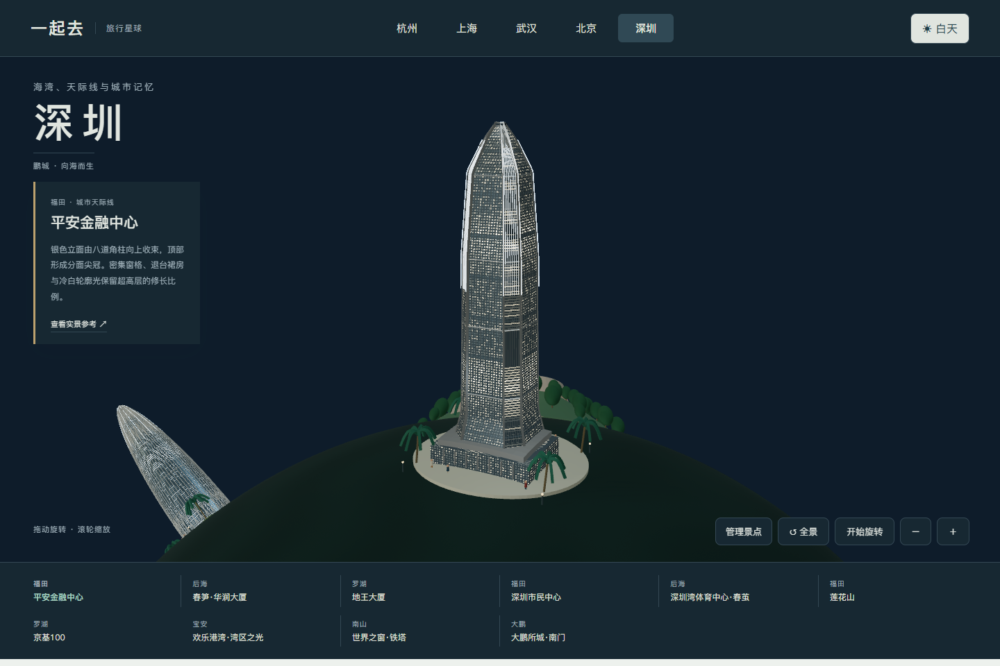
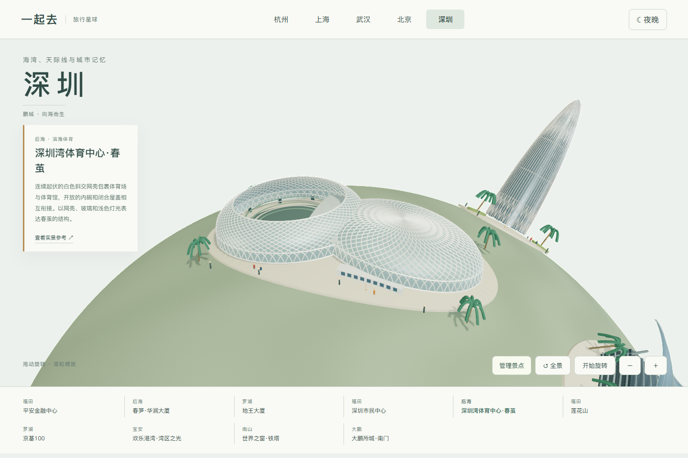
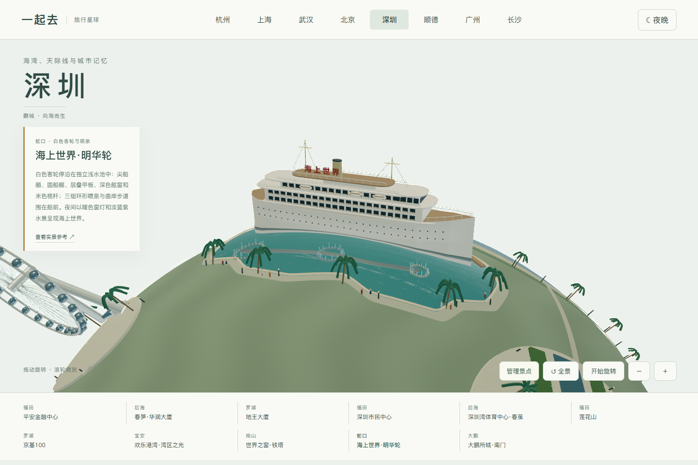
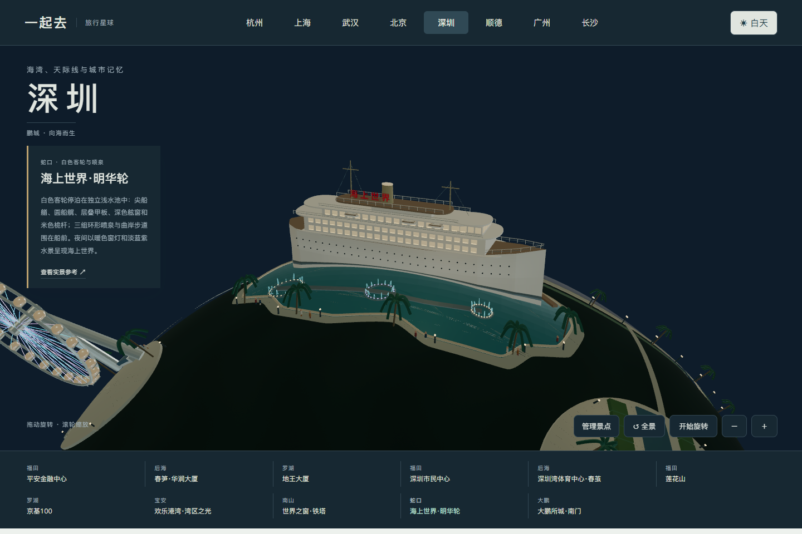
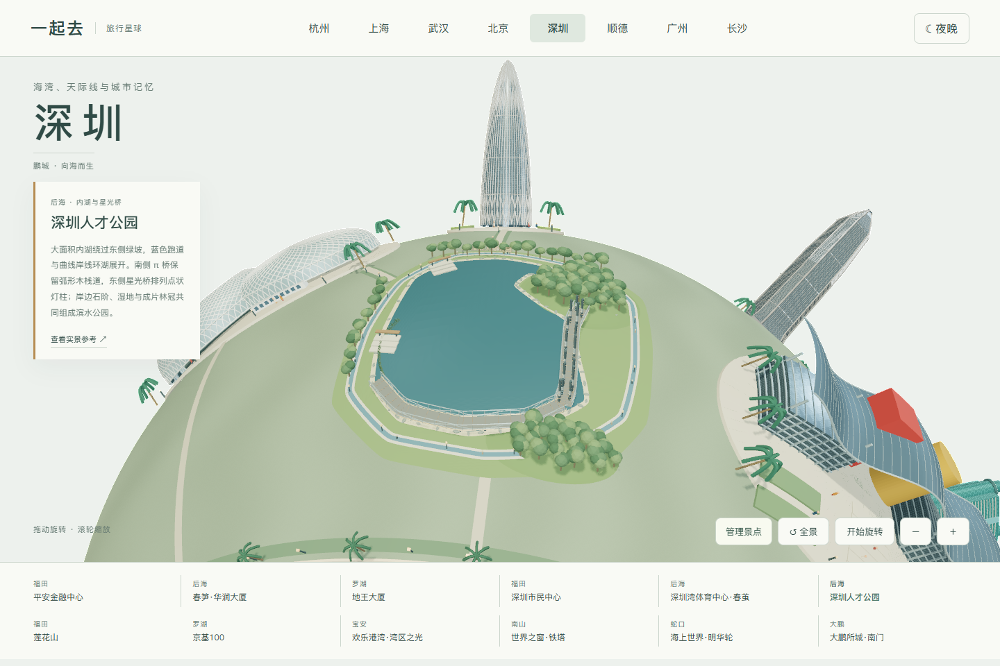
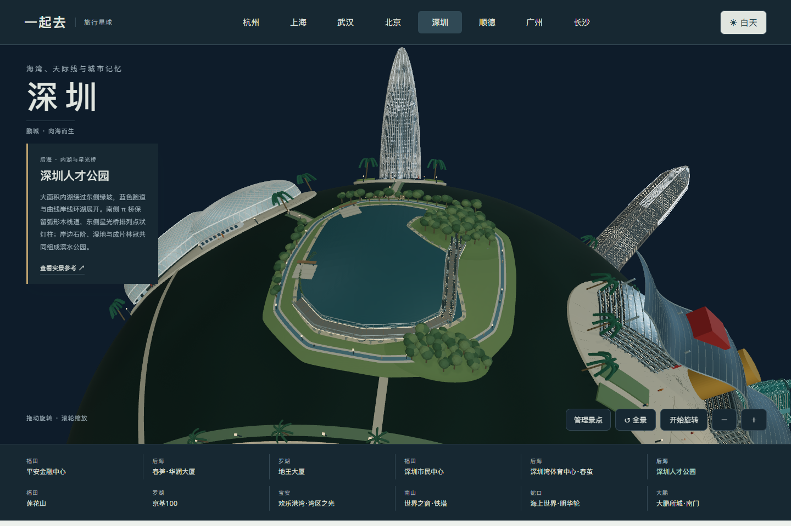
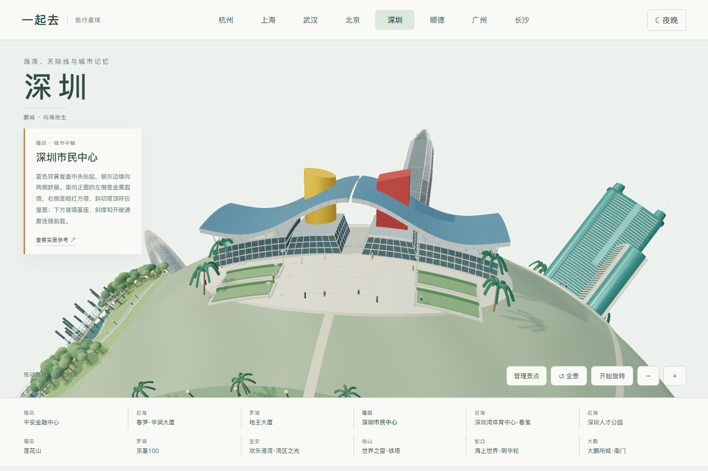
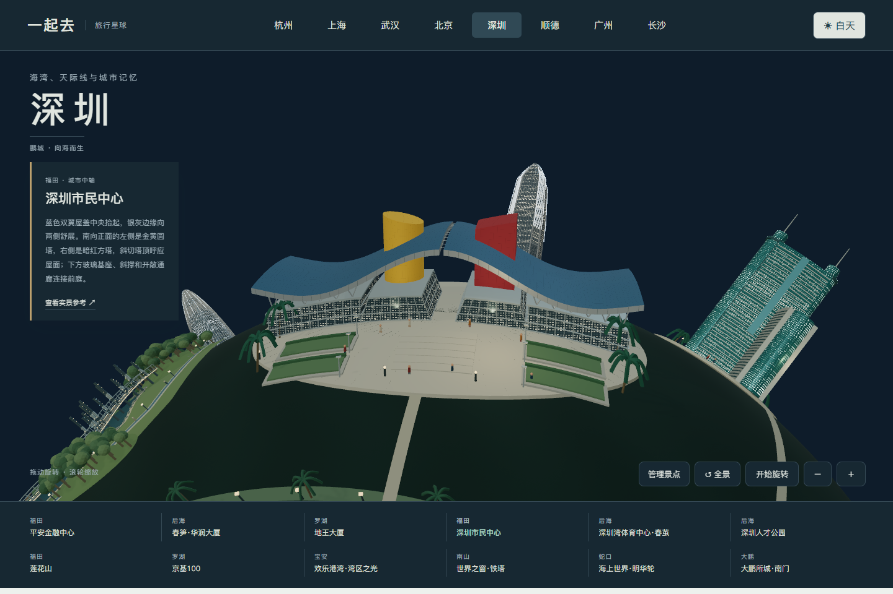

# 深圳地图与造型参考

深圳入口为 `shenzhen.html`，包含十二组独立地标。该页面是艺术化微缩景观，尚未接入多人旅行目录；原杭州、上海、武汉的旅行流程保留。

## 实景与制作范围

| 地标 | 主要造型依据 | 参考来源 |
| --- | --- | --- |
| 平安金融中心 | 八道角柱、分面尖冠、退台裙房、上部冷白竖向灯带与暖色窗灯 | [KPF 建筑资料](https://www.kpf.com/project/ping-an-finance-centre)；[照明设计团队夜景](https://www.lighting.co.jp/en/projects/ping-an-finance-center/) |
| 春笋·华润大厦 | 饱满圆塔逐渐收尖、密集竖肋、入口和塔冠的斜交结构 | [KPF 建筑资料与照片](https://www.kpf.com/project/china-resources-tower) |
| 地王大厦 | 青绿幕墙、横向分缝、两侧圆塔、双塔尖与较低副楼 | [深圳政府介绍](https://www.sz.gov.cn/szstory/202302/content/post_10421146.html)；[立面照片](https://newoss.zhulong.com/tfs/photo/big/200909/14/300031_5.jpg) |
| 京基100 | 扁长玻璃体、柔和弯曲收尖的冠部、银色竖向边线 | [Farrells 项目资料](https://farrells.com/project/kk100/)；[CTBUH 建筑照片](https://www.skyscrapercenter.com/shenzhen/kk100/173/) |
| 深圳市民中心 | 长翼屋顶、中部红方塔与金圆塔、玻璃柱廊和前庭 | [建筑介绍](https://society.people.com.cn/n1/2018/1124/c1008-30418921.html)；[中轴实景](https://n.sinaimg.cn/sinakd20201218s/140/w1080h660/20201218/34d9-kfnaptt7679750.png) |
| 深圳湾体育中心·春茧 | 连续起伏网壳、白色斜交结构、大开口内碗与较低的闭合馆顶 | [深圳英文网实景](https://www.eyeshenzhen.com/content/2023-05/12/content_30192864.htm)；[设计团队细部照片](https://www.axscom.jp/media2020/project/no03341/project_photo06.jpg) |
| 欢乐港湾·湾区之光 | 悬臂支架、圆形轮盘、球形轿厢和青蓝淡紫光环 | [欢乐港湾](https://www.octohbay.net/)；[夜景照片](https://sg.trip.com/moments/detail/shenzhen-26-145301529/) |
| 世界之窗·铁塔 | 深圳园区中的埃菲尔铁塔复制景观；拱门、分层平台、镂空钢架与前庭水池 | [南山区资料](https://www.szns.gov.cn/mlns/whns/lyjq/content/post_12590149.html)；[参考照片](https://dimg04.c-ctrip.com/images/0EQ1m12000j05dj0x7302_W_640_10000.jpg?proc=autoorient) |
| 大鹏所城·南门 | 厚砖墙、贯通拱门、垛口、深瓦木构城楼及灯笼 | [大鹏新区介绍](https://www.dpxq.gov.cn/ztzl/pyxsj/wzdp/zjd/content/post_11551556.html)；[南门实景](https://www.e-asianmarket.com/hk/dapeng01.html) |
| 海上世界·明华轮 | 白色长客轮、尖艏圆艉、层叠甲板与双排舷窗、米色桅杆烟囱、独立浅水池和三组相连环形喷泉 | [深圳新闻网航拍](https://sznews.com/news/content/2021-05/29/content_24254471_0.htm)；[客轮侧面实拍](https://commons.wikimedia.org/wiki/File:%E6%B5%B7%E4%B8%8A%E4%B8%96%E7%95%8C%E6%98%8E%E5%8D%8E%E8%BD%AE.jpg) |
| 深圳人才公园 | 封闭内湖、北侧入水湾与东侧半岛、星光桥灯柱、南侧 π 形木栈道、蓝色跑道、石岸台阶和成片林冠 | [南山区官方介绍与导览图](https://www.szns.gov.cn/mlns/stns/lc/csgy/content/post_12595660.html)；[深圳新闻网桥梁实拍](https://www.sznews.com/zhuanti/content/2021-08/17/content_24480814.htm) |
| 莲花山 | 山坡林木、登顶石阶、山顶广场与纪念铜像 | [深圳史志照片](https://www.shenzhenshizhi.cn/a/109.html) |

照片用于核对轮廓、颜色和结构，没有用作产品贴图，也不包含在公开源码或提交包。音乐厅候选照片存在建筑标注歧义，未据此制作。外部参考页的可用性由来源网站决定。

## 场景边界

- 地标按浏览需要分布在球面两侧，海湾为艺术化地形；相对位置、比例和场地均经过压缩，不代表精确城市地图。
- 灯光保留建筑底色，窗灯与摩天轮光环缓慢变化。开启系统「减少动态效果」后停止变化；不模拟实地演出时间或完整灯光秀。
- 每座地标的建筑、庭院、植物、人物和照明作为一组添加或移除，不留下悬空灯具。明华轮包含自己的封闭水池、喷泉和池边步道；不把这艘固定停泊的船当作在深圳湾航行的游船。人才公园的内湖、桥梁和林木也随该模块整体管理；共享海湾、滨海步道、后海短连接及其照明保留，保存仅作用于当前浏览器。
- 春茧保留看台与屋盖关系，没有制作足球草坪；大鹏仅表现南门，世界之窗仅表现铁塔及前庭，不将局部模型称作完整园区。

## 验收方式

`npm test` 包含深圳模型有限几何、陆地与海湾边界、球面间距、模块增删与资源释放、大鹏门洞、明华轮舷窗未被船壳遮挡、喷泉池范围、滨海步道连接及不涉水、两座公园步桥架在湖上、曲面水体单一闭合边界无内部裂缝、日夜底色和动态降级。`python tools/destination-check.py shenzhen` 使用独立内存服务，核对全部近看入口、日夜、手机布局、触屏与键盘、保存恢复和 WebGL 丢失后的重试。浏览器模拟不代表物理手机性能已经验收。

## 实际界面

## 市民中心外观校正（0.30.0）

对照[中建实拍](https://2bhn.cscec.com/ywly/kjww/202506/3878756.html)、[N509FZ 南向全景](https://commons.wikimedia.org/wiki/File:Civic_Center_from_the_C-E_Center_Shenzhen_(20160811173423).jpg)和[Cocoablini 通廊照片](https://commons.wikimedia.org/wiki/File:Shenzhen_Civic_Center_Aperture.jpg)，修正南向正面金黄圆塔在左、暗红方塔在右，以及向中心倾斜的塔顶。蓝色长屋盖补齐银灰厚边、底面、中央透空结构缝和两翼斜撑；玻璃基座向通廊收分，中央通道保持贯通。前庭加入铺装、绿篱和低位灯具。

夜景为克制的艺术化照明，保留建筑底色，不宣称复刻某晚的真实灯光。没有根据局部照片臆造不可见的完整平面。所有实拍仅作内部参考，公开图片均为产品截图。

