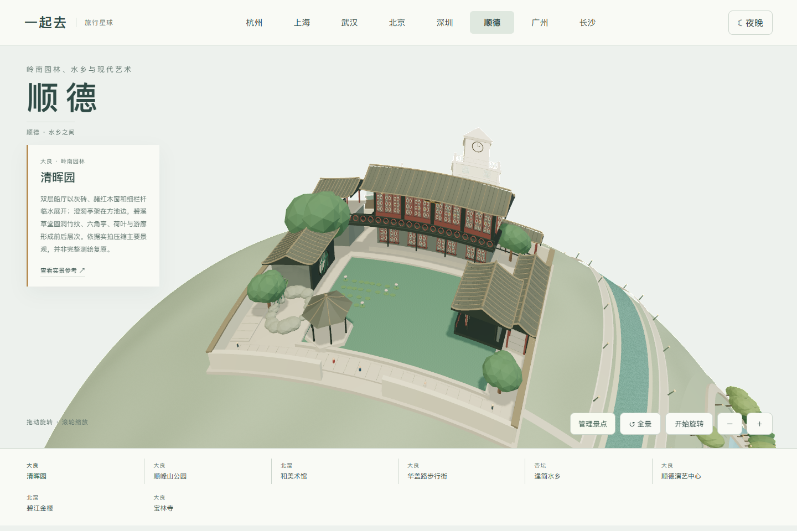
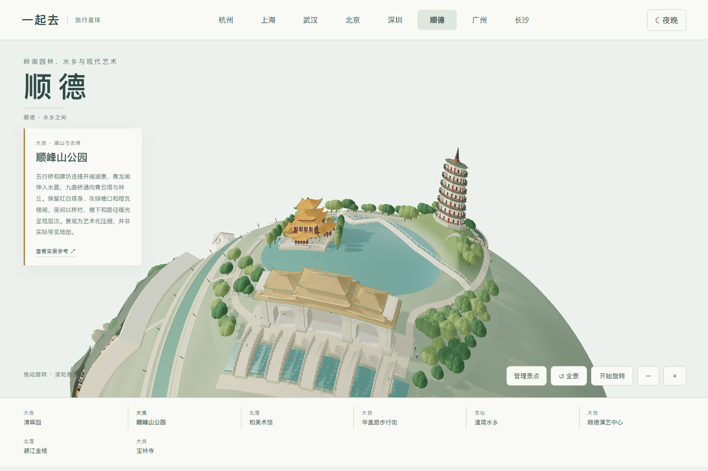
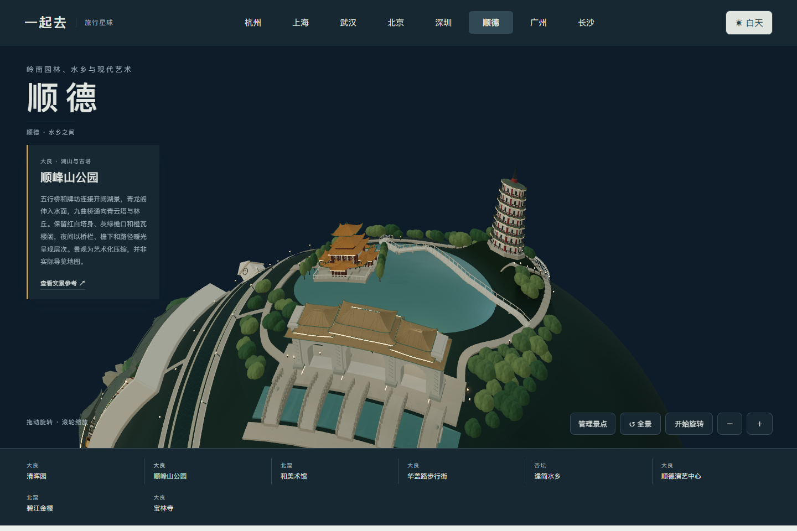
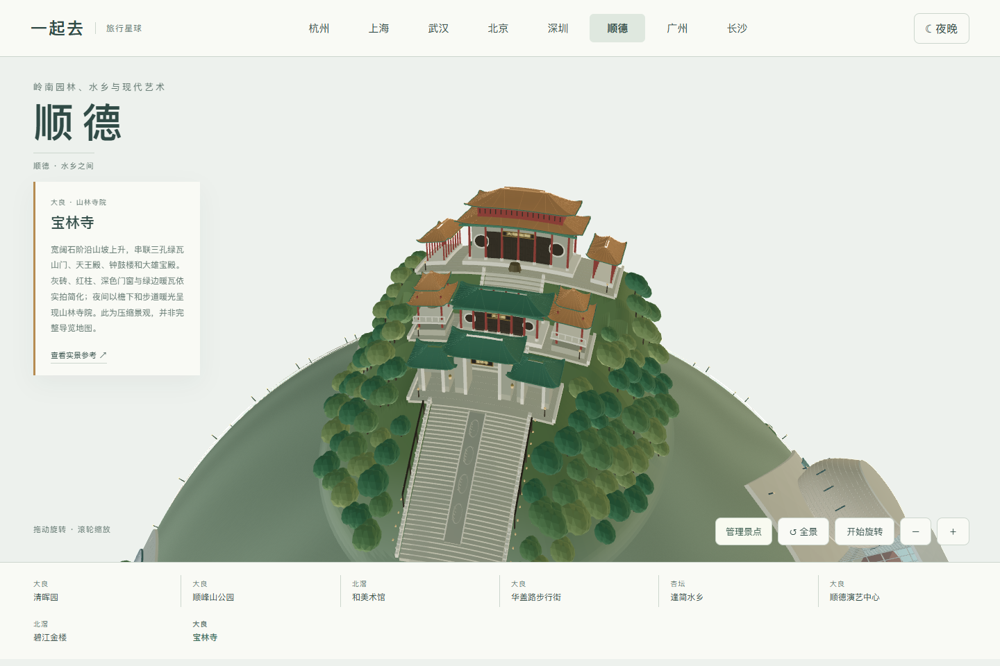
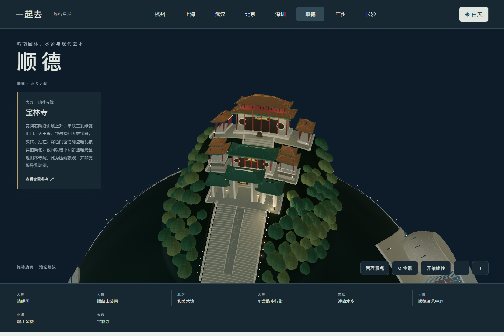

# 顺德地图与造型参考

顺德入口为 `shunde.html`，包含八组可独立添加、移除的景点。页面是艺术化缩微景观，目前没有顺德多人旅行目录；杭州、上海、武汉旅行功能保持。

## 实景与制作范围

| 景点 | 观察到的主要特征与模型范围 | 实拍来源 |
| --- | --- | --- |
| 清晖园 | 水池、临水庭院、连续游廊、假山与竹木；碧溪草堂圆洞窗、小蓬瀛的木构与花窗作为细部参考。表现组合园景，不宣称完整复原全园 | [园林官方景点图](https://www.sdqinghuiyuan.cn/list/foldId/20.html)、[庭院全景](https://www.sohu.com/a/537667229_121124703) |
| 顺峰山公园 | 牌坊与入口五行桥、青云湖、九曲桥、湖中青龙阁和林丘青云塔。塔身收分七层，白墙红柱、灰绿檐与深色外廊；青龙阁为橙瓦绿脊的一大四小楼阁 | [牌坊实拍](https://cj.sina.com.cn/articles/view/5787187353/158f1789902001c98z)、[湖塔楼阁航拍](https://www.sohu.com/a/423952070_798673)、[五行桥与湖景](https://www.abaxjp.com/china1602-14junpo/china1602-14junpo.html)、[佛山新闻网公园介绍](https://www.foshannews.net/h/5026/20230310/589361.html) |
| 和美术馆 | 错位外扩的圆形楼层、密集竖向格栅、低层方形翼楼与水池；主体采用灰白和银色 | [官方建筑说明](https://hem.org/zh/about/architecture)、[外观照片](https://k.sina.com.cn/article_2311055702_89bfe95600102t1gk.html) |
| 华盖路步行街 | 入口钟楼、粉彩骑楼、贯通拱廊与街道灯笼。只表现有实景依据的街段，不用随机房子填充地图 | [顺德城市网照片](https://shundeplus.shundecity.com/index.php/phone/index/article?id=190752) |
| 逢简水乡 | 石拱桥、桥头进士牌坊、河道与小船；黑色柱架、金色梁饰、上翘瓦顶，不将局部景观称作整个水乡 | [桥与牌坊同框](https://www.sohu.com/a/450999353_341089)、[牌坊细部](https://k.sina.com.cn/article_6438914599_17fca0a2700100oyjp.html) |
| 顺德演艺中心 | 玻璃长方体外壳内的红色折面屋顶，卵形石质音乐厅、灯塔和临水台阶；依据设计团队资料，未将旁边图书馆混作剧场 | [P&T 项目与照片](https://web.p-t-group.com/sc/project-detail.php?projects_category_id=4&projects_id=52&projects_name=Shunde-Library-and-Performing-Arts-Centre) |
| 碧江金楼 | 灰砖外墙、硬山瓦顶、木构阳台、绿栏杆和月洞门；金色集中在木雕和梁架，外墙不做成金色 | [建筑外观照片](https://www.sohu.com/a/190764153_743740) |
| 宝林寺 | 连续山坡承托院落，宽石阶通向三孔灰砖绿瓦山门；红柱、深门窗、圆窗、钟鼓楼和绿边暖瓦重檐殿。石阶中间的雕刻以低对比纹样概括 | [寺院整体实拍](https://k.sina.cn/article_2407500342_8f7f8a360010022hp.html)、[山门正面](https://fo.sina.com.cn/temple/2012-11-23/14363617.shtml)、[登山石阶与殿堂实拍](https://www.abaxjp.com/china1602-13horinji/china1602-13horinji.html) |

照片只用于观察造型、材质和空间关系，没有作为产品贴图，也不包含在公开仓库或源码包。参考页的可用性由原网站决定；这些来源不用于提供票价、营业时间或旅游承诺。

## 场景边界

- 八组景点分布在球面两侧。水道、距离、尺寸和朝向经过艺术化重排，不是精确地理地图。
- 夜景保留建筑底色，以檐口、格栅、窗灯、灯笼和路径灯区分层次。现代建筑的局部灯光缓慢变化；系统「减少动态效果」会停止变化。灯光是景观表达，不复刻真实场馆的演出安排。
- 建筑和所属庭院、水池、植物、人物及照明一起添加或移除；设置保存在当前浏览器。顺峰山的湖、桥、塔、楼阁与林地属于同一模块，移除后公共滨河步道保留。
- 公园是按实拍组织的缩微组合，未完整复原顺峰山全园；环湖和滨河连接用于场景浏览，不可据此计算实际步行距离。
- 手机浏览器模拟包含触屏和窄屏检查，不能替代 iOS、微信内置浏览器或低端手机的真机性能验收。

## 验收

`npm test` 包含顺德模型有限几何、球面落地、河道避让、景点间距、牌坊和石桥的贯通开口、日夜材质、整组增删与释放。`python tools/destination-check.py shunde` 使用独立内存服务，核对八组近看、日夜、手机布局、触屏与键盘、保存恢复以及 WebGL 丢失后的重试。

