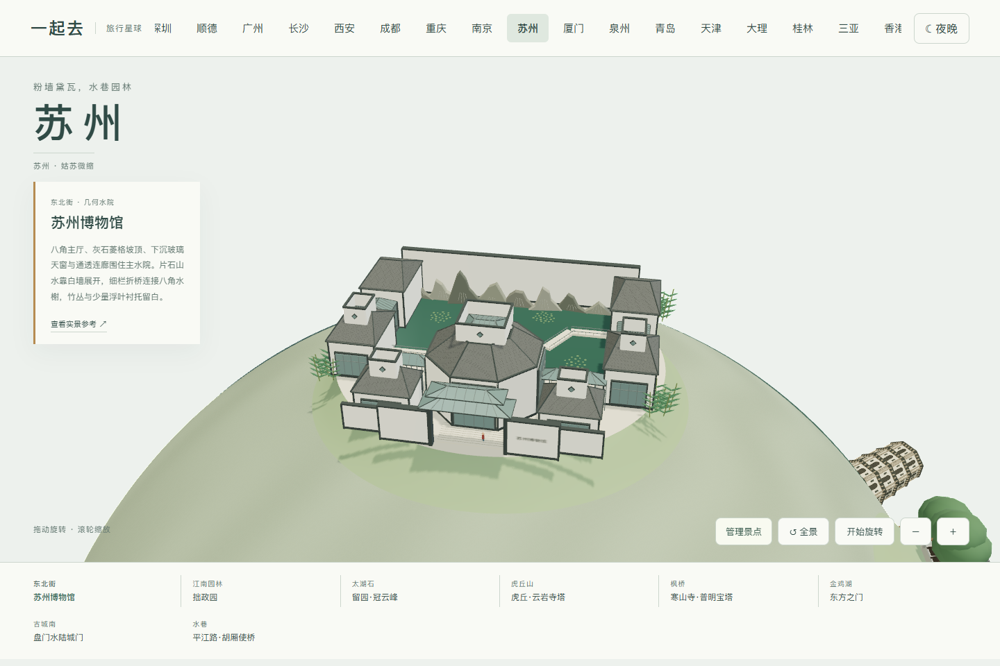
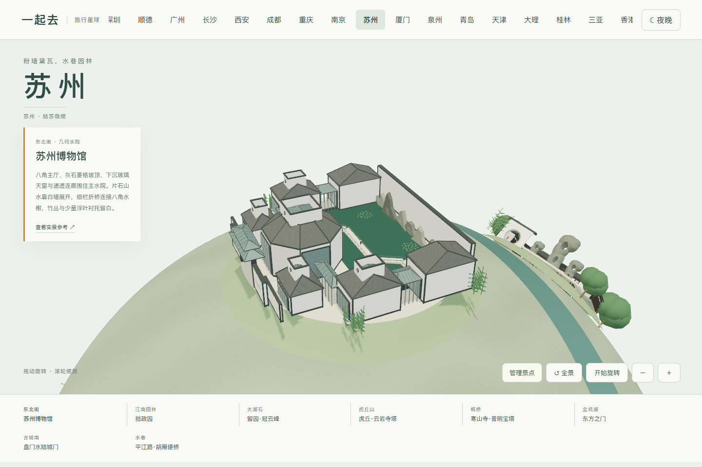
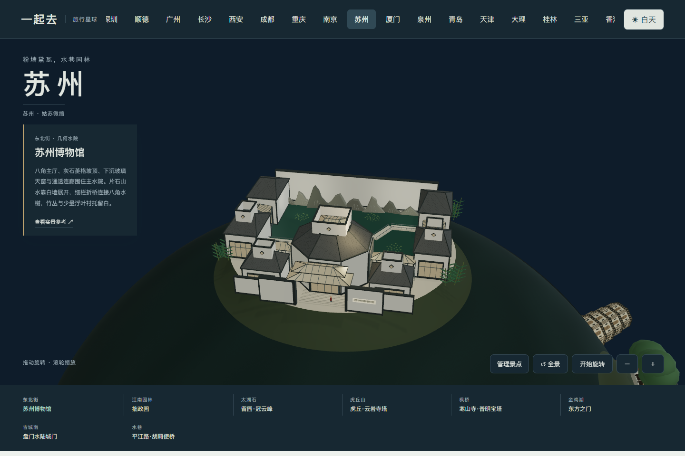

# 苏州造型参考

本页记录 2026-11-04 核看的照片及造型取舍。模型是艺术化微缩表达，场地距离经过压缩，不是测绘复原；夜间灯光也不代表景区实时亮灯安排。原始摄影作品仅用于内部观察，不随仓库分发。

| 地标 | 已核看的外貌与实现重点 | 参考 |
| --- | --- | --- |
| 苏州博物馆 | 主庭院的白墙灰边、几何坡顶、片石山水、折线桥、菱形小窗和玻璃天窗。只提炼主要水院，没有宣称覆盖全馆。 | [设计事务所落成照片](https://pei-architects.com/projects/suzhou-museum/)、[馆方图片](https://dx.szmuseum.com/views/NewsDetails.aspx?guid=349a54de-f3f5-41bc-b86d-7c3488d3c0d6) |
| 拙政园 | 远香堂、荷塘和荷风四面亭；亭为六角形，不能按部分图片标题误做八角亭。保留竹丛、临水树冠与曲折石桥。 | [园林文化介绍](https://lhsr.sh.gov.cn/jnylwh/20230731/97e84acfec034f0a930b23fdadbe390f.html)、[荷塘实拍](https://www.thepaper.cn/newsDetail_forward_23798852)、[亭体近景](https://cj.sina.com.cn/articles/view/7453483002/1bc431ffa001011op0) |
| 留园冠云峰 | 瘦高、穿孔、起伏的太湖石与两侧配峰，前水池、后冠云楼、侧廊和月洞门。岩体采用有真实通孔的立体表面。 | [苏州市园林局](https://ylj.suzhou.gov.cn/szsylj/sjyc/201905/b7c0f2058c75498c9ecbacf234e25b08.shtml) |
| 虎丘云岩寺塔 | 七层八角砖塔、略倾斜、浅色壁面、灰褐叠砖檐、券窗和收束塔顶；不套用宽木檐塔。 | [现场照片](https://www.trip.com/travel-guide/attraction/suzhou/tiger-hill-scenic-area-76159/) |
| 寒山寺普明宝塔 | 五层方木塔、深灰宽檐、粉白墙、暗木梁柱、斗栱、栏杆、金色塔刹和黄色院墙。 | [施工方落成实拍](https://www.szscgj.com/a/list_29/204.html) |
| 东方之门 | 蓝灰玻璃双腿、高位尖拱、圆肩、银色水平鳍片和真实透空。夜间保持材质原色，窗灯缓慢变化。 | [RMJM 设计方照片](https://rmjm.com/portfolio/gate-to-the-east-china/) |
| 盘门 | 并列水陆通道、双重城门、灰砖城台、两层木构门楼和登城石阶；入口洞穿过城体。 | [苏州官方遗产说明](https://www.suzhou.gov.cn/szwgjyhsj/yhsjjbgk/202110/3ad7341d62c24548bd075701ca6bbeda.shtml)、[门楼实拍](https://suzhoushenghuo.hatenablog.com/entry/2024/11/19/144954) |
| 平江路胡厢使桥 | 石拱桥、相连小桥、水巷、白墙灰瓦和临水木格窗。少量街屋属于这段具名历史街景，不作无名填充建筑。 | [两桥关系说明](https://swzfw.suzhou.gov.cn/swzfw/pasz/202309/ae5591e44c534d26ae81e329c43a0396.shtml)、[水巷实拍](https://jp.trip.com/travel-guide/attraction/suzhou/pingjiang-road-87769/) |

八组地标分布在两半球，提供日夜切换、自由旋转、逐景近看和整组添加或移除。苏州当前为景观地图，未接入多人旅行。

## 0.55.6 苏州博物馆主庭院精修

继续核看[设计事务所项目](https://pei-architects.com/projects/suzhou-museum/)、[设计方航拍](https://pei-architects.com/wp-content/uploads/suzhou_IMG_0812.jpg)与上表馆方入口、菱格屋面及玻璃连廊近照。主厅改为八角体量，灰石坡顶接到有真实凹口的玻璃天窗；侧翼展厅通过玻璃连廊衔接，入口采用通透门庭与双层玻璃雨棚。白墙深灰收边和石材菱格区分墙面、屋面与玻璃。

主水院保留宽阔水面，片石采用不同轮廓、前后错位与灰色层次；细栏折桥连接八角平台，浮叶集中成小片，竹丛留在外围。夜间玻璃内侧用低亮暖光，白墙与灰顶保留日景原色，片石墙使用静态白光。灯光是项目的展示设计，不声称重现现实开放时段或灯光节目。

这是主水院及相连门庭的压缩表达，不是全馆平面或工程模型。原八组景点位置、其他城市与三城多人旅行不变。

## 虎丘云岩寺塔精修（第 216 轮）

直接核看[塔身正面实拍](https://www.trip.com/travel-guide/attraction/suzhou/tiger-hill-scenic-area-76159/)、[砖斗拱及壶门侧面近照](https://suzhoushenghuo.hatenablog.com/entry/2024/09/12/161606)，并以[苏州市园林局说明](https://ylj.suzhou.gov.cn/szsylj/ylwh/201604/f3f52d3ee502486b8a4873c36b0d24e0.shtml)核对七层八角、砖柱、壶门、砖斗拱和叠涩细檐。夜间暖光仅参考游客发布的实际夜景，不承诺当前开放时间或灯光活动。

厚重的砖砌层间、略不均匀的浅色墙面、实际凹进的多瓣壶门、深处的棕红栏栅和密叠砖檐共同替换重复平面窗贴。塔身整体微倾，外侧前庭和登阶保持水平；基座增加低矮保护墙。塔顶采用实拍可见的紧凑收束，不另造宽木檐或金色塔刹。

网上建筑史文章中的一个链接图带有完整木檐，不能作为现存塔形的直接复原依据，因此未用于本轮外观。模型仍为压缩比例的风格化表达，未复制完整文物内部结构；参考照片不随包分发。

## 0.55.38 寒山寺普明宝塔

依据[建造方项目近照与全景](https://www.szscgj.com/a/list_29/204.html)、[入口近照](https://fireinovs.hatenablog.com/entry/2022/08/19/233423)及[塔基与回廊照片](https://hk.trip.com/moments/detail/suzhou-11-120950390/)重新制作五层方形塔身、红褐木构、粉色墙面、四面回廊、深窗栅、宽挑瓦檐与高石台，前院采用矩形木门楼，保留黄色围墙。

夜景参考[姑苏晚报 2024 年末亮灯实拍](https://news.2500sz.com/doc/2024/12/30/1126228.shtml)，将暖光布置在檐口、回廊和塔刹，保留木构暗部。照片为特定节庆活动，不能据此推断每天开放或亮灯时间。本模型是宝塔及局部前庭的风格化微缩，不代表完整寒山寺。照片只用于本地研究，不随项目分发。
