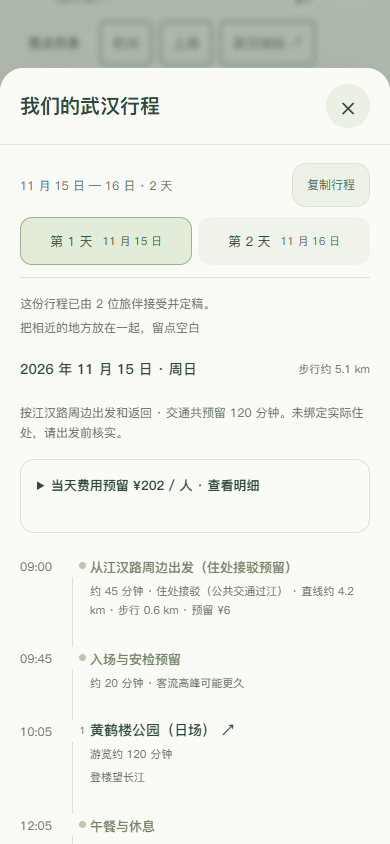
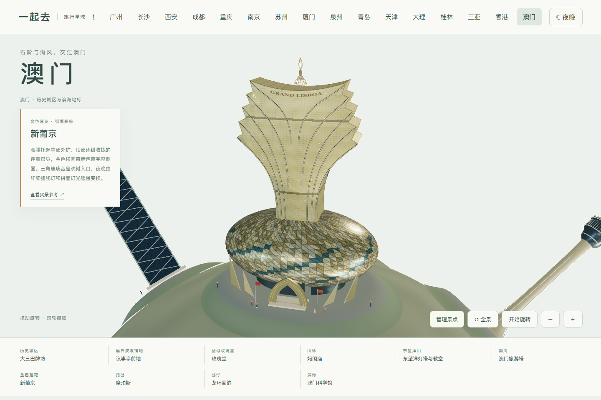
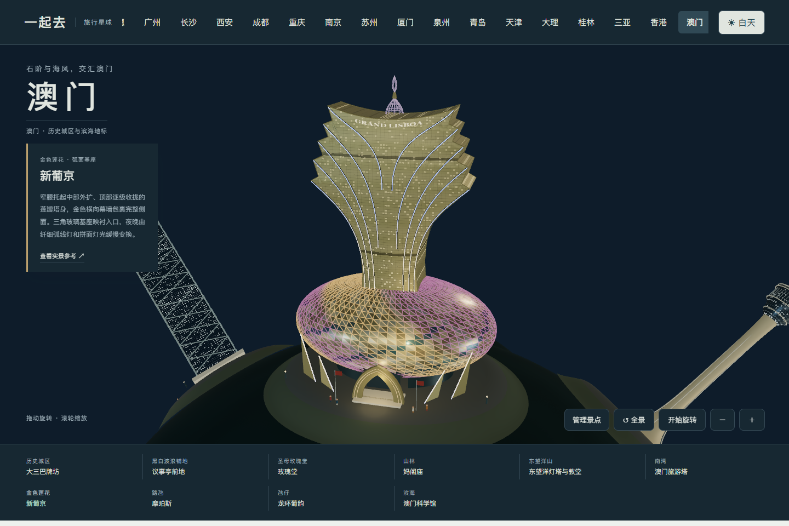

# 0.12.0 验收说明

验收日期：2026-10-29。自动化浏览器使用静音、无头 Edge；业务测试使用独立内存服务和合成成员，不写入公开旅行，不调用付费模型。

## 已检查

- 0.11.0 基线已有 218 项自动测试；0.12.0 新增武汉目录、三镇过江、1—3 日方案、闭馆、预算、城市隔离、模拟 AI 与共同定稿回归。公开源码仅保留可复现工具，其语法文件数可能更少；GitHub Actions 对公开仓库独立执行检查。
- 五个网页入口在 320×740、390×844、844×390、768×1024 和 1440×960 视口无整页横向溢出。实际查看日夜地图、近看地标、景点管理和旅行表单截图。
- 使用浏览器实际触屏输入模拟单指拖动与双指缩放：画面变化，结束手势后不误触景点。
- 上海、武汉的景点整组删除、刷新保持、恢复默认通过；删除正在近看的景点会返回全景。
- 两个独立手机浏览器身份完成选点、创建、邀请、偏好草稿返回、断网失败后重试、生成、费用查看、提出修改、重新生成、双方接受、定稿和复制。
- 320 像素宽度下，最终确认按钮和逐日表单可以正常访问。邀请与行程自动复制受限时，手动复制入口可用。

## 复现

先运行 `npm ci`。规则测试用 `npm test`，语法检查用 `npm run check`。

浏览器检查另外需要 Python、Playwright 和 Edge：

```sh
python -m pip install playwright
python tools/mobile-check.py
python tools/travel-flow-check.py
```

脚本会启动自己的 `127.0.0.1` 临时端口，测试结束后关闭，不需要先启动网页。结果和截图保存在 `test-results/mobile/` 与 `test-results/travel-flow/`。

没有 Edge 时，可运行 `python -m playwright install chromium`，再设置环境变量 `BROWSER_CHANNEL=chromium` 后执行脚本。PowerShell 使用 `$env:BROWSER_CHANNEL='chromium'`；macOS/Linux 可在命令前写 `BROWSER_CHANNEL=chromium`。

## 未覆盖

触屏模拟不等于手机真机验证。尚未完成 iOS Safari、微信内置浏览器、低端 Android 的真实键盘、GPU 内存、帧率、耗电或后台恢复测试。也没有进行生产并发压测、真实游客研究或实地路线验证。

浏览器确认的布局与流程结果不能替代上述检查。当前在线入口用于体验和反馈，不作商业服务可用性承诺。

## 武汉旅行专项

`python tools/wuhan-flow-check.py` 在独立内存服务中用两个手机浏览器身份执行真实界面流程：点击黄鹤楼模型查看地点、从目录发起旅行、保留草稿、复制邀请、从上海页面的错误城市入口自动转回武汉、朋友加入、断网提交后重试、生成两份方案、逐日费用、提出修改、旧确认失效、双方重新接受、发起人定稿、复制及历史只读。包含 390px 与 320px 表单检查和 1440px 日夜地图截图。

地图回归脚本包含武汉旅行新入口的整组移除、刷新保持、恢复、触屏与多尺寸检查。实际真机边界不变。



## 0.13.0 北京地图

2026-10-31 完成十一组地标日夜近看、两半球到达、独立资源释放、球面间距与真实穿孔检查。新浏览器脚本 `python tools/destination-check.py beijing` 覆盖 320/390/768/844/1000/1440 视口，触屏拖动及缩放、键盘旋转、整组管理与夜景保存、真实 WebGL 上下文丢失后的重新载入。全过程使用内存服务，无业务写入；保留真机性能边界。

## 0.14.0 深圳地图

2026-10-31 完成十组地标的实景核对、造型与布局修正。独立内存服务中的 `python tools/destination-check.py shenzhen` 已通过全部近看、日夜、动态变化、整组管理、保存恢复、触屏与键盘、WebGL 丢失重试以及 320/390/768/844/1000/1440 视口检查。修正 320px 控制按钮换行和当前城市入口被挤出视野后，深圳与北京浏览器流程均已重新通过，页面错误与业务写入均为 0。新增几何测试覆盖真实海岸边界与地标间距；测试不把看起来合理的中心点位置当作完整模型未涉水的证据。真机性能边界保持。

## 0.15.0 顺德地图

2026-10-31 对照八组景点照片制作模型，修正骑楼朝向、连续游廊、硬山屋顶、山坡台阶和夜间檐口光。`python tools/destination-check.py shunde` 在独立内存服务中核对全部日夜近看、双半球到达、整组管理与保存、触屏和键盘、320 至 1440 像素视口及 WebGL 故障恢复。几何回归检查模型整体离开水道、贴合球面、相互留有间距；牌坊与石桥具有真实贯通的开口。结果不代表精确测绘或物理手机性能已经验证。


## 0.16.0 广州地图

2026-10-31 完成八组地标的照片核对与造型制作。独立内存服务验收所有日夜近看、两半球到达、整组增删和保存、触屏与键盘、320至1440像素布局及WebGL故障恢复，页面错误与业务写入为0。后续修正大剧院折面玻璃、省博物馆凹槽、纪念堂屋顶连接、教堂立面和五羊雕像比例，并针对变化对象重新查看日夜和窄屏画面。几何测试覆盖整个模型的水道避让、球面落地、间距及资源释放。未测试物理手机性能。


## 0.17.0 长沙地图

2026-10-31 完成八组实拍参考模型、湘江洲地和双半球布局。修正书院屋顶开口、天心阁城墙支承与穿过拱洞的砖缝、梅溪湖三组体量与白色外墙、影像馆楼梯支承、现代场馆夜间反光及页面城市文案。独立内存服务完成全部日夜近看、整组增删与保存、触屏/键盘、320至1440像素布局和WebGL恢复；最后材质调整另行检查相关日夜及320/390画面。没有业务写入或付费模型调用。几何测试覆盖完整水道避让、落地、间距、结构开口和资源释放；未验收物理手机性能。


## 0.18.0 长沙山地与橘子洲大桥

2026-10-31 新增橘子洲大桥及岛上匝道，并将岳麓山改为连续球面地形，扩展山麓林地，连接江岸、洲岛与景点入口。山体根据实际模型范围避让庭院；几何检查新增山体与地面顶点的相交检测、桥面连续与桥下开口检测。桥梁与桥上灯光可整组移除，共享地形和两岸步道保留。

独立内存服务 05:18:03—05:18:41 完成九组景点日夜近看、桥梁增删与保存恢复、触屏和键盘、320至1440像素布局以及 WebGL 故障恢复，页面异常和业务写入均为0。实际手机截图发现桥端截断后，调整桥梁近看距离和方向；05:18:55—05:19:01 定向复核，320px 可以看见完整主要桥跨与岛上环形匝道。此前截图不算最终桥梁构图。本轮没有物理手机测试。

本版公开源码 245 项自动测试及 199 项 JavaScript 语法检查通过。

0.19.0：247 项完整测试和 201 项 JavaScript 语法检查通过。最后的明华轮船体曲率修正后，6 项深圳测试及日夜、390/320 画面再次通过。十一组近看、动态降级、模块保存、触屏、键盘和 WebGL 恢复通过浏览器模拟；未进行物理手机性能验收。

0.20.0：249 项完整测试和 202 项 JavaScript 语法检查通过。人才公园内湖、两座步桥、单一闭合水面及后海连接通过模型检查；十二组景点的管理保存、日夜、触屏与键盘、WebGL 恢复和 320 至 1440 布局通过独立内存服务验收。最后水面细分与连接修改后定向日夜及手机截图复核通过。手机为浏览器模拟，未做物理手机性能测试。

0.21.0：251 项完整自动测试通过。新增海心桥实际跨江、桥面净空、江岸步道避水与模块移除测试。十组广州景点的日夜、触屏与键盘、模块管理与恢复、WebGL 故障恢复，以及320至1440像素布局通过独立内存服务验收；定向检查桥梁、花城广场和两岸连接的实际截图。手机为浏览器模拟。

0.22.0：253 项完整测试和 208 项工作区 JavaScript 语法检查通过，205 项公开源码语法检查也通过。景山新增真实射线检验山体朝向及亭阁落地、院落平整和中轴衔接检查；全景、景山日夜、钟鼓楼和手机管理面板直接查看。十二组模块完成近看、日夜、触屏与键盘、移除后保存恢复、320至1440布局以及 WebGL 故障恢复；未进行物理手机验收。


0.23.0：255 项完整测试、210 项工作区语法检查通过。顺峰山新增真实几何检查：开放湖面、塔基落地、五座入口桥和九曲桥上岸净空；八组场地的滨河连接保持避水，完整公园可增删。八模块浏览器交互、日夜、触屏与键盘、窄屏布局和 WebGL 恢复通过。最后桥面与树木避让调整后 6 项顺德专项再次通过，未重复本地完整测试；公开持续集成会检查最终提交。手机为浏览器模拟。


0.24.0：256 项完整测试和 211 项工作区 JavaScript 语法检查通过。宝林寺新增真实射线检查院落贴地、三孔山门贯通、石阶净空、山体朝向及树木避让。八模块完整浏览器验收通过，含日夜、整组增删与恢复、触屏键盘、320至1440像素布局和 WebGL 故障恢复；宝林寺正面日夜、侧面及320/390画面直接核看。未做物理手机测试。


0.25.0：257 项完整测试、212 项工作区语法检查通过。长沙六项专项包含三馆屋面闭合、法线朝向、凹口高差和三条广场通道净空。九组模块日夜、保存与恢复、触屏键盘、320至1440布局、WebGL故障恢复通过独立内存服务；没有业务写入。直接查看最终三馆日夜、390及管理面板，手机仍为浏览器模拟。


0.26.0：258 项完整测试、213 项工作区语法检查通过。北京新增真实射线检查，确认屋顶封闭、外廊通透、最低层檐下有入口结构。十二组模块日夜、整组保存与恢复、触屏和键盘、320至1440布局、WebGL故障恢复通过独立内存服务；页面异常与业务写入均为0。直接核看佛香阁日夜、390及管理面板；手机为浏览器模拟。武汉多人旅行此前已完成双身份流程，当前完整测试继续覆盖其城市隔离、排程与确认机制。


0.27.0：259 项完整测试、214 项工作区语法检查通过。水立方新增五向气枕外法线、压力曲面高度、射线覆盖和平滑法线在球面变形后连续性检查。十二组模块日夜、整组管理保存恢复、触屏键盘、320 至 1440 布局与 WebGL 故障恢复通过；页面异常和业务写入均为 0。直接查看水立方日夜、390 及管理面板，手机为浏览器模拟。武汉多人业务未改动。


0.28.0：260 项完整测试、215 项工作区语法检查通过。新增大剧院屋顶闭合、两座入口步道净空和球面水池连续性检查。广州十组地标日夜近看、整组管理保存恢复、触屏键盘、320 至 1440 布局与 WebGL 故障恢复通过；页面异常和业务写入均为 0。直接查看大剧院日夜、侧面、390 与管理面板，手机为浏览器模拟。原三城多人业务保持。


0.29.0：261 项完整测试、216 项工作区语法检查通过。新增教堂侧廊屋面闭合、飞扶壁下方净空及整组灯光增删检查。广州十组地标日夜、管理保存恢复、触屏键盘、320 至 1440 布局与 WebGL 恢复通过；页面异常和业务写入为 0。随后修正左侧支撑镜像错位，专项七项及最终日夜、侧面、390 画面再次核验。手机为浏览器模拟，原三城多人业务保持。


0.30.0：262 项完整测试、217 项工作区语法检查通过。新增市民中心真实屋顶开缝、两侧屋盖闭合、中央通廊净空、双塔左右颜色和斜顶高度检查。深圳12组日夜、整组移除保存恢复、触屏键盘、320至1440布局和WebGL故障恢复已验收；页面异常与业务写入0。手机为浏览器模拟。原三城多人旅行保持。


0.31.0：263 项完整测试、218 项工作区语法检查通过。新增双馆中央通道净空、连桥高度、屋面封闭、独立冷暖灯光与场地间距检查。深圳13组日夜近看、整组移除保存恢复、触屏键盘、320至1440布局和WebGL故障重试已验收，异常和业务写入0。直接查看双馆日夜、390与管理面板；手机为浏览器模拟。原三城多人业务保持。


0.32.0：265 项完整测试、220 项工作区语法检查和8项长沙专项通过。新增洲头场地48点真实支撑、河道周期闭合、两侧水道净宽、雕塑头部闭合和面部高差检查。十组地标日夜、整组管理保存恢复、触屏键盘、320至1440布局和WebGL故障恢复通过；异常和业务写入0。雕塑日夜、390及管理面板直接查看。手机为浏览器模拟，人物为艺术化缩微而非扫描还原。


0.33.0：267 项当前项目测试、221 项工作区 JavaScript 语法及9项顺德专项通过。新增清晖园开放池面、船厅屋顶闭合、竹纹圆洞贯通、临水亭支撑与球面水面法线连续性检查。八组模块日夜、整组移除保存恢复、触屏键盘、320至1440布局及WebGL故障恢复通过；异常与业务写入0。直接查看清晖园最终日夜、390和管理面板。手机为浏览器模拟，模型为按实拍提炼的缩微布局。


0.34.0：268 项当前项目测试、222 项工作区语法和10项北京专项通过。新增敌楼拱门真实贯通、四座塔基及连续石阶落地、屋顶闭合与山脊高差检查。十二组地标日夜、整组管理保存恢复、触屏键盘、320至1440布局与WebGL故障恢复通过；异常及业务写入0。完整回归后只调整夜间山体边缘渐隐，另以语法和最终日夜、侧面、390/320浏览器画面核验。手机为浏览器模拟，山势为缩微提炼，暖光不表示实际开放时间。


0.35.0：269项当前项目测试、223项工作区语法及8项广州专项通过。新增沙面教堂入口进深、红楼十二处外廊净空、两座屋顶闭合和步道畅通检查；整体避水与场地间距继续覆盖新增模块。十一组日夜、增删保存恢复、触屏键盘、320至1440布局与WebGL重试通过。最终沙面日夜、390与管理面板直接查看，异常和业务写入0。手机为浏览器模拟，原三城多人旅行保持。


0.36.0：270项当前项目测试、224项工作区语法和11项北京专项通过。新增祈年殿外檐柱结构、正门净空及三层蓝瓦屋面朝向与覆盖检查。十二组模块日夜、整组增删保存恢复、触屏键盘、320至1440布局及WebGL故障恢复通过；异常与业务写入0。最终祈年殿日夜、390和管理面板直接查看。手机为浏览器模拟，原三城旅行业务保持。


0.37.0：271项当前项目完整测试、224项工作区语法和11项深圳专项通过。新增春茧真实透空菱格、露天内碗、闭合馆顶与中央入口净空检查。十三组模块日夜、整组保存恢复、触屏键盘、320至1440布局及WebGL故障恢复通过；异常与业务写入0。直接查看春茧最终日夜、390与管理面板；手机为浏览器模拟。原三城多人旅行业务保持。


0.38.0：272 项当前项目完整测试、225 项工作区语法和 9 项长沙专项通过。新增杜甫江阁三层屋面闭合、前后外廊净空、连续台阶与山墙覆盖检查。十组模块日夜、整组增删保存恢复、触屏键盘、320 至 1440 布局和 WebGL 故障重试通过；异常与业务写入为 0。直接查看最终日夜、390 夜景及管理面板；手机为浏览器模拟。原三城多人旅行业务保持。


0.39.0：273 项完整测试、226 项工作区语法检查通过。新增和美术馆天窗真实开口、闭合环形屋盖、入口桥和水院净空，以及贴球面前水网格连续性检查。顺德八组日夜、整组增删保存恢复、触屏键盘、320 至 1440 布局及 WebGL 重试通过；异常与业务写入为 0。直接查看和美术馆日夜、390 夜景与管理面板，手机为浏览器模拟。原三城多人旅行保持。


0.40.0：274 项完整测试、227 项工作区语法检查通过。新增广东省博物馆水平屋顶、内退中庭、真实凹槽进深和底部入口净空检查。广州十一组地标日夜、整组增删保存恢复、触屏键盘、320 至 1440 布局及 WebGL 故障重试通过；异常与业务写入为 0。直接查看省博日夜、390 夜景与管理面板。手机为浏览器模拟，原三城多人旅行保持。


0.41.0：275 项完整测试、228 项工作区语法检查通过。新增国家大剧院壳面完整朝外、玻璃帷幕宽度和贴球面水网格连续性检查。北京十二组地标日夜、整组增删保存恢复、触屏键盘、320 至 1440 布局及 WebGL 故障重试通过；异常与业务写入为 0。直接查看大剧院日夜、390 夜景与管理面板。手机为浏览器模拟，原三城多人旅行保持。


0.42.0：278 项完整测试通过（95.1 秒），随后新增水面连续性回归检查，西安 4 项专项再次通过，合计 279 项；234 项工作区语法通过。八组地标日夜、320—1440 布局、整组增删保存恢复、真实触摸事件与键盘旋转、WebGL 故障重试通过；异常和业务写入均为 0。直接查看全部八组日夜近景、全景及手机画面。手机为浏览器模拟，不作真机保证。


0.42.1：280 项完整测试通过，234 项工作区 JavaScript 语法通过。武汉与上海分别用两个独立浏览器身份走完选点、创建、邀请、提交偏好、生成两份方案、变更后重新确认、双方接受、发起人定稿及复制完整行程。武汉新增地图入口专项覆盖 1440/768/390/320 布局、目录/加入/我的旅行直达、只向同城未关闭且未定稿的旅行添加草稿、保留原预算和文字、列表请求失败重试，以及选中前旅行被关闭时禁止编辑。3D 载入失败时，目录和邀请表单仍可用。所有写入均在独立内存服务，未调用真实付费模型；手机为浏览器模拟。可运行 `python tools/wuhan-entry-check.py` 和 `python tools/wuhan-flow-check.py` 复验。


0.43.0：284 项完整测试通过。成都新增地标球面净空、五处真实桥洞、体育场屋盖开口与刚性、昼夜原色、动态灯光与减少动态效果、整组灯光增删及释放回归。八组地标日夜、整组移除保存恢复、触屏与键盘、320—1440 布局及 WebGL 故障重试通过独立内存服务。已直接查看八组日夜与手机画面，并修正桥洞封闭、草堂尖顶、神鸟纹样穿插和错误窗灯。最终茅屋日夜与390/320补验通过。页面异常和业务写入均为0；手机为浏览器模拟。


## 0.44.0 重庆地图

2026-11-04 完成八组实拍参考地标。287 项完整测试通过；新增真实几何检查覆盖两半球净空、建筑落地、桥塔透空、李子坝站层通道、夜间原色与动态降级，以及移除模块时灯光一同离开和资源只释放一次。两轮独立内存服务浏览器验收覆盖八组日夜、整组管理与保存恢复、实际触屏输入、键盘旋转、320 至 1440 像素布局和 WebGL 丢失重试。实际截图发现并修正河道十字形截口、大礼堂穿檐柱、大剧院圆鼓法线和列车未进入通道；最终画面直接核看。页面错误与业务写入均为 0。手机仍为浏览器模拟，原三城多人旅行保持。


## 0.45.0 南京地图

2026-11-04 完成八组实拍参考地标。290 项完整测试和 255 项 JavaScript 语法检查通过。专项检查覆盖四道城门贯通、上层藏兵洞真实开口、南京眼双环内部净空、两半球间距、落地、日夜原色、动态降级、模块灯光移除与资源只释放一次。浏览器验收覆盖八组日夜、整组管理、保存恢复、触屏与键盘、320 至 1440 像素布局和 WebGL 恢复；修正三个旅行页遗漏的导航后完整通过。最后针对中山陵入口、鸡鸣寺台阶、木格门窗和玻璃塔檐灯补看实际画面。页面异常与业务写入 0，手机为浏览器模拟。


## 0.46.0 苏州地图

293 项完整测试、262 项 JavaScript 语法检查通过。苏州专项检查真实东方之门尖拱、盘门双重水陆通道、太湖石孔洞、两半球净空、球面落地、材质原色、动态降级及模块灯光/资源释放。两轮浏览器覆盖八组日夜、整组增删保存恢复、触屏与键盘、320 至 1440 布局及 WebGL 恢复。最后对留园岩石体积、寒山寺塔刹、东方之门眩光、游客与路灯高度补验实际画面。城市导航改为可横向滚动，桌面日夜按钮保持同一行。页面异常和业务写入 0；手机为浏览器模拟。


## 0.47.0 厦门地图

296 项完整测试通过（52.6 秒），末次造型和水面调整后 3 项厦门专项再次通过；269 项 JavaScript 语法检查通过。新增海湾三角面不会沉入星球、桥塔主跨真开口、两半球间距与落地、日夜原色、动态降级和移除模块资源释放检查。完整浏览器验收覆盖八组日夜、双塔动态灯光、整组增删保存恢复、触屏键盘、320 至 1440 布局、WebGL 丢失重试以及原城市导航。修正三个旅行入口漏导航、燕尾脊悬空、海湾露地、双塔斜楼层线和过强水面眩光，最后补验实际画面。异常和业务写入均为 0；手机为浏览器模拟，三城多人旅行保持。


## 0.48.0 泉州地图

299 项完整测试通过（55.1 秒）、276 项 JavaScript 语法检查通过；末次夜间石材调整后 3 项泉州专项再次通过。检查尖拱真开口、石梁桥间隙、球面落地、两半球净空、日夜原色、动态降级和模块资源释放。完整浏览器完成八组日夜、增删保存恢复、触屏键盘、320 至 1440 布局与 WebGL 重试；最后导航检查发现三个旅行页漏链接，修复后单独补验所有城市入口通过，未重做已经通过的交互。最终石像日夜另行截图核看，异常与业务写入均为 0。手机为浏览器模拟，原三城多人旅行保持。


## 0.49.0 青岛地图

302 项完整测试通过（57.0 秒）、283 项 JavaScript 语法检查通过。核验球面落地、两半球净空、海湾水面、夜间红色保留、动态降级和模块资源释放。完整浏览器于 2026-11-04 03:47—03:49 完成八组日夜、整组增删与保存恢复、触屏拖动与双指缩放、键盘旋转、320—1440 布局、WebGL 重试及全部城市入口；异常和业务写入均为 0。模型修正前后实际截图直接核看，手机为浏览器模拟。原三城多人旅行保持。


## 0.50.0 天津地图

305 项完整测试通过（62.4 秒）、290 项 JavaScript 语法检查通过。新增真实拱洞射线、两半球净空、球面水面和整组资源验证。完整浏览器于 2026-11-04 04:04—04:06 完成八组日夜、整组增删保存恢复、触屏键盘、320—1440、WebGL 重试和全部城市入口，异常和业务写入均 0。天塔连接和玻璃夜色修正后，3 项专项与 04:08 日夜补验再次通过，实际画面已直接查看。手机是浏览器模拟；原三城多人旅行保持。

## 0.51.0 大理地图

308 项完整测试通过（56.6 秒）、297 项 JavaScript 语法检查通过。完整浏览器于 2026-11-04 04:20—04:21 完成八组日夜、整组保存恢复、触摸拖动与缩放、键盘、320—1440、WebGL 重试和城市导航，异常与业务写入为 0。修正苍山夜间地形自发光后，3 项专项与 04:28 日夜近景再次通过；八组最终日夜和手机画面均已直接查看。手机为浏览器模拟；原三城多人旅行保持。

## 0.52.0 桂林地图

311 项完整测试（63.1 秒）、304 项 JavaScript 语法检查通过。最终造型与材质修正后，3 项桂林专项再次通过，检查贯通天然石洞、梯田朝上表面、两半球净空、球面落地、夜间材质、动态降级与模块资源释放。完整浏览器 04:45—04:46 完成八组日夜、整组增删保存恢复、触屏键盘、320—1440、WebGL 重试及所有城市入口；04:49 八组画面、04:50 象鼻山与双塔取景补验通过。修正岩壁条纹、圆柱化山峰、湖岸托盘感、竖向匾额与梯田法线。最终实际日夜和手机截图直接查看，异常与业务写入 0。手机为浏览器模拟，原三城多人旅行保持。


## 0.53.0 三亚地图

314 项完整测试通过（60.4 秒）、311 项 JavaScript 语法检查通过。专项验证五座独立弧塔、桥面下垂和真实谷地、两端锚座落地、两半球净空、有限法线、日夜原色、减少动态偏好及整组资源释放。完整浏览器于 2026-11-04 05:08—05:09 验收八组日夜、整组增删保存恢复、触控拖动与缩放、键盘、320—1440 布局、WebGL 重试和各城导航；05:16—05:17 最终造型与取景补验，实际截图直接查看。异常和业务写入 0，手机为浏览器模拟。修正高楼圆柱轮廓、观音冠饰、雨林坡边和桥头、夜间广场自发光以及金色顶部被外墙遮挡。原三城旅行保持。


## 0.54.0 香港地图

317 项完整测试（61.1 秒）、318 项 JavaScript 语法检查通过；末次雕像肩臂修正后 3 项专项再次通过。专项检查两半球与海岸净空、有限顶点法线、建筑落地、汇丰开放底层射线、大佛可见台阶、媒体立面时钟、夜间保色、减少动态和整组资源释放。完整浏览器于 2026-11-04 05:54—05:56 完成十组日夜近景、整组增删保存恢复、触屏拖动与双指缩放、键盘自由旋转、320—1440 布局、WebGL 重试与各城市导航；异常和业务写入为 0。最终实际日夜与手机画面已直接查看，手机为浏览器模拟；原三城旅行保持。

## 0.55.0 澳门地图

320 项完整测试（60.8 秒）、325 项 JavaScript 语法检查通过；末次新葡京莲瓣前后关系修正后 3 项专项再次通过。专项覆盖双半球与海岸净空、落地与间距、有限顶点法线、大三巴三入口与摩珀斯三孔洞射线、夜间保色、减少动态和整组资源释放。完整浏览器于 2026-11-04 06:18—06:19 完成十组日夜、动态像素、整组增删保存恢复、实际触屏拖动双指缩放、键盘自由旋转、320—1440 布局、WebGL 恢复和既有城市导航；异常与业务写入 0。最终截图06:19:48—06:19:56已核看，手机为浏览器模拟。原三城旅行与数据保持。

## 0.55.1 洪崖洞精修

321 项完整测试（60.8 秒）与326 项 JavaScript 语法检查通过；最后的崖坡修改后4 项重庆专项再次通过。新增射线检查确保露台前方有真实退让深度、退后的房间仍存在、临街入口可穿透且券洞侧壁为实体。完整浏览器于2026-11-04 06:34—06:35完成八组日夜、动态、整组增删保存恢复、触摸拖动与缩放、键盘、320—1440布局、WebGL恢复及城市导航。最后06:36补验洪崖洞日夜、侧后方和390/320；页面错误及业务写入0。手机为浏览器模拟，原三城旅行保持。


## 0.55.2 新葡京精修

322 项完整测试（63.4 秒）、327 项 JavaScript 语法检查通过。新增射线检查塔身窄腰、中部宽肩、收拢塔冠、侧面闭合与入口真开口。2026-11-04 06:53—06:55 完成澳门十组日夜、双半球、整组增删保存恢复、触屏与键盘、320—1440 布局、WebGL 重试和城市导航；新葡京正侧背日夜与窄屏直接检查，页面异常与业务写入为 0。

06:56 定向检查新葡京动态灯光：稳定绘制后，减少动态模式两帧一致；恢复动态后，建筑区域有明确像素变化。第一次定向检查在切换后的绘制完成前截图导致断言失败，补齐帧同步后通过，未削弱静止断言。手机仍为浏览器模拟，未进行物理设备性能验收；原三城多人旅行保持。






## 0.55.3 大三巴精修

323 项完整测试（61.0 秒）、328 项 JavaScript 语法检查和 5 项澳门专项通过。新增射线检查矩形入口的上角、三处透空上窗、四处有深度的铜像壁龛和实体中央上层；立面泛光灯随整组移除且白天关闭。原有双半球净空、球面落地、有限顶点和法线、日夜材质保色、减少动态及资源释放检查保留。

2026-11-04 07:08—07:11 连续核看大三巴正面、侧面、背面、夜景和 320/390 实际画面，修正灰石偏黄、柱径不足、上方人物姿态及夜间只照亮下部的问题。07:12—07:14 完整浏览器通过澳门十组日夜、整组移除保存恢复、触控拖动与双指缩放、键盘旋转、320—1440 布局、WebGL 恢复和各城导航；页面错误与业务写入为 0。手机为浏览器模拟，原三城多人旅行保持。


## 0.55.4 西安钟楼精修

324 项完整测试（64.3 秒）、329 项 JavaScript 语法检查与 5 项西安专项通过。新增射线检查验证前向、侧向外廊通透，内室退后，柱子和上层回廊承托真实存在；保留四向券洞、球面落地、双半球净空、日夜材质保色与整组资源释放检查。

2026-11-04 07:22—07:23 直接核看多角度、日夜和 320 画面，修正瓦垄过亮、檐口遮挡及砖缝过强；07:24—07:26 完整浏览器通过八组日夜、整组移除保存恢复、触屏拖动与双指缩放、键盘、320—1440 布局、真实 WebGL 丢失恢复与原城市入口，错误与业务写入为 0。手机为浏览器模拟，未代替物理手机性能验收。


## 0.55.5 中山陵祭堂精修

325 项完整测试、330 项 JavaScript 语法和 4 项南京专项通过。新增射线检查验证三座门洞真实通透、中间拱门较高、石墩和后墙完整；保留球面落地、两半球净空、日夜保色、整组灯光与资源释放检查。

2026-11-04 07:36 起对照实拍核看祭堂正侧背、日夜和窄屏，修正屋面拼接缝、后墙空隙、地形重叠和瓦垄亮度。完整浏览器验收八组日夜、模块保存恢复、触控键盘、320—1440、真实 WebGL 丢失恢复及原城市导航，异常与业务写入为 0。手机为浏览器模拟，不代替物理设备性能测试。


## 0.55.6 苏州博物馆主庭院精修

326 项完整测试、331 项 JavaScript 语法与 4 项苏州专项通过。新增射线检查验证入口门庭通透、侧墙保留、玻璃天窗真实下凹且周围石材屋面完整；保留两半球净空、球面落地、整组资源和灯光管理。

2026-11-04 07:44—07:48 核看两轮草稿及正式模型日夜、正侧背、320，修正侧墙整面变暗的问题。完整浏览器第一次在静态平江路检查动态而失败，已明确选择带动态灯光的东方之门，重跑通过八组日夜、模块保存恢复、触控键盘、320—1440 与 WebGL 恢复，异常和业务写入为 0。手机为浏览器模拟，未替代物理设备性能验证。


## 0.55.7 八卦楼柱廊与顶座精修

327 项完整测试、332 项 JavaScript 语法与 4 项厦门专项通过。新增射线检查确认正面和侧面的柱廊真实退进、柱身保留、八角鼓座拱窗有实际开口。原八组两半球布局、球面净空、动态及整组资源释放检查保留。

2026-11-04 07:57—08:01 对照修缮后照片完成两轮隔离草稿和正式模型日夜、正侧背、320 实际核看，修正内墙颜色、顶部露台和照明热点。完整浏览器通过八组日夜、模块保存恢复、触控键盘、320—1440 与 WebGL 恢复，异常和业务写入为 0。手机为浏览器模拟，不代表物理设备性能测评。


## 0.55.8 开元寺东西塔精修

328 项完整测试、333 项 JavaScript 语法检查通过。新增射线检查覆盖两塔五层八面，确认四个真实门洞与四个实心龛位逐层交错，洞旁石墙保留。原八组两半球球面净空、夜景颜色、减少动态及整组资源释放检查保持通过。

2026-11-04 08:07—08:14 完成两轮隔离草稿与正式模型日夜、正侧背和 320 截图核看；修正屋面纹理、塔刹与匾额位置。08:13—08:15 完整浏览器验收通过八组日夜、整组保存恢复、触控键盘、320—1440 显示与真实 WebGL 上下文恢复，异常及业务写入为 0。手机是浏览器模拟，未声称物理设备性能验证。


## 0.55.9 青岛教堂精修

329 项完整测试、334 项 JavaScript 语法检查通过。新增射线检查验证玫瑰窗与钟楼成对窗洞真实开口，窗旁石墙和中柱保留；原八组球面净空、日夜颜色与资源释放测试通过。

2026-11-04 08:19—08:23 完成三轮隔离草稿和正式模型日夜、正侧背、320 截图核看，修正被墙遮住的窗片、过厚拱饰及后殿屋顶。08:23—08:25 完整浏览器验收八组日夜、整组保存恢复、触控键盘、320—1440、WebGL 恢复与城市导航，异常和业务写入为 0。390 管理面板已直接核看。手机为浏览器模拟。


## 0.55.10 天津瓷房子精修

330 项完整测试、335 项 JavaScript 语法检查通过。新增射线检查确认入口与侧廊通透、两侧柱墙保留；瓷瓶装饰坐标在合并后仍与顶点一一对应。原八组球面净空、日夜颜色与资源释放测试继续通过。

2026-11-04 08:31—08:39 隔离草稿与正式模型逐次核验，修正初次几何接口调用错误、合并后装饰坐标丢失和瓷片纹理过粗。正式日夜、正侧背与 320 画面已核看。08:38:45—08:40:38 完整浏览器验收八组近景、整组保存恢复、触控键盘、320—1440、WebGL 恢复与城市导航；异常和业务写入为 0。390 管理面板已直接核看。手机为浏览器模拟。


## 0.55.11 大理三塔精修

331 项完整测试、336 项 JavaScript 语法检查通过。新增射线检查确认主塔窗洞与相邻实墙、凹入雕像区分；实测几何验证两座小塔等高，且与主塔高度比例处于 0.60—0.64。

2026-11-04 08:47—08:49 隔离预览修正材质着色器保留字、收分转角开缝和小塔偏高。08:51:34—08:53:34 正式日夜、正侧背及 320/390 画面直接核看；八组近景、整组保存恢复、触控键盘、多宽度、WebGL 恢复和城市导航通过，异常及业务写入为 0。手机为浏览器模拟。


## 0.55.12 桂林日月双塔

332 项完整测试、337 项 JavaScript 语法检查通过。新增几何射线验证月塔与日塔高度比接近 35∶41，验证湖面动画时钟、减弱动态时冻结、整组移除恢复保留材质、白天关闭发光并恢复水色。

2026-11-04 08:56—09:01 三轮隔离预览修正湖面白色高光、背面取景及月塔偏矮；09:02 起正式日夜、正侧背及 320/390 画面核验。完整浏览器验收涵盖八组近景、整组保存恢复、触控键盘、多宽度、WebGL 恢复和城市导航，异常及业务写入为 0。手机为浏览器模拟。


## 0.55.13 三亚凤凰岛

333 项完整测试、338 项 JavaScript 语法检查通过。新增测试验证五楼宽面比例、楼体间隔、合并后灯带坐标、动画时间更新、减弱动态冻结及整组移除恢复。

2026-11-04 09:08—09:10 三轮隔离预览调整楼体宽度、右侧间隔及夜景亮度；09:15—09:17 正式核看日夜、侧背、动态与 320/390 画面。完整浏览器覆盖八组日夜、模块保存恢复、触控键盘、多宽度和 WebGL 恢复，异常和业务写入均为 0。手机为浏览器模拟。


## 0.55.14 香港汇丰大厦

334 项完整测试、339 项 JavaScript 语法检查通过。新增测试对两座扶梯的真实台阶做射线检查，确认台阶逐级升高、中央底层通道透空，以及桁架日夜颜色切换正确。

2026-11-04 09:21—09:22 两轮隔离预览修正桁架方向与窗框密度；09:26—09:28 正式日夜正侧背、动态、320 画面与 390 管理面板直接核看。完整浏览器覆盖十组景点、整组保存恢复、触控键盘、多宽度及 WebGL 恢复，异常与业务写入均为 0。手机为浏览器模拟。


## 0.55.15 成都安顺廊桥

335 项完整测试、340 项 JavaScript 语法检查通过。新增射线检查覆盖包含灯光衬面的完整桥洞和圆洞，以及沿桥轴逐级升高的两端台阶；原八组落地、间距、材质恢复与整组释放测试继续通过。

2026-11-04 09:32—09:34 两轮隔离预览修正台阶方向和屋面悬空线；09:38—09:39 正式核看日夜正侧背、320 画面与 390 管理面板。完整浏览器覆盖八组景点、整组保存恢复、触控键盘、多宽度和 WebGL 恢复，异常与业务写入均为 0。手机为浏览器模拟。


## 0.55.16 广州中山纪念堂

336 项完整测试、341 项 JavaScript 语法检查通过。新增射线检查覆盖四面门廊的实际进深、闭合屋谷、水平屋顶与连续石阶；既有十一组落地、间距、日夜恢复和资源释放测试继续通过。修复了台基粗网格局部下沉，测试没有放宽地面边界。

2026-11-04 09:44—09:50 隔离预览修正台阶悬高、扇形屋面线和相交屋顶；09:55—09:56 最终日夜正侧背、320 画面与 390 管理面板直接核看。完整浏览器覆盖十一组景点、整组保存恢复、触控键盘、多宽度及 WebGL 恢复，异常与业务写入均为 0。手机为浏览器模拟。


## 0.55.17 长沙爱晚亭

337 项完整测试、342 项 JavaScript 语法检查通过。新增射线检查覆盖通透亭身、上层窗棂真实开孔、闭合绿瓦屋面、逐级上升的石阶及与台基衔接；既有山地、江面、间距、日夜恢复和整组资源释放检查继续通过。

2026-11-04 09:59—10:05 隔离预览修正悬空台基和首级台阶；10:08—10:10 正式日夜正侧背、320 画面与 390 管理面板已直接核看。完整浏览器覆盖十组景点、整组保存恢复、触控键盘、多宽度及 WebGL 恢复，异常与业务写入均为 0。手机为浏览器模拟。


## 0.55.18 长沙岳麓书院

338 项完整测试、343 项 JavaScript 语法检查通过，含 11 项长沙专项。新增射线检查覆盖中轴门洞、二门三开间、御书楼完整屋盖、主楼高度关系、灰瓦与黄瓦材质，以及最终球面场景中的连续石阶和门槛衔接。初次测试的台阶探针忽略预补偿高度，已改为最终场景检查。

2026-11-04 10:13—10:15 隔离预览；10:21 实际截图发现后立面过简和侧廊瓦色问题并修正。10:27—10:29 正式日夜正侧背、320 画面与 390 管理面板已直接核看。完整浏览器覆盖十组景点、整组保存恢复、触控键盘、多宽度及 WebGL 恢复，异常与业务写入均为 0。手机为浏览器模拟。


## 0.55.19 长沙湖南博物院

339 项完整测试、344 项 JavaScript 语法检查通过，含 12 项长沙专项。新增检查覆盖露台水平、两侧展厅落地、入口通道、屋顶闭合、连续石阶与日夜金属底色。

2026-11-04 10:36—10:38 隔离预览发现侧展厅下方悬空，补齐支承。10:41—10:42 正式场景和完整交互通过；实际截图发现屋顶接缝过密，降低密度后于 10:45 重新直接核看日夜、正侧背和 320/390 画面。完整浏览器检查涵盖十组景点、整组保存恢复、触控键盘、多宽度及 WebGL 恢复，异常和业务写入为 0。手机为浏览器模拟。


## 0.55.20 长沙天心阁

340 项完整测试、345 项 JavaScript 语法检查通过，含 13 项长沙专项。新增射线检查覆盖三阁的水平步道、弯曲游廊屋盖连续性、主阁外廊净空、16 级背侧石阶与夜间瓦色。既有拱洞、完整屋顶、陆地范围、景点间距和整组释放检查仍通过。

2026-11-04 10:49—10:53 隔离预览，修正游廊碎屋脊和城墙曲面，调整本组位置以留出与梅溪湖艺术中心的间距。10:55—10:58 正式日夜、侧背、320/390 画面直接核看；十组景点、触控键盘、整组保存恢复、多宽度和 WebGL 恢复通过，异常与业务写入均为 0。手机为浏览器模拟。


## 0.55.21 谢子龙影像艺术馆

341 项完整测试、346 项 JavaScript 语法检查通过，含 14 项长沙专项。新增射线检查覆盖平直水面与屋盖、桥面高于水面、悬挑入口净空、偏置支墩、实际凹入的三角入口和连续 16 级台阶；夜间保持混凝土底色。陆地范围、河道避让、模块间距、整组释放检查继续通过。

2026-11-04 11:13—11:17 三轮隔离预览，收低池岸并修正地形、坡道末端与侧门。11:19—11:21 正式日夜、侧门、背面、320/390 实图直接核看；十组景点、整组保存恢复、触屏键盘、多宽度和 WebGL 恢复通过，异常及业务写入为 0。手机为浏览器模拟。


## 0.55.25 陕西历史博物馆

345 项完整测试、350 项 JavaScript 语法检查通过，含 9 项西安专项。新增射线检查覆盖前门中央通道、主殿外廊净空、十级台阶与平台连续性、四角楼与低侧廊高差；既有八组地标的落地、间距、夜间颜色、整组增删及资源释放检查通过。

2026-11-04 14:15 正式日夜、侧背和 320 宽度截图直接核看；14:15—14:18 隔离浏览器验收覆盖全部八组取景、陕历博整组增删与刷新恢复、双指缩放、拖动和键盘、320/390/768/844/1000 宽度以及 WebGL 丢失后恢复。页面异常和业务写入均为 0。手机为浏览器模拟，未用真实旅行做写入测试。


## 0.55.26 秦始皇帝陵博物院保护展馆

346 项完整测试、351 项 JavaScript 语法检查通过，含 10 项西安专项。新检查覆盖浅拱长壳、连续脊部天窗、前门净空、五级台阶连续接入平台、相邻展厅落地，以及八组地标的陆地范围、间距和资源释放。

2026-11-04 14:44—14:45 正式日夜、侧背和 320 宽度截图直接核看。首轮浏览器检查发现新版庭灯完全静止；补齐四盏独立缓慢明暗变化后，最终 10 项西安专项再次通过，确认减少动态效果时静止。14:49—14:51 完整交互重验通过，包含八组取景、整组增删与刷新恢复、双指缩放、拖动和键盘、320/390/768/844/1000 宽度与 WebGL 恢复；最终夜景、390 管理面板和窄屏图片已直接核看。页面异常和业务写入为 0，手机为浏览器模拟。完整 346 项记录在庭灯修正前，最终提交的完整检查以 GitHub Actions 为准。
## 0.55.27 西安城墙·永宁门

347 项完整测试、352 项 JavaScript 语法检查通过，含 11 项西安专项。新增射线检查覆盖主城门、瓮城侧门、月城外门贯通，四排箭窗开孔与砖间柱，21 级石阶与墙顶连续连接，以及弧形月墙。八组地标的落地、间距、夜间原色与资源释放检查继续通过。

2026-11-04 15:12—15:13 正式日夜、斜向、背面及 320 宽度画面直接核看；15:13—15:15 完整浏览器验收通过，覆盖八组地标、整组增删与刷新恢复、夜景动态及减少动态效果、双指缩放、拖动、键盘、320/390/768/844/1000 宽度和 WebGL 丢失后恢复。390 管理面板与窄屏夜景已直接核看。页面异常与业务写入均为 0，手机为浏览器模拟。


## 0.55.28 大唐芙蓉园·紫云楼

348 项完整测试、353 项 JavaScript 语法检查通过，含 12 项西安专项。新增检查覆盖四角亭内部通透、主楼回廊净空、16 级临湖台阶、13 级侧阶、平台连接、四座拱形连桥和三个凹入门洞；湖面边界拓扑、八组地标间距、落地、日夜原色与资源释放检查继续通过。

草稿检查发现侧阶被台基边缘遮挡，已移至外侧并重新连接。2026-11-04 15:31—15:32 正式日夜、斜向、背面和 320 宽度画面直接核看；15:31—15:34 完整浏览器验收通过，涵盖八组地标取景、紫云楼夜间动态与减少动态效果、整组增删及刷新恢复、双指缩放与拖动、键盘、多宽度布局和 WebGL 恢复。390 管理面板与窄屏夜景已核看。页面异常及业务写入均为 0；手机为浏览器模拟。


### 武侯祠入口精修

几何回归检查中央门道开口、封闭木门侧板、逐级升高且连接门廊的台阶、可通行的红墙夹道及竹叶不穿外墙。已有成都整组增删、日夜底色、减少动态效果、资源释放和八组景点净空检查继续适用。浏览器验收覆盖入口正侧背、日夜、320/390 宽度及整组管理、触控、键盘和 WebGL 恢复；均使用独立内存服务。


## 0.55.30 天府美术馆

350项完整测试、355项语法检查通过，含7项成都专项。新增检查保证中央庭院屋顶有真实开口、展厅屋盖保持实体、水面保持水平、背面入口通路不落入草地或水面且连续连接；原有地标间距、球面落地、日夜原色、动态与减少动态效果及资源释放检查继续通过。

2026-11-04 17:23—17:24，独立内存服务与无头浏览器完成八组景点取景、天府美术馆日夜/侧背/320、动态与减少动态效果、整组增删和刷新恢复、触控缩放拖动、键盘、五种屏宽和WebGL恢复。异常与业务写入均为0，手机为浏览器模拟。草稿期间修正水面垂直外翻、背部步道缺口、扩大场地后与体育场间距不足；未通过的草稿未发布。

## 0.55.31 来福士·朝天门

351 项完整测试、356 项语法检查通过，含 5 项重庆专项。新增结构回归验证八座独立塔楼框架及六低两高、连廊两端真实开口与可站立平台、中段玻璃、两座连续连接桥、12 级台阶和上层接驳。双半球间距、球面落地、原色、动态和资源释放继续通过。

草稿中窗灯过密、负坐标生成的着色器语法错误已经修正；正式提取模块曾漏保留洪崖洞导出，完整测试检出后已补回并重跑通过，失败记录保留。2026-11-04 17:43—17:44 本地实际浏览器完成日夜正侧背、320/390 画面、八组取景、动态及减少动态效果、整组增删与刷新、触控缩放拖动、键盘、多宽度和 WebGL 恢复。关键画面直接核看，页面异常和业务写入均为 0。手机为浏览器模拟，未替代真机性能测试。

## 0.55.32 重庆大剧院

352 项完整测试、357 项语法检查通过，含 6 项重庆专项。新增结构检查覆盖两座高低舞台体量、玻璃板缝坐标、真实凹入入口、贴合斜面的窄窗和九级台阶及上层平台。原有落地、两半球间距、日夜原色、动画与资源释放检查继续通过。

2026-11-04 20:38—20:40，隔离内存服务与无头浏览器完成八组取景、日夜正侧背、320/390 画面、整组增删与刷新、触控缩放拖动、键盘、五种宽度和 WebGL 恢复。关键截图直接核看，异常和业务写入均为 0。手机为浏览器模拟。草稿阶段发现并修复玻璃合并后板缝丢失、板缝闪点、夜间层次不足及斜面窄窗悬空，不以早期草稿代替验收结果。

## 0.55.33 重庆人民大礼堂

353 项完整测试、358 项语法检查通过，含 7 项重庆专项。新增检查确认三处牌楼开口可通行，中央步道与多级台地连续连接且无突兀高差；双半球间距、球面落地、原色保持、动画与资源释放继续通过。

2026-11-04 21:00—21:03，本地无头浏览器完成八组取景、日夜正侧背、320/390、整组管理与刷新、触控缩放拖动、键盘、五种宽度及 WebGL 恢复。关键截图直接核看，页面异常与业务写入均为 0，手机为浏览器模拟。两轮草稿中修正侧墙空白和屋顶夜间过暗，降低瓦垄密度；不以单张正面图代替交互验收。


## 0.55.34 南京博物院

354 项完整测试、359 项语法检查通过，含 5 项南京专项。新增检查覆盖两段台阶及中间平台连续性、柱廊门扇真实退进、瓦面合并后保留纹理坐标。既有球面落地、双半球净空、日夜底色、动画与资源释放继续通过。

2026-11-04 21:25—21:28，本地独立内存服务与无头浏览器完成八组取景、日夜正侧背及手机画面、整组增删与刷新恢复、触控缩放拖动、键盘、五种宽度和 WebGL 恢复。关键截图直接核看，页面错误和业务写入均为 0。手机为浏览器模拟。草稿中瓦垄摩尔纹和台阶接驳缝隙已经修正；模型仅表现历史馆大殿及局部前庭，不冒充完整院区。


## 0.55.35 鸡鸣寺山地院落

355 项完整测试、360 项语法检查通过，含 6 项南京专项。新增几何检查覆盖山门真实开口、三段石阶与休息平台连续连接，以及坡面不会遮挡通道；原有两半球间距、落地、日夜颜色、动画、整组管理和资源释放继续通过。

2026-11-04 21:44—21:46，无头浏览器在隔离内存服务完成八组取景、日夜正侧背与 320/390 画面、整组增删与刷新恢复、触控缩放拖动、键盘、五种宽度及 WebGL 恢复。关键实图直接检查；页面错误及业务写入均为 0。手机为浏览器模拟。草稿阶段修复塔刹悬空、山坡盖住入口、平台侧壁截断石阶和着色器编译错误，失败草稿未发布。

## 0.55.36 紫峰大厦精修

2026-11-04 22:02—22:04 完成本地验收：356 项测试、361 项语法检查通过。新增检查确认设备层有后壁而非贯穿空洞、塔尖连续连接、曲面幕墙采样坐标在合批后保留。直接核看正面、侧面、背面、夜景和 320 像素窄屏实图。完整浏览器验收覆盖 8 组地标、来源链接、整组管理与重载持久化、触摸旋转和缩放、键盘操作、320/390/768/844/1000 布局及 WebGL 丢失恢复，无页面错误和业务写入。

本轮发布状态单独记录：测试网站连接异常，尚未完成公网版本与资源核验。本地通过不等于已上线；GitHub 提交包保留独立版本。


## 0.55.37 虎丘云岩寺塔

2026-11-04 22:17—22:24 完成本地验收：357 项测试、362 项语法检查通过。新增射线检查验证七层壶门具有真实开口、窗栅后退，以及登塔石阶连续接入塔基。直接核看正面、侧背面、夜景、320 窄屏和 390 景点管理画面。

八组日夜取景完成后，交互脚本一度错误地要求古塔闪烁；改为在东方之门验证动态灯光，再接续整组增删、重载、触控缩放拖动、键盘、五种宽度和 WebGL 恢复。页面错误和业务写入均为 0。古塔保留稳定暖光；手机为浏览器模拟。测试网站仍待恢复连接后验收，本地结果不能代替上线确认。


## 0.55.38 寒山寺普明宝塔

2026-11-04 22:36—22:38 完成本地验收：358 项测试、363 项语法检查通过。新增检查覆盖入口真实退进、登塔石阶连续性、四面回廊高于下层瓦顶及四面窗栅深度。正侧背、夜景、320 窄屏及 390 管理/夜景实图已直接核看。

隔离内存服务和无头浏览器完成八组地标、来源链接、动态与减少动态效果、整组增删重载、触控与键盘、五种宽度及 WebGL 恢复，无页面错误和业务写入。草稿中已修复木椽穿出瓦面、上层回廊与下层瓦顶交叠、夜景整面偏棕的问题。手机为浏览器模拟。测试网站连接仍异常，本版本公网验收待完成。


## 0.55.39 盘门水陆城门

2026-11-04 22:58—23:00 完成本地验收：359 项完整测试、364 项语法检查通过。新增几何检查覆盖水道从两端穿过双重水门、两道错位陆门、露天瓮城和从院落连续接入城楼平台的登城阶道。发现过水道端部石条挡路、屋脊悬空、石阶穿入平台，均在验收前修复。

八组地标日夜取景、整组移除保存恢复、触控和键盘、五种宽度及 WebGL 恢复通过；直接核看盘门正侧背、夜景、320 窄屏及 390 夜景/管理实图。页面错误和业务写入均为 0。手机为浏览器模拟；测试网站仍连接异常，尚未完成本版公网验收。


## 0.55.40 平江路双桥水巷

2026-11-04 23:15—23:18 完成本地验收：360 项完整测试、365 项语法检查通过。新增几何检查覆盖可通行的厚石拱、两侧登桥台阶、支河平桥与石岸衔接及凹进木窗。修复街屋悬浮、步道衔接和桥板接缝缺少下部支撑。

八组地标日夜取景、整组移除保存恢复、触控和键盘、五种宽度及 WebGL 恢复通过；直接核看平江路正侧背、夜景、320 窄屏及 390 夜景/管理实图。页面错误和业务写入均为 0。手机为浏览器模拟；测试网站仍连接异常，尚未完成本版公网验收。


## 0.55.41 建南大会堂

2026-11-04 23:36—23:40 完成本地验收。361 项完整测试通过；最终修正平台与底座重叠的闪纹后，5 项厦门专项和 366 项语法检查再次通过。专项覆盖通高门廊、凹窗、连续细阶、后方礼堂体量及铺面与底座不共面。

八组地标日夜取景、整组移除保存恢复、触控和键盘、五种宽度及 WebGL 恢复通过；直接核看最终正侧背、夜景、320 窄屏和完整交互中的 390 夜景/管理实图。交互验收早于最后的平台共面修正，最终截图及专项复测覆盖该修正。页面错误和业务写入均为 0。手机为浏览器模拟；公网尚未验收，未称网站与本版一致。


## 0.55.42 南薰楼

2026-11-04 23:54—23:58 完成本地验收：362 项完整测试、367 项语法检查通过。新增专项以射线核对预留圆洞、开放风亭、凹窗、两翼基础和亭间开敞水面。草稿阶段修复高地侧翼悬空和圆洞旁窗洞过近。

八组地标日夜取景、整组移除保存恢复、触控和键盘、五种宽度及 WebGL 恢复通过；正侧背、夜景、320 窄屏及 390 夜景/管理实图均直接核看。页面错误和业务写入均为 0。手机是浏览器模拟。23:56 只读连接仍超时，尚未部署或验收本版公网。


## 0.55.43 南普陀寺

2026-11-05 00:13—00:17 完成 363 项完整测试、368 项语法检查及八组不重复的厦门地标交互验收。新增专项核对主殿和大悲殿柱廊进深、连续上行台阶、台阶与基座连接及荷塘没有被基础覆盖；地标之间保持原有边界要求。

正侧背、日夜、320 窄屏与 390 夜景和管理面板实图已直接核看。整组移除、保存、恢复、触控与键盘、五种宽度和 WebGL 重试通过，页面错误和业务写入为 0。手机检查使用浏览器模拟。网站仍连接异常，本版没有部署，不能据本地验收声称已上线。


## 0.55.44 菽庄花园四十四桥

2026-11-05 00:31—00:35 完成 364 项完整测试、369 项语法检查及厦门八组地标交互验收。专项检查真实石拱开口、拱顶厚度、连续桥面、桥墩承接、月洞门与亭旁通路，修复斜向栏杆伸入桥面的问题。

正侧背、日夜、320 窄屏和 390 夜景与管理面板实图已直接核看。整组移除、保存、恢复、触控、键盘、五种宽度和 WebGL 重试通过，页面错误与业务写入均为 0。手机验收为浏览器模拟。本地验收不能替代公网验收：网站连接异常，本版未部署。


## 0.55.45 日光岩

2026-11-05 00:52—00:56 完成 365 项完整测试、370 项语法检查。新增 210 个阶道采样点，检查台阶连续高度、台阶与岩体承接、圆形观景台入口没有垛口或墙壁阻挡。

厦门八组地标聚焦与夜景、整组移除和恢复、保存重载、触控和键盘、五种宽度与 WebGL 重试通过。正侧背、日夜、320 窄屏和 390 夜景与管理面板实图已直接核看；页面错误及业务写入均为 0。手机为浏览器模拟。本版本没有部署，网站连接异常仍待恢复。


## 0.55.46 洛伽寺

2026-11-05 01:13—01:16 完成 366 项完整测试、371 项语法检查。新增桥面 101 点、主殿台阶 51 点采样，以及山门拱洞和门廊通路检测，检查连续高度与真实开口。

泉州八组地标聚焦与夜景、整组移除和恢复、保存重载、触控和键盘、五种宽度与 WebGL 重试通过。正侧背、日夜、320 窄屏和 390 夜景与管理面板实图已直接核看；页面错误及业务写入均为 0。手机为浏览器模拟。本版本没有部署，网站连接异常仍待恢复。


## 0.55.47 天后宫

2026-11-05 01:27—01:31 完成 367 项完整测试、372 项语法检查。新增山门三个通道及四条阶道 404 个采样点检测，检查入口阻挡、阶面承接与连续高度。

泉州八组地标聚焦与夜景、整组移除和恢复、保存重载、触控和键盘、五种宽度与 WebGL 重试通过。正侧背、日夜、320 窄屏和 390 夜景与管理面板实图已直接核看；页面错误及业务写入均为 0。手机为浏览器模拟。本版本没有部署，网站连接异常仍待恢复。


## 0.55.48 洛阳桥

2026-11-05 01:42—01:46 完成 368 项完整测试、373 项语法检查。新增桥面及两端阶道 301 点、碑亭阶道 61 点采样与水平通路检测，检查连续承接、挡路构件和低位尖头基础。

洛阳桥维持静态照明，动态与减弱动态设置在天后宫灯笼上核验。泉州八组地标聚焦与夜景、整组移除和恢复、保存重载、触控和键盘、五种宽度与 WebGL 重试通过。正侧背、日夜、320 窄屏和 390 夜景与管理面板实图已直接核看；页面错误及业务写入均为 0。手机为浏览器模拟。本版本没有部署，网站连接异常仍待恢复。


## 0.55.49 泉州府文庙

2026-11-05 01:58—02:03 完成 369 项完整测试、374 项语法检查及实际页面验收。391 点中心路径检测覆盖山门、泮桥、露台与殿前阶道，检查连续承接、门洞与桥下净空。

泉州八组不重复地标的聚焦和夜景、整组增删、重载保存、触控和键盘、五种宽度及 WebGL 恢复通过。正侧背、日夜、320 窄屏与 390 夜景及管理面板实图已核看，页面错误和业务写入均为 0。手机为浏览器模拟。第一次交互脚本遗漏城市参数跑到北京，结果单独留档，未作为泉州验收；正确泉州运行 01:59:58—02:01:50。本版本未部署。


## 0.55.50 泉州清净寺

2026-11-05 02:11—02:17 完成 370 项完整测试、375 项语法检查及实际页面验收。门楼双高度净空、七个石窗透空、101 点连续地面及露天庭院检查通过。

泉州八组不重复地标的聚焦和夜景、整组增删、重载保存、触控和键盘、五种宽度及 WebGL 恢复通过。正侧背、日夜、320 窄屏与 390 夜景及管理面板实图已核看，页面错误和业务写入均为 0。手机为浏览器模拟。正确泉州交互运行 02:11:53—02:13:43。本版本未部署。


## 0.55.51 泉州钟楼

2026-11-05 02:23—02:27 完成 371 项完整测试、376 项语法检查，以及泉州八组不重复地标、整组增删保存、触控键盘、五种宽度和 WebGL 恢复验收。四向底架通道、支柱支撑、圆台连续性与立面凹进深度检查通过。页面错误与业务写入为 0。

正侧背、日夜与 320/390 窄屏图已核看。正式日景、夜景和 320 图片与已核看的第二轮图片 SHA 完全相同，未重复截图。手机为浏览器模拟；没有在真实旅行上写入。本版本未部署。


## 0.55.52 泉州老君岩

2026-11-05 02:35—02:40 完成 372 项完整测试、376 项语法检查及实际页面验收。新增石像连通检查，面部、胡须、耳鼻、手指与身体形成单一石雕，没有漂浮碎块。地块边界检查通过。

泉州八组不重复地标、整组增删和重载保存、日夜切换、触控和键盘、五种宽度及 WebGL 恢复通过。正侧背、日夜和 320 窄屏最终图与已直接核看的第四轮草稿逐 SHA256 一致；390 夜景与管理面板最终实图另行直接核看。页面错误及业务写入为 0，手机为浏览器模拟。实际交互 02:35:45—02:37:47。本版未部署。


## 0.55.53 青岛花石楼

2026-11-05 02:46—02:51 完成 373 项完整测试、377 项语法检查和实际页面验收。顶部拱廊、入口、背面凹窗及 241 点连续阶道检查通过；此前发现后墙挡玻璃、平台接缝与第一阶过高，已修正。

正侧背、日夜、320 窄屏及 390 夜景、管理面板实际截图已核看。青岛八组不重复地标聚焦、日夜、整组增删、重载保存、触控键盘、五种宽度和 WebGL 恢复通过，页面错误及业务写入为 0。浏览器验收 02:47:02—02:48:52，手机为模拟。本版未部署。


## 0.55.54 青岛站

2026-11-05 02:59—03:03 完成 374 项完整测试、378 项语法检查。新增钟楼长窗和三扇门的真实开口、181 点入口通路验证；修复底阶悬高和门槛落差，完整地块边界、灯光与资源释放检查通过。

02:59:24—03:01:25 完成正式截图和青岛八组不重复地标交互。实际核看日夜、正侧背、320 窄屏、390 夜景与管理面板；整组增删及重载、触控键盘、五种宽度和 WebGL 恢复通过，页面错误及业务写入为 0。手机为浏览器模拟。本版未部署。


## 0.55.55 太清宫

2026-11-05 03:10—03:14 完成 375 项完整测试、379 项语法检查。新增山门中门关闭、侧门通透和两侧各 221 点连续石阶通路检查。修正草稿中的岩底穿地和变量重名，失败草稿不计入验收。

03:10:43—03:12:44 正式截图与青岛八组不重复地标交互通过；03:14 实际核看正侧背、日夜、320 窄屏、390 夜景和管理面板。整组增删及重载、触控键盘、五种宽度和 WebGL 恢复通过，页面错误及业务写入为 0。手机为浏览器模拟，本版未部署。


## 0.55.56 奥帆中心

2026-11-05 03:20—03:25 完成 376 项完整测试、380 项语法检查。新增两条码头各 201 点路面连续性、灯塔圆台入口未被栏杆封堵和帆船低船舷检查。修复圆台栏杆缺口原先朝海的问题。

03:21:02—03:23:04 正式截图、青岛八组日景聚焦与其余交互通过；复核发现夜景循环重复奥帆中心、遗漏太清宫，完整夜景覆盖在 0.55.57 补验，03:24 实际核看正侧背、日夜、320 窄屏、390 夜景和管理面板。整组增删及重载、触控键盘、五种宽度和 WebGL 恢复通过，页面错误及业务写入为 0。手机为浏览器模拟，本版未部署。


## 0.55.57 信号山观景楼

2026-11-05 03:33—03:40 完成 377 项完整测试、381 项语法检查和实际页面验收。主塔底层与二层拱窗是真实开口，221 点阶道沿地形连续上升。草稿中材质编译失败、弯曲墙面方向、球体比例及草地穿阶已修复。

日夜、正侧背、320 窄屏、390 夜景和管理面板实际核看通过。03:38:10—03:39:52 补跑八组不重复地标的日夜聚焦，增加 ID 集合断言，修正上一版夜景覆盖遗漏；整组增删、重载、触控键盘、五种宽度和 WebGL 恢复通过，页面错误与业务写入为 0。手机为浏览器模拟。发布前网站已恢复连接，当前线上仍为 0.55.34，本版本地验收通过、准备发布。
