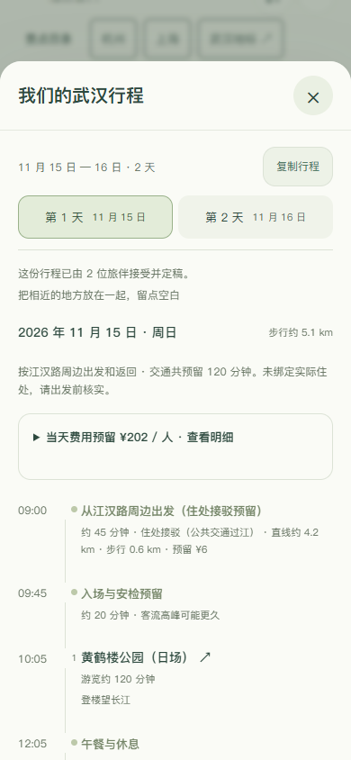

# 0.12.0 验收说明

验收日期：2026-10-29。自动化浏览器使用静音、无头 Edge；业务测试使用独立内存服务和合成成员，不写入公开旅行，不调用付费模型。

## 已检查

- 0.11.0 基线已有 218 项自动测试；0.12.0 新增武汉目录、三镇过江、1—3 日方案、闭馆、预算、城市隔离、模拟 AI 与共同定稿回归。公开源码仅保留可复现工具，其语法文件数可能更少；GitHub Actions 对公开仓库独立执行检查。
- 五个网页入口在 320×740、390×844、844×390、768×1024 和 1440×960 视口无整页横向溢出。实际查看日夜地图、近看地标、景点管理和旅行表单截图。
- 使用浏览器实际触屏输入模拟单指拖动与双指缩放：画面变化，结束手势后不误触景点。
- 上海、武汉的景点整组删除、刷新保持、恢复默认通过；删除正在近看的景点会返回全景。
- 两个独立手机浏览器身份完成选点、创建、邀请、偏好草稿返回、断网失败后重试、生成、费用查看、提出修改、重新生成、双方接受、定稿和复制。
- 320 像素宽度下，最终确认按钮和逐日表单可以正常访问。邀请与行程自动复制受限时，手动复制入口可用。

## 复现

先运行 `npm ci`。规则测试用 `npm test`，语法检查用 `npm run check`。

浏览器检查另外需要 Python、Playwright 和 Edge：

```sh
python -m pip install playwright
python tools/mobile-check.py
python tools/travel-flow-check.py
```

脚本会启动自己的 `127.0.0.1` 临时端口，测试结束后关闭，不需要先启动网页。结果和截图保存在 `test-results/mobile/` 与 `test-results/travel-flow/`。

没有 Edge 时，可运行 `python -m playwright install chromium`，再设置环境变量 `BROWSER_CHANNEL=chromium` 后执行脚本。PowerShell 使用 `$env:BROWSER_CHANNEL='chromium'`；macOS/Linux 可在命令前写 `BROWSER_CHANNEL=chromium`。

## 未覆盖

触屏模拟不等于手机真机验证。尚未完成 iOS Safari、微信内置浏览器、低端 Android 的真实键盘、GPU 内存、帧率、耗电或后台恢复测试。也没有进行生产并发压测、真实游客研究或实地路线验证。

浏览器确认的布局与流程结果不能替代上述检查。当前在线入口用于体验和反馈，不作商业服务可用性承诺。

## 武汉旅行专项

`python tools/wuhan-flow-check.py` 在独立内存服务中用两个手机浏览器身份执行真实界面流程：点击黄鹤楼模型查看地点、从目录发起旅行、保留草稿、复制邀请、从上海页面的错误城市入口自动转回武汉、朋友加入、断网提交后重试、生成两份方案、逐日费用、提出修改、旧确认失效、双方重新接受、发起人定稿、复制及历史只读。包含 390px 与 320px 表单检查和 1440px 日夜地图截图。

地图回归脚本包含武汉旅行新入口的整组移除、刷新保持、恢复、触屏与多尺寸检查。实际真机边界不变。



## 0.13.0 北京地图

2026-10-31 完成十一组地标日夜近看、两半球到达、独立资源释放、球面间距与真实穿孔检查。新浏览器脚本 `python tools/destination-check.py beijing` 覆盖 320/390/768/844/1000/1440 视口，触屏拖动及缩放、键盘旋转、整组管理与夜景保存、真实 WebGL 上下文丢失后的重新载入。全过程使用内存服务，无业务写入；保留真机性能边界。

## 0.14.0 深圳地图

2026-10-31 完成十组地标的实景核对、造型与布局修正。独立内存服务中的 `python tools/destination-check.py shenzhen` 已通过全部近看、日夜、动态变化、整组管理、保存恢复、触屏与键盘、WebGL 丢失重试以及 320/390/768/844/1000/1440 视口检查。修正 320px 控制按钮换行和当前城市入口被挤出视野后，深圳与北京浏览器流程均已重新通过，页面错误与业务写入均为 0。新增几何测试覆盖真实海岸边界与地标间距；测试不把看起来合理的中心点位置当作完整模型未涉水的证据。真机性能边界保持。

## 0.15.0 顺德地图

2026-10-31 对照八组景点照片制作模型，修正骑楼朝向、连续游廊、硬山屋顶、山坡台阶和夜间檐口光。`python tools/destination-check.py shunde` 在独立内存服务中核对全部日夜近看、双半球到达、整组管理与保存、触屏和键盘、320 至 1440 像素视口及 WebGL 故障恢复。几何回归检查模型整体离开水道、贴合球面、相互留有间距；牌坊与石桥具有真实贯通的开口。结果不代表精确测绘或物理手机性能已经验证。


## 0.16.0 广州地图

2026-10-31 完成八组地标的照片核对与造型制作。独立内存服务验收所有日夜近看、两半球到达、整组增删和保存、触屏与键盘、320至1440像素布局及WebGL故障恢复，页面错误与业务写入为0。后续修正大剧院折面玻璃、省博物馆凹槽、纪念堂屋顶连接、教堂立面和五羊雕像比例，并针对变化对象重新查看日夜和窄屏画面。几何测试覆盖整个模型的水道避让、球面落地、间距及资源释放。未测试物理手机性能。


## 0.17.0 长沙地图

2026-10-31 完成八组实拍参考模型、湘江洲地和双半球布局。修正书院屋顶开口、天心阁城墙支承与穿过拱洞的砖缝、梅溪湖三组体量与白色外墙、影像馆楼梯支承、现代场馆夜间反光及页面城市文案。独立内存服务完成全部日夜近看、整组增删与保存、触屏/键盘、320至1440像素布局和WebGL恢复；最后材质调整另行检查相关日夜及320/390画面。没有业务写入或付费模型调用。几何测试覆盖完整水道避让、落地、间距、结构开口和资源释放；未验收物理手机性能。


## 0.18.0 长沙山地与橘子洲大桥

2026-10-31 新增橘子洲大桥及岛上匝道，并将岳麓山改为连续球面地形，扩展山麓林地，连接江岸、洲岛与景点入口。山体根据实际模型范围避让庭院；几何检查新增山体与地面顶点的相交检测、桥面连续与桥下开口检测。桥梁与桥上灯光可整组移除，共享地形和两岸步道保留。

独立内存服务 05:18:03—05:18:41 完成九组景点日夜近看、桥梁增删与保存恢复、触屏和键盘、320至1440像素布局以及 WebGL 故障恢复，页面异常和业务写入均为0。实际手机截图发现桥端截断后，调整桥梁近看距离和方向；05:18:55—05:19:01 定向复核，320px 可以看见完整主要桥跨与岛上环形匝道。此前截图不算最终桥梁构图。本轮没有物理手机测试。

本版公开源码 245 项自动测试及 199 项 JavaScript 语法检查通过。

0.19.0：247 项完整测试和 201 项 JavaScript 语法检查通过。最后的明华轮船体曲率修正后，6 项深圳测试及日夜、390/320 画面再次通过。十一组近看、动态降级、模块保存、触屏、键盘和 WebGL 恢复通过浏览器模拟；未进行物理手机性能验收。

0.20.0：249 项完整测试和 202 项 JavaScript 语法检查通过。人才公园内湖、两座步桥、单一闭合水面及后海连接通过模型检查；十二组景点的管理保存、日夜、触屏与键盘、WebGL 恢复和 320 至 1440 布局通过独立内存服务验收。最后水面细分与连接修改后定向日夜及手机截图复核通过。手机为浏览器模拟，未做物理手机性能测试。

0.21.0：251 项完整自动测试通过。新增海心桥实际跨江、桥面净空、江岸步道避水与模块移除测试。十组广州景点的日夜、触屏与键盘、模块管理与恢复、WebGL 故障恢复，以及320至1440像素布局通过独立内存服务验收；定向检查桥梁、花城广场和两岸连接的实际截图。手机为浏览器模拟。

0.22.0：253 项完整测试和 208 项工作区 JavaScript 语法检查通过，205 项公开源码语法检查也通过。景山新增真实射线检验山体朝向及亭阁落地、院落平整和中轴衔接检查；全景、景山日夜、钟鼓楼和手机管理面板直接查看。十二组模块完成近看、日夜、触屏与键盘、移除后保存恢复、320至1440布局以及 WebGL 故障恢复；未进行物理手机验收。


0.23.0：255 项完整测试、210 项工作区语法检查通过。顺峰山新增真实几何检查：开放湖面、塔基落地、五座入口桥和九曲桥上岸净空；八组场地的滨河连接保持避水，完整公园可增删。八模块浏览器交互、日夜、触屏与键盘、窄屏布局和 WebGL 恢复通过。最后桥面与树木避让调整后 6 项顺德专项再次通过，未重复本地完整测试；公开持续集成会检查最终提交。手机为浏览器模拟。


0.24.0：256 项完整测试和 211 项工作区 JavaScript 语法检查通过。宝林寺新增真实射线检查院落贴地、三孔山门贯通、石阶净空、山体朝向及树木避让。八模块完整浏览器验收通过，含日夜、整组增删与恢复、触屏键盘、320至1440像素布局和 WebGL 故障恢复；宝林寺正面日夜、侧面及320/390画面直接核看。未做物理手机测试。


0.25.0：257 项完整测试、212 项工作区语法检查通过。长沙六项专项包含三馆屋面闭合、法线朝向、凹口高差和三条广场通道净空。九组模块日夜、保存与恢复、触屏键盘、320至1440布局、WebGL故障恢复通过独立内存服务；没有业务写入。直接查看最终三馆日夜、390及管理面板，手机仍为浏览器模拟。


0.26.0：258 项完整测试、213 项工作区语法检查通过。北京新增真实射线检查，确认屋顶封闭、外廊通透、最低层檐下有入口结构。十二组模块日夜、整组保存与恢复、触屏和键盘、320至1440布局、WebGL故障恢复通过独立内存服务；页面异常与业务写入均为0。直接核看佛香阁日夜、390及管理面板；手机为浏览器模拟。武汉多人旅行此前已完成双身份流程，当前完整测试继续覆盖其城市隔离、排程与确认机制。


0.27.0：259 项完整测试、214 项工作区语法检查通过。水立方新增五向气枕外法线、压力曲面高度、射线覆盖和平滑法线在球面变形后连续性检查。十二组模块日夜、整组管理保存恢复、触屏键盘、320 至 1440 布局与 WebGL 故障恢复通过；页面异常和业务写入均为 0。直接查看水立方日夜、390 及管理面板，手机为浏览器模拟。武汉多人业务未改动。


0.28.0：260 项完整测试、215 项工作区语法检查通过。新增大剧院屋顶闭合、两座入口步道净空和球面水池连续性检查。广州十组地标日夜近看、整组管理保存恢复、触屏键盘、320 至 1440 布局与 WebGL 故障恢复通过；页面异常和业务写入均为 0。直接查看大剧院日夜、侧面、390 与管理面板，手机为浏览器模拟。原三城多人业务保持。


0.29.0：261 项完整测试、216 项工作区语法检查通过。新增教堂侧廊屋面闭合、飞扶壁下方净空及整组灯光增删检查。广州十组地标日夜、管理保存恢复、触屏键盘、320 至 1440 布局与 WebGL 恢复通过；页面异常和业务写入为 0。随后修正左侧支撑镜像错位，专项七项及最终日夜、侧面、390 画面再次核验。手机为浏览器模拟，原三城多人业务保持。


0.30.0：262 项完整测试、217 项工作区语法检查通过。新增市民中心真实屋顶开缝、两侧屋盖闭合、中央通廊净空、双塔左右颜色和斜顶高度检查。深圳12组日夜、整组移除保存恢复、触屏键盘、320至1440布局和WebGL故障恢复已验收；页面异常与业务写入0。手机为浏览器模拟。原三城多人旅行保持。


0.31.0：263 项完整测试、218 项工作区语法检查通过。新增双馆中央通道净空、连桥高度、屋面封闭、独立冷暖灯光与场地间距检查。深圳13组日夜近看、整组移除保存恢复、触屏键盘、320至1440布局和WebGL故障重试已验收，异常和业务写入0。直接查看双馆日夜、390与管理面板；手机为浏览器模拟。原三城多人业务保持。


0.32.0：265 项完整测试、220 项工作区语法检查和8项长沙专项通过。新增洲头场地48点真实支撑、河道周期闭合、两侧水道净宽、雕塑头部闭合和面部高差检查。十组地标日夜、整组管理保存恢复、触屏键盘、320至1440布局和WebGL故障恢复通过；异常和业务写入0。雕塑日夜、390及管理面板直接查看。手机为浏览器模拟，人物为艺术化缩微而非扫描还原。


0.33.0：267 项当前项目测试、221 项工作区 JavaScript 语法及9项顺德专项通过。新增清晖园开放池面、船厅屋顶闭合、竹纹圆洞贯通、临水亭支撑与球面水面法线连续性检查。八组模块日夜、整组移除保存恢复、触屏键盘、320至1440布局及WebGL故障恢复通过；异常与业务写入0。直接查看清晖园最终日夜、390和管理面板。手机为浏览器模拟，模型为按实拍提炼的缩微布局。


0.34.0：268 项当前项目测试、222 项工作区语法和10项北京专项通过。新增敌楼拱门真实贯通、四座塔基及连续石阶落地、屋顶闭合与山脊高差检查。十二组地标日夜、整组管理保存恢复、触屏键盘、320至1440布局与WebGL故障恢复通过；异常及业务写入0。完整回归后只调整夜间山体边缘渐隐，另以语法和最终日夜、侧面、390/320浏览器画面核验。手机为浏览器模拟，山势为缩微提炼，暖光不表示实际开放时间。


0.35.0：269项当前项目测试、223项工作区语法及8项广州专项通过。新增沙面教堂入口进深、红楼十二处外廊净空、两座屋顶闭合和步道畅通检查；整体避水与场地间距继续覆盖新增模块。十一组日夜、增删保存恢复、触屏键盘、320至1440布局与WebGL重试通过。最终沙面日夜、390与管理面板直接查看，异常和业务写入0。手机为浏览器模拟，原三城多人旅行保持。


0.36.0：270项当前项目测试、224项工作区语法和11项北京专项通过。新增祈年殿外檐柱结构、正门净空及三层蓝瓦屋面朝向与覆盖检查。十二组模块日夜、整组增删保存恢复、触屏键盘、320至1440布局及WebGL故障恢复通过；异常与业务写入0。最终祈年殿日夜、390和管理面板直接查看。手机为浏览器模拟，原三城旅行业务保持。


0.37.0：271项当前项目完整测试、224项工作区语法和11项深圳专项通过。新增春茧真实透空菱格、露天内碗、闭合馆顶与中央入口净空检查。十三组模块日夜、整组保存恢复、触屏键盘、320至1440布局及WebGL故障恢复通过；异常与业务写入0。直接查看春茧最终日夜、390与管理面板；手机为浏览器模拟。原三城多人旅行业务保持。


0.38.0：272 项当前项目完整测试、225 项工作区语法和 9 项长沙专项通过。新增杜甫江阁三层屋面闭合、前后外廊净空、连续台阶与山墙覆盖检查。十组模块日夜、整组增删保存恢复、触屏键盘、320 至 1440 布局和 WebGL 故障重试通过；异常与业务写入为 0。直接查看最终日夜、390 夜景及管理面板；手机为浏览器模拟。原三城多人旅行业务保持。


0.39.0：273 项完整测试、226 项工作区语法检查通过。新增和美术馆天窗真实开口、闭合环形屋盖、入口桥和水院净空，以及贴球面前水网格连续性检查。顺德八组日夜、整组增删保存恢复、触屏键盘、320 至 1440 布局及 WebGL 重试通过；异常与业务写入为 0。直接查看和美术馆日夜、390 夜景与管理面板，手机为浏览器模拟。原三城多人旅行保持。


0.40.0：274 项完整测试、227 项工作区语法检查通过。新增广东省博物馆水平屋顶、内退中庭、真实凹槽进深和底部入口净空检查。广州十一组地标日夜、整组增删保存恢复、触屏键盘、320 至 1440 布局及 WebGL 故障重试通过；异常与业务写入为 0。直接查看省博日夜、390 夜景与管理面板。手机为浏览器模拟，原三城多人旅行保持。
