# 天津地标实拍与模型范围

2026-11-04 逐张核看八组地标日景，并核看天津之眼、民园和解放桥夜景。摄影作品仅作内部造型参考，不作为公开贴图或源码包素材。模型为艺术化缩微表达，场地距离经过压缩，夜景不代表实际开放时间或灯光秀排期。

| 模块 | 实拍与资料 | 主要识别点 |
| --- | --- | --- |
| 天津之眼·永乐桥 | [完整日景](https://www.visitourchina.com/tianjin/attraction/the-tientsin-eye.html)、[照明项目近景](https://www.baitrlighting.com/news/bairt-lighting-illuminates-tianjin-boosting-cultural-tourism-elevation-protecting-millennium-old-canal-golden-tourist-attraction-project/) | 桥面上的白色分叉支架、内外轮缘、细辐条、独立轿厢与海河水面。夜间轮缘采用缓慢变化的粉紫、青蓝和金色，未照搬实际灯光节目。 |
| 瓷房子 | [2025 年完整正面实拍](https://www.chinaservicesinfo.com/s/202505/27/WS6835552b498eec7e1f737ccc/crowds-flock-to-tianjins-porcelain-house.html)、[旧照中的细部](https://dp.pconline.com.cn/dphoto/list_2406457.html) | 砖红洋楼、瓷瓶围墙、曲线门头、白色格窗、露台、瓷龙与屋顶 China 字样。以完整正面图为主，旧照施工架不进入模型；瓷片表面为程序纹理。 |
| 西开教堂 | [游客正面实拍](https://gs.ctrip.com/html5/you/sight/tianjin154/10630.html) | 红黄相间砖墙、前方双塔与后方第三座绿穹顶、圆拱入口、高窄窗、山花和十字架。避免混成哥特式尖塔。 |
| 五大道·民园广场 | [澎湃新闻航拍](https://m.thepaper.cn/wifiKey_detail.jsp?contid=7842004&from=wifiKey)、[天津图书馆图片资料](https://rwtj.tjl.tj.cn/pic/view/type2/164.html)、[夜景实拍](https://gs.ctrip.com/html5/you/sight/tianjin154/1513563.html) | 连续拱廊、直廊红瓦顶与弧廊平顶、正面大拱门、中央草坪、玻璃展亭与阶梯草坪。保留真正贯通的拱洞，不用黑色窗片代替。 |
| 海河·解放桥 | [日景实拍](https://you.ctrip.com/sight/tianjin154/1556051.html)、[夜景近照](https://4travel.jp/os_shisetsu/10520215) | 灰色钢桁架、门式横梁、斜撑、石墩、贯通桥面和桥头石碑，夜间以暖金强调结构。本版没有模拟开桥动作。 |
| 天塔·天塔湖 | [湖岸与塔身实拍](https://www.tripadvisor.com.au/Attraction_Review-g311293-d1814662-Reviews-Tianta_Lake_Scenic_Resort-Tianjin.html) | 湖中基座、细长收分塔身、层层展开的观景舱、细长天线和连接石堤；与东方明珠的球体结构区分。 |
| 国家海洋博物馆 | [COX 设计方实拍与剖面](https://www.coxarchitecture.com.au/project/national-maritime-museum-of-china/) | 五组向海湾分叉的金属展厅、曲折壳体、玻璃端面、架空连桥和入口平台。根据实拍压低屋面比例，保持各展厅之间的水面与通廊关系。 |
| 蓟州·独乐寺观音阁 | [天津政务网实拍](https://www.tj.gov.cn/sq/yztj/jgtp/202005/t20200520_2468035.html) | 灰瓦重檐、暗红柱网、层叠木斗拱、上层回廊与观音阁匾额，石台前保留香炉。屋檐照明克制，不作霓虹描边。 |

提供两半球分布、日夜、自由旋转、逐景近看、整组增删保存与手机触控。天津当前为景观地图，未接入多人旅行；不套用杭州、上海或武汉目录，不虚构票价、开放时间、预约方式。

## 0.55.10 瓷房子精修

对照上表所列 2025 年正面实拍、旧照中的建筑细部和瓷瓶围墙近照，重新制作凸弧立面、不对称通透侧廊、收坡阁楼、弧形围墙和敞开入口。白色格窗、栏杆、柱头、屋顶瓷龙、雕像及 China 字样保持轮廓关系；青花和红彩瓷瓶沿围墙分层起伏，瓷片覆盖檐口、柱头与屋面。

瓷瓶花纹与碎瓷材质均由程序生成，没有复制照片作为贴图。背面与雕像采用缩微简化，没有声称逐件复原馆藏。夜间为低亮柔光展示，不代表真实灯光节目。

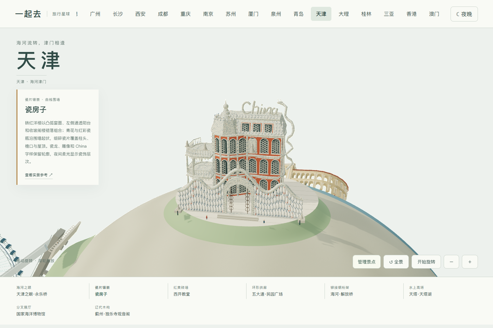

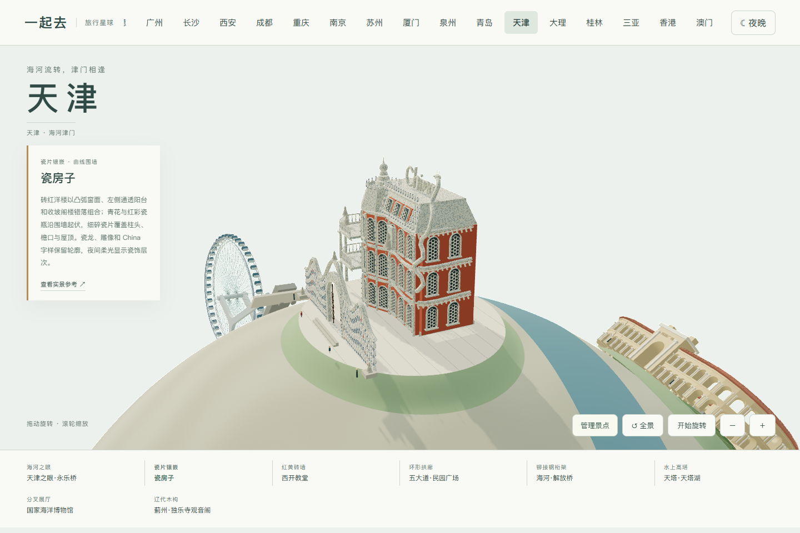

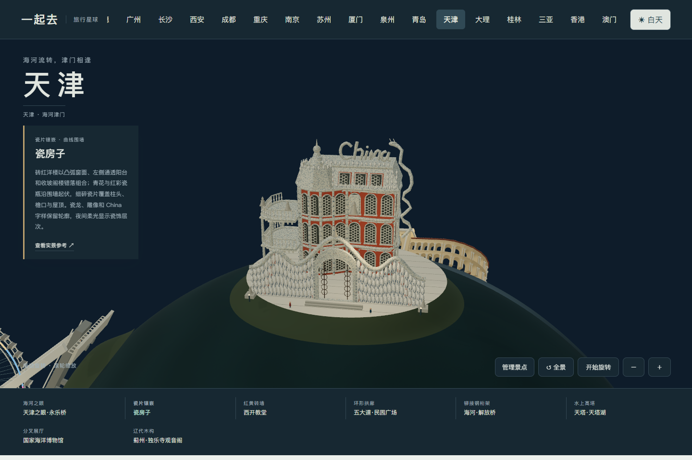

## 0.55.58 西开教堂

2026-11-05 对照正面、立面近照、暮色、夜景与夜间航拍，重做三座略向上拉长的铜绿穹顶、后方八角鼓座、长堂及低侧廊。立面补三联拱窗、白色拱券和细柱、层叠门洞、四叶窗、连续小拱廊及收分墙柱。砖缝与铜板接缝由程序生成，入口三条石阶通路连续接入前平台。

- [正面建筑照片](https://www.topchinatravel.com/china-attractions/xikai-church.htm)
- [游客近照、暮色及夜景](https://gs.ctrip.com/html5/you/sight/tianjin154/10630.html)
- [夜间航拍与建筑资料](https://www.wanyouzhenyuan.cn/index.php?a=content&id=44794&m=news&tm=2)

夜景取暖色砖墙与绿色铜顶的实拍关系，保留日间材质本色。模型是建筑外观缩微，雕像、彩窗与后立面采用简化造型，未复刻宗教画作或室内；研究照片不作为贴图分发。

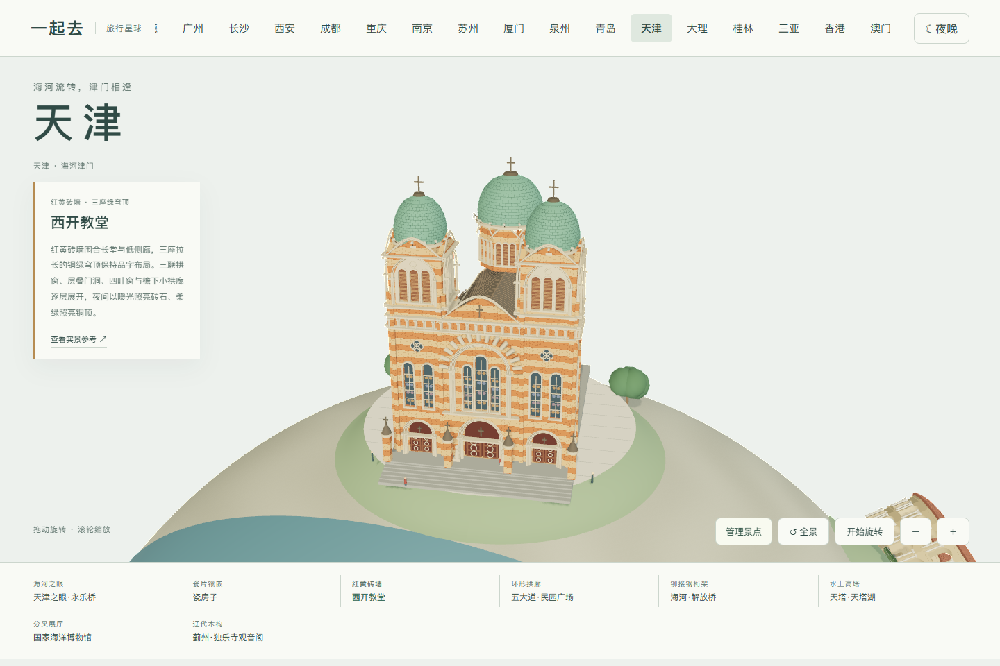

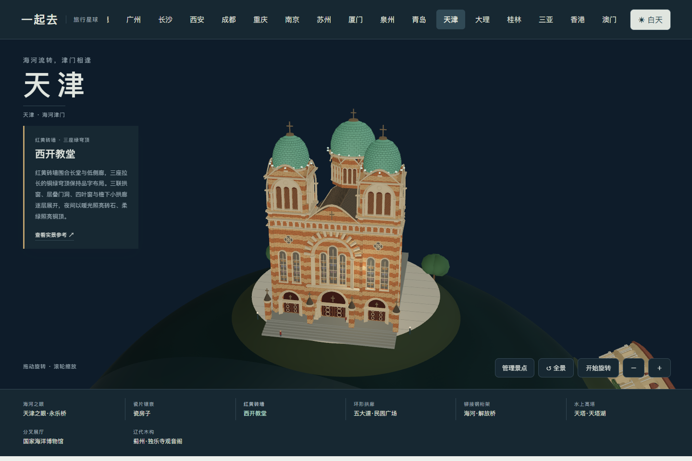

## 0.55.59 国家海洋博物馆

依据 [COX 设计方项目照片与立面图](https://www.coxarchitecture.com.au/project/national-maritime-museum-of-china/)，将原来五根近似均匀管状的展厅改成两对高低不同的弯折金属壳体与一处侧向短翼。中央增加有连续肋架的拱形玻璃大厅，两侧保留窄玻璃采光带。端面采用收分折角、凹进玻璃和水平遮檐，外墙增加局部切口及细板缝。

到达广场位于陆地上，海水只保留在临港一侧；两个细码头接向水面，入口阶道适应星球坡面。夜间保留金属本色和克制的玻璃照明，不代表实际运营灯光节目。模型仅呈现建筑外观，展陈和馆藏未建模；没有复制照片作为贴图。

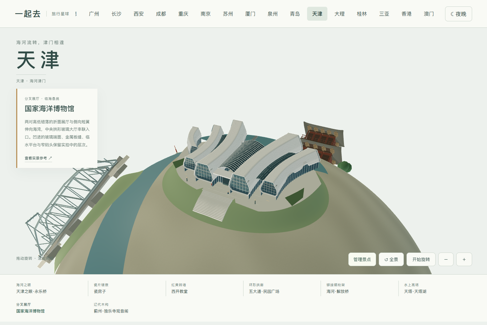

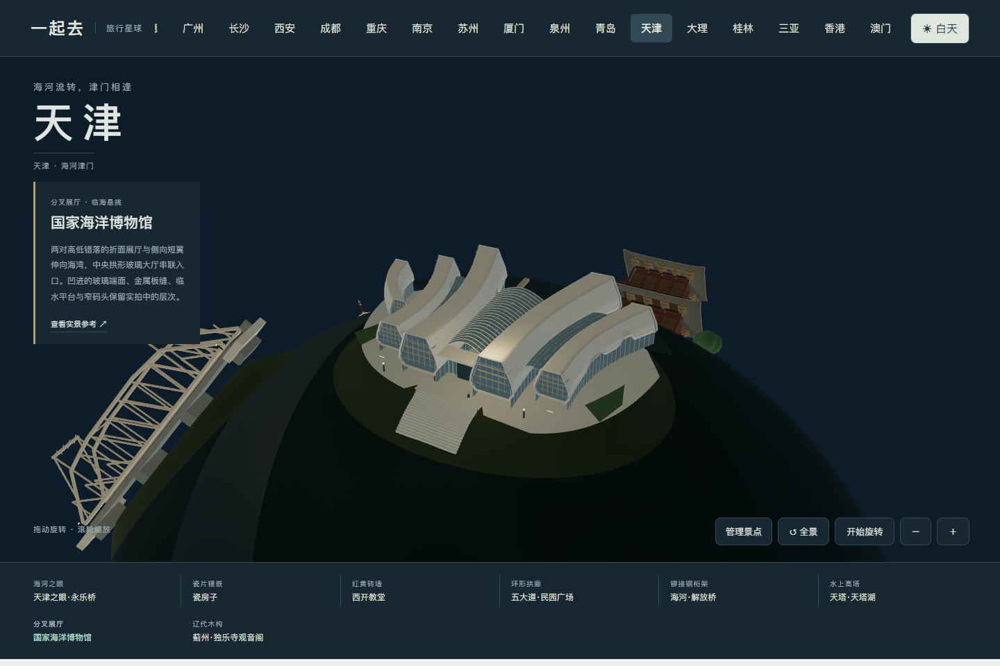

## 0.55.60 独乐寺观音阁

对照 [天津政务正面照片](https://www.tj.gov.cn/sq/yztj/jgtp/202005/t20200520_2468035.html)、[新华社斗拱与瓦面近照](https://www.xinhuanet.com/20251107/b84304589ffd47088f682be77d0a9bfe/c.html) 和 [建筑研究侧立面照片](https://architecturasinica.org/place/000024c)，修正过窄的体量及满墙窗格。改用宽红墙与低窗，补三层木斗拱、灰瓦歇山顶、木山花、瓦当、四面回廊及镂空香炉。入口十级浅石阶接通前院与台基。

五张实拍用于外观研究；建筑研究页面本轮返回 403，侧立面照片可直接读取。模型不复刻室内造像；夜间仅用克制的暖光呈现木构，照片不作为贴图分发。

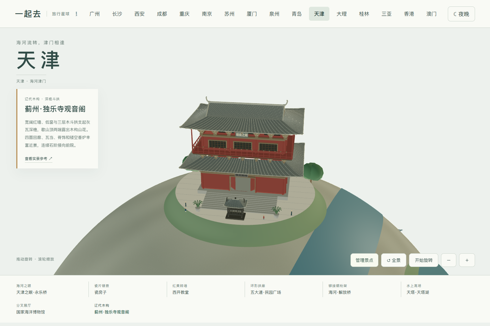

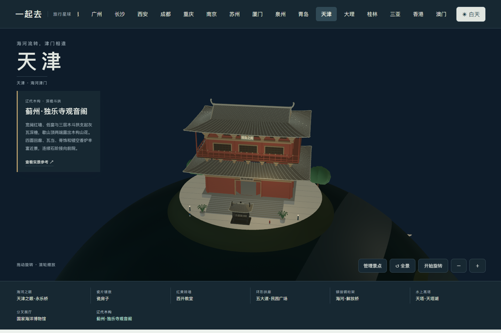

## 0.55.61 民园广场

依据 [澎湃新闻航拍](https://m.thepaper.cn/wifiKey_detail.jsp?contid=7842004&from=wifiKey)、[清华同衡照明设计方的三张夜景照片](https://so.thupdi.com/project/view?id=2161) 与 [游客拍摄的拱廊、阶梯草坪和玻璃展亭](https://you.ctrip.com/sight/tianjin154/1513563.html)，区分直廊的红瓦顶和弧廊的平顶、上层矩形窗。补砖墩、细柱、拱券线脚、门户层叠檐口和内院草坪。

新增叶形玻璃展亭、外露白肋架及五层阶梯草坪；步道与树列按广场照片布置。夜间参照设计方暖色照明，以拱券和檐口为主，不把整片墙面照成霓虹。模型为缩微外观表达，未复刻地下空间、具体商铺或活动海报。参考照片仅用于研究，不作为贴图分发。

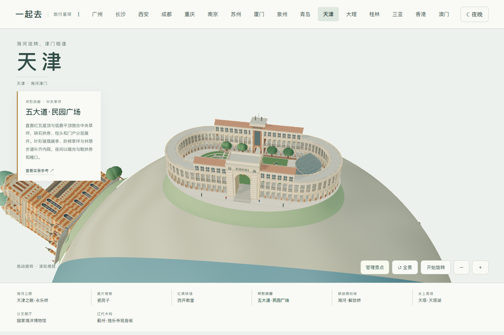

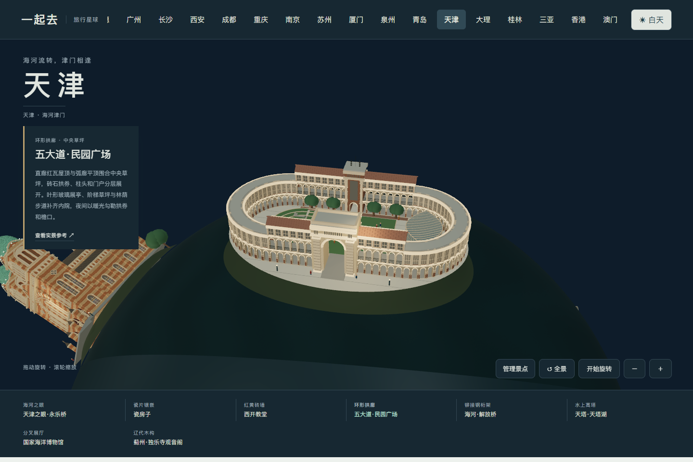

## 0.55.62 解放桥

依据 [天津日报航拍转载](https://tj.sina.com.cn/news/m/2022-11-11/detail-imqqsmrp5726600.shtml)、[南开大学开桥夜景](https://sie.nankai.edu.cn/info/1038/1470.htm) 和 [游客拍摄的桥身细部](https://you.ctrip.com/sight/tianjin154/1556051.html)，补出两座高门架、向中间下凹的板式上弦梁、工字形梁、节点板、铆钉和双侧栏杆。桥面与两岸坡道保持连续，横梁留出道路净空。

日景保留灰色钢材，夜景采用暖金色结构光。模型是固定闭合状态的缩微外观，没有实现开桥机构或模拟实际交通。参考照片仅供研究，不随项目分发。

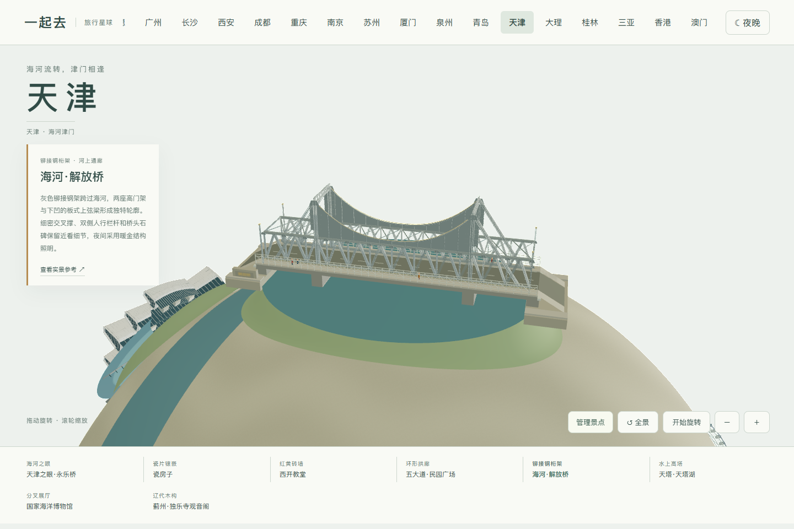

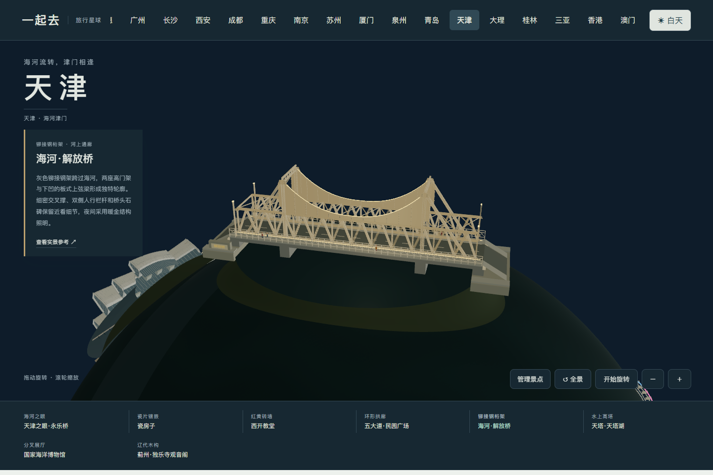

## 0.55.63 天塔与天塔湖

依据 [天塔全景](https://s.visitbeijing.com.cn/attraction/118518)、[湖中基座航拍](https://commons.wikimedia.org/wiki/File:TianJin_TV_Tower.jpg)、[塔身照片](https://www.thechinatravelplanner.com/china-inspiration/the-best-things-about-tianjin) 与 [暖色夜景](https://s.visitbeijing.com.cn/index.php/attraction/118704)，调整观景舱高度与长天线比例，补出渐收混凝土塔身、倒锥形玻璃观景舱、顶部天线格架、环形台阶及入口玻璃门厅。

两条步道连接环形平台；夜间采用暖色塔身照明，保留玻璃与红白天线的颜色。模型是缩微外观，不模拟真实内部空间；参考照片只供研究，不随项目分发。

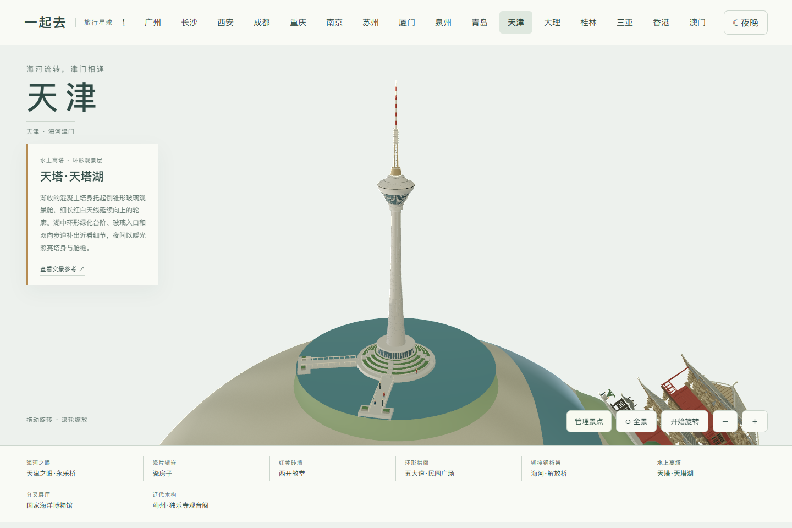

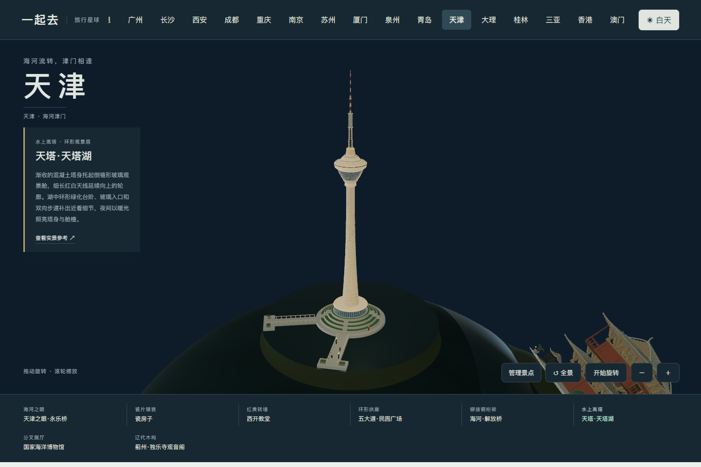
