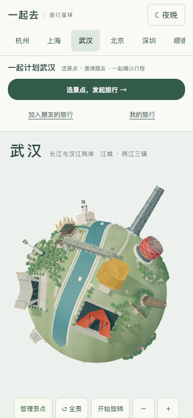
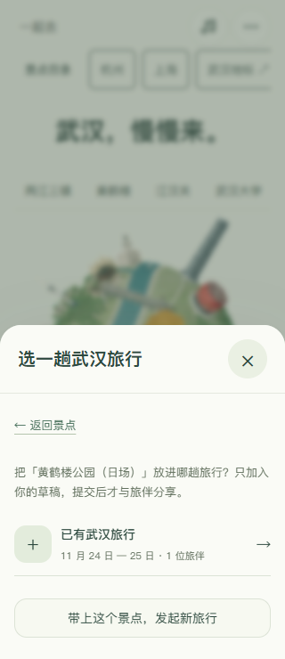

# 武汉多人旅行

入口：[`wuhan-trip.html`](https://43.139.249.151/travel/wuhan-trip.html)。原武汉地图保留，顶部「选景点，发起旅行」「加入朋友的旅行」「我的旅行」可以直接打开对应功能。点击地标详情中的「选入武汉旅行」可以带上当前景点。

武汉使用与杭州、上海相同的旅行房间、邀请、偏好、协商和定稿规则。支持 1—3 天、最多 6 位成员；两种基础安排不需要 AI 密钥。所有成员明确接受同一版本后，发起人才能定稿。修改想法后需要重新生成和确认。

## 目录与地图

地图保留 17 组地标，旅行目录有 16 个去处。武汉站是交通地标，不自动作为观光目的地。点击其他地标可以查看对应旅行说明；从地图删除建筑只影响当前浏览器景观，不删除任何成员偏好。

目录区分黄鹤楼日场、省博常设展、校园步行、东湖听涛、公共区域外观等范围。汉秀和琴台大剧院不默认包含演出票；电视塔、绿地中心不默认包含登塔。美术馆汉口馆目前只安排外观，展览与开馆状态另查。

## 从地图开始一趟旅行

1. 在地图顶部打开「选景点，发起旅行」，或点击地标详情中的「选入武汉旅行」。
2. 查看游览范围和预约提示，选择「从这里发起旅行」。如果已经有旅行，选择「放进已有旅行」；列表只显示当前浏览器身份参加的、尚未定稿或关闭的同城旅行。
3. 选中的地点先进入个人草稿，原来的文字、预算和其他选择保留。明确提交后，旅伴才能看到。
4. 复制邀请给朋友，对方填写昵称加入。双方分别提交偏好后，由发起人生成基础方案。
5. 读完逐日时间、交通和费用，两人明确接受同一版本，再由发起人确认行程。

即使 3D 地图加载失败，旅行目录、邀请和行程仍可使用。旅行身份保存在当前浏览器，换设备或清除浏览器数据不会自动恢复；不要把「我的旅行」当作跨设备账号。

## 时间、距离与预算

- 以江汉路周边住处为起终点。坐标是位置估算，模型摆放不参与计算；市内交通是保守预留，不是实时导航。
- 汉口、汉阳、武昌分别标记。跨三镇不会因为直线距离短而被当作附近步行，按公共交通过江预留候车、换乘和进出站时间；不假定轮渡全天可乘。
- 每天计入首末接驳、转场、入场、足量游览和午餐，最晚 18:00 返回。预算含门票、餐饮、公共交通和机动金，不含住宿、购物及往返武汉交通。
- 共同预算取最低值，步行上限取最低值，出发时间取最晚值。排不下时说明冲突，不自动放宽限制。日夜地图只是景观展示，当前日程不承诺夜场活动。

## 规则来源

核对日期：2026-10-29。开放时间可能调整，确认行程不代表购票或预约成功。

- [黄鹤楼市政府介绍](https://english.wuhan.gov.cn/H_1/NWP/202607/t20260727_2825602.shtml)：普通成人日场按 70 元计入，排程采用更保守的日场窗口；季节开放、优惠票与夜场另核。
- [湖北省博物馆参观服务](https://hbww.org.cn/fuwu/index.html)：常设展免费，需实名预约；日场按 9:00—17:00、16:00 停止入馆，常规周一闭馆。延时与节假日规则不自动套入。
- [武大入校政策更新](https://3g.wuhan.gov.cn/zwgk/tzgg/202605/t20260514_2764315.shtml)：2026 年 5 月起普通公众持身份证由指定校门步行入校，无需日常预约。目录使用保守游览窗口；樱花季及临时管理须另核，不保证花期。
- [汉阳文旅信息](https://www.hanyang.gov.cn/zwgk_38/xxgkml/gysyjs/lyly/202512/P020251226584729113888.pdf)：古琴台、晴川阁常规开放窗口及闭园日。
- [辛亥革命博物院声明](https://www.1911museum.cn/view_2051.html)：常规周二至周日 9:00—17:00，16:00 停止入馆；节假日与临时调整另核。
- [东湖听涛内湖介绍](https://hbj.wuhan.gov.cn/hjxw/202306/t20230601_2209316.html)：当前选点只涵盖听涛片区，不能把两小时散步理解成游遍东湖。

各地点的具体来源、入场范围和预算说明也显示在网页目录与最终行程中。

## 界面

