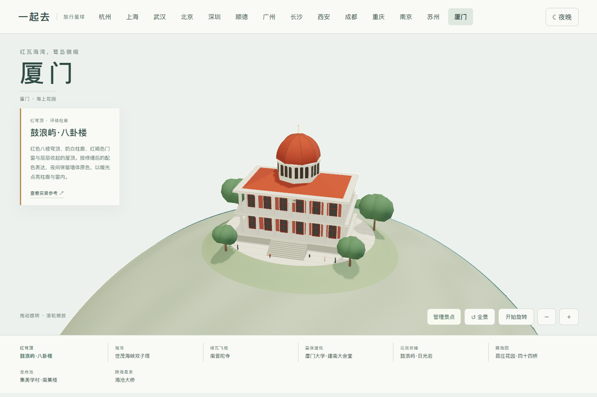
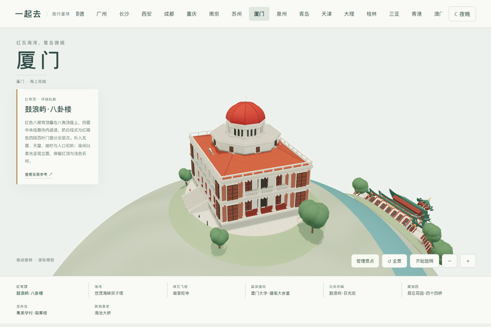
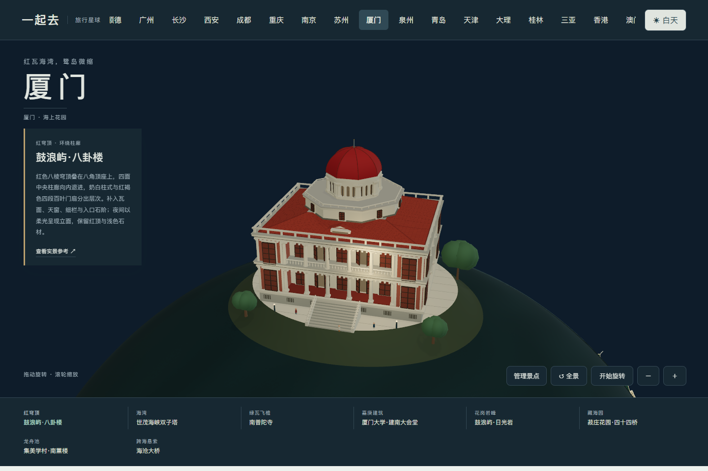

# 厦门地标参考与模型范围

2026-11-04 对照八组建筑及景观照片制作。照片只用于内部观察，未作为贴图、截图背景或下载包素材。公开内容是程序化缩微模型，不是测绘模型，不表示完整复原所有建筑。

| 模块 | 实拍和设计资料 | 主要保留特征 |
| --- | --- | --- |
| 鼓浪屿八卦楼 | [鼓浪屿景区照片](https://www.glyylq.cn/article.php?id=156)、[修缮报道](https://fj.people.com.cn/n2/2024/0206/c181466-40741194.html) | 红色八棱穹顶、奶白柱廊、红褐色门窗、低坡屋面。按修缮后颜色表达。 |
| 日光岩 | [独立旅行摄影](https://teavanilla.com/51480.html) | 圆钝花岗岩峰、岩面裂隙、贴岩石阶、小型顶部观景台与林冠。 |
| 菽庄花园 | [花园航拍照片](https://www.chinadiscovery.com/xiamen-tours/gulangyu.html) | 临海四十四桥、白栏、桥柱、转折、桥亭和岸上园屋；不会把殿堂直接放入海水。 |
| 南普陀寺 | [逐殿实拍](https://twtemple.pixnet.net/blog/posts/16099080626) | 大雄宝殿、三重檐八角大悲殿、红柱绿瓦、荷塘、院廊和石阶。压缩实际轴线距离以适配微缩场景。 |
| 建南大会堂 | [厦门大学建筑资料](https://jjc.xmu.edu.cn/info/1018/53831.htm)、[正面游客摄影](https://touch.travel.qunar.com/comment/10154122727) | 中央高楼与侧翼、绿瓦燕尾脊、花岗岩色墙、四根入口柱、红褐百叶窗、棕榈和上弦场大台阶。 |
| 南薰楼及龙舟池 | [集美地方资料及摄影](https://m.thepaper.cn/baijiahao_9143453) | 逐层收起的高塔、红砖侧翼、石色竖线、池亭及临水夜景。不是复制周边普通住宅。 |
| 世茂海峡双子塔 | [Gensler 设计图与项目资料](https://www.gensler.com/projects/xiamen-shimao-straits-tower)、[游客夜景照片](https://you.ctrip.com/sight/xiamen21/2504037.html) | 蓝灰玻璃双帆、斜切弧形顶部、水平楼层线、低裙房。设计渲染与实拍分开使用；夜间紫蓝轮廓与暖窗取自实拍，动态节奏是艺术化表达，不冒充真实灯光节目。 |
| 海沧大桥 | [中交项目报道所配照片](https://k.sina.cn/article_1740522895_67be458f027011wyn.html) | 双门式塔、下垂主缆、竖向吊杆、车道和桥面灯带。只表现主要悬索跨，不声称按真实里程缩尺。 |

本版提供景观浏览、日夜、自由旋转、整组管理和手机布局。厦门尚未接入多人旅行目录，不套用杭州、上海、武汉的行程数据，也不提供未经核验的营业时间、票价或预约承诺。

## 0.55.7 八卦楼柱廊与顶座精修

对照[景区正面照片](https://www.glyylq.cn/article.php?id=156)与[厦门晚报修缮后实拍](https://www.fjdaily.com/app/content/2024-02/03/content_2337014.html)，重建四面中央退进的柱廊、转角砖墙、上下层柱式和细栏。红褐色四段通高百叶门扇、红砖廊面依据修缮后的外观；[厦门日报现场报道](https://news.xmnn.cn/xmxw/202402/t20240207_126981.html)说明了门窗复原的依据。没有把早年米黄门窗继续当作现状。

低坡红瓦屋面补入天窗、齿状檐口和低栏，中央白色八角顶座承托有真实拱窗的鼓座及八棱红穹顶。正面石阶、侧廊和柱间进深可在旋转后看到。夜景保留红顶、红褐木门及浅色石材，以低亮暖白光表现前廊，不将整面建筑点成黄色。

这是建筑外观的微缩表达，不含馆内完整展厅、附楼和完整真实庭园；夜景属于展示设计，不代表景区实际夜间开放或灯光节目。照片仅用于观察，没有收进网站或源码包。八组模块布局、其他城市以及三城多人旅行未改变。

## 0.55.41 建南大会堂

依据[厦门大学基建处的建筑资料与实照](https://jjc.xmu.edu.cn/info/1018/53831.htm)，修正前部中央高楼、逐级降低的两翼和后方礼堂之间的体量关系。前部采用绿瓦燕尾脊，后方礼堂采用红瓦及连续高窗；门廊补齐四根石柱、凹进花窗、红褐百叶、石栏与中央细台阶。正面、屋脊、柱式、红瓦近照和全景已直接核看，内部屋架照片只作屋顶结构辅助参考。

夜间参考[摄影师拍摄的建南楼屋檐夜照](https://unsplash.com/photos/a-building-with-a-red-roof-JQWLLOdmObA)，采用暖色檐下光和柔和门窗光，保留绿瓦、红木与石材本色，不添加未经核实的彩色灯光秀。

这是建南大会堂与相邻石阶的压缩模型，未声称覆盖整个建南五楼群。侧后方未获完整测绘，按主体结构简化表达；参考照片仅供本地研究，不随公开源代码和提交包分发。

## 0.55.42 南薰楼与龙舟池

依据[集美地方资料的日夜实拍](https://m.thepaper.cn/baijiahao_9143453)和[厦门日报修缮现场报道](https://xm.fjsen.com/2024-03/22/content_31544389.htm)，重做灰石塔楼的递退露台、花栏、凹窗、顶部开放风亭，以及顺不同地平展开的两侧翼楼。补入层叠回廊、红砖石柱、八角端亭、嘉庚瓦和池岸石栏。顶部预留圆洞保持开敞，不添加未安装的时钟或导航灯。

已直接核看近景、仰视、顶楼、屋脊施工细节、日出剪影和两张池岸夜景。夜景照片包括相邻道南楼，模型只借鉴南薰楼和池岸，不把其他楼群合并冒充同一栋。灯光采用暖色檐线和低亮墙面，石、砖、瓦保留各自本色。

池中亭台及岸线作微缩组合，没有复刻整座龙舟池和七亭的真实距离。照片只供本地研究，不随网站、源码和提交包分发。厦门仍是景观浏览，不虚构多人旅行目录、开放时间或票价。
