# 西安地标与实拍参考

0.42.0 新增八组完整地标，可逐景近看、自由旋转、切换日夜、整组添加或移除。分布于两个半球，场地与模型随球面贴地；这是一张艺术化缩微地图，不是精确导航。西安尚未接入多人旅行，不套用其他城市的景点、时间和预算数据。

| 地标 | 直接核看的照片与保留特征 |
| --- | --- |
| 西安钟楼 | [日景](https://dimg04.c-ctrip.com/images/0105612000eyu4qtrE774_W_750_0.jpg)、[夜景](https://dimg04.c-ctrip.com/images/1mh6412000ilotsxnCCAD_W_640_10000.jpg?proc=autoorient)：三重绿瓦、红柱彩画、方形石台、四向贯通券洞、白栏与铜钟；夜间绿瓦和暖金楼身分层。 |
| 西安鼓楼 | [西安科普网实拍](https://www.xakpw.com/single/23806)：宽楼身、深灰瓦、三重檐、台阶与鼓列，避免仅复制钟楼。 |
| 城墙·永宁门 | [摄影者实拍](https://dp.pconline.com.cn/photo/5086132.html)：城楼、贯通券洞、围合瓮城、垛口、登城台阶和护城河。 |
| 大雁塔·大慈恩寺 | [香港商报实拍](https://www.hkcd.com/content_p/2013-12/09/content_1991.html)：七层灰褐砖塔、逐层收分、四面券窗、砖仿木柱与低矮方顶，搭配前殿、侧廊和庭树；详细实拍与本次修正见下方 0.55.22 记录。 |
| 小雁塔·荐福寺 | [游客实拍](https://media-cdn.tripadvisor.com/media/photo-o/0f/87/76/3e/small-wild-goose-pagoda.jpg)：十三层密檐、较低层高、残缺塔冠与寺院庭树，不补造完整塔刹。 |
| 陕西历史博物馆 | [中国建筑资料和实拍](https://www.cscec.com/ztzl_new/mhsjd81_new/bq/201812/2899627.html)：浅色柱廊、深灰宽屋顶、对称展馆、入口水院和石牌，按现有馆舍外观缩微。 |
| 大唐芙蓉园·紫云楼 | [园区日景实拍](https://dp.pconline.com.cn/photo/list_4848079.html)：重檐主楼、侧亭、临水台阶与前庭；[园区夜间照片](https://www.ourchinastory.com/zh/2897)仅用于暖金檐光和暗水面的色彩参考，未把照片里的另一座塔当作紫云楼。 |
| 秦始皇帝陵博物院 | [新华社航拍转载图片](https://x0.ifengimg.com/res/2024/D4663B530AEE52669F4D456E9746E2B754F06896_size2827_w3911_h2557.jpg)、[博物院官网](https://www.bmy.com.cn/index.htm)：一号坑大跨度拱壳、顶部天窗、竖向端墙、相邻展馆与入口建筑。展示现有保护展馆外观，未将兵马俑编造成露天阵列。 |

照片只用于内部观察，未作为网页贴图或源码包附件。模型为自主编写的程序几何，压缩了院落和展馆数量，不宣称完整建筑测绘、室内复原或复刻真实夜游演出。灯光只做温和变化，遵循系统「减少动态效果」设置。

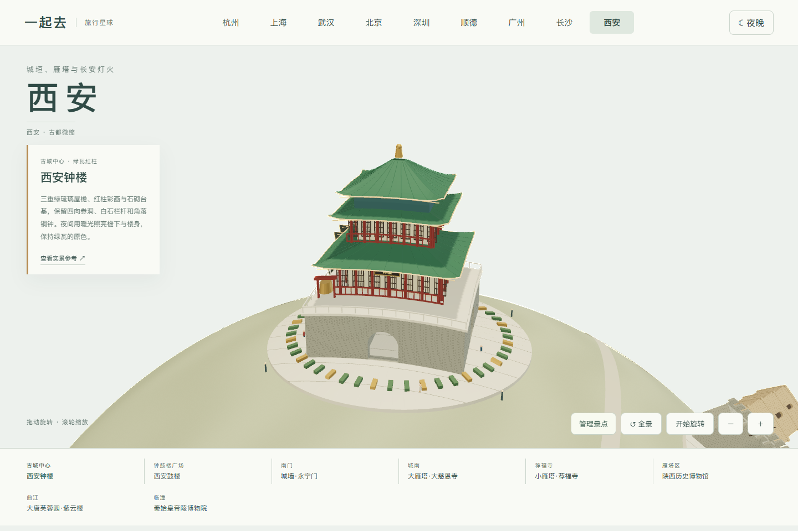

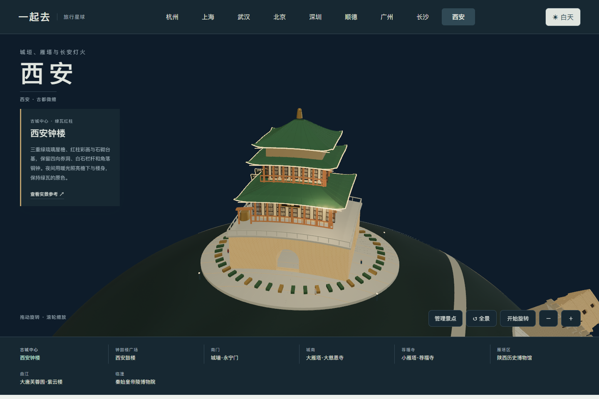

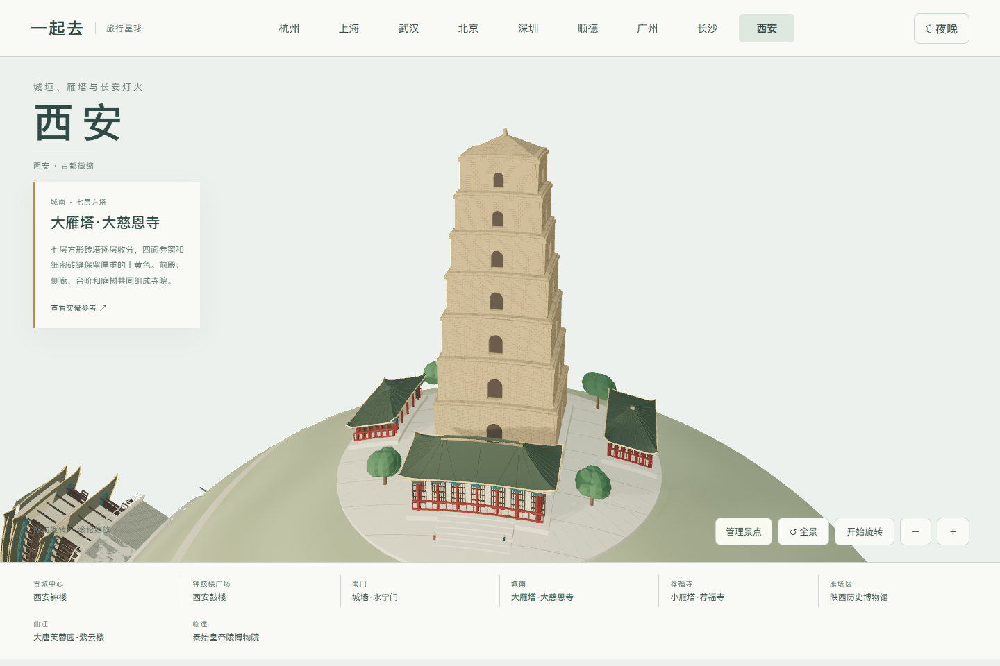

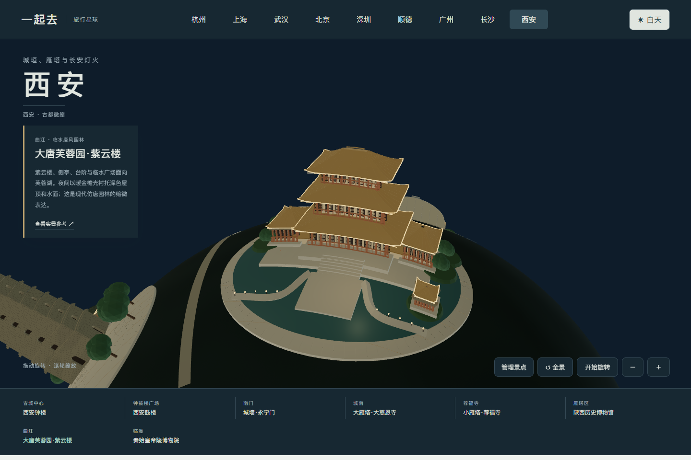

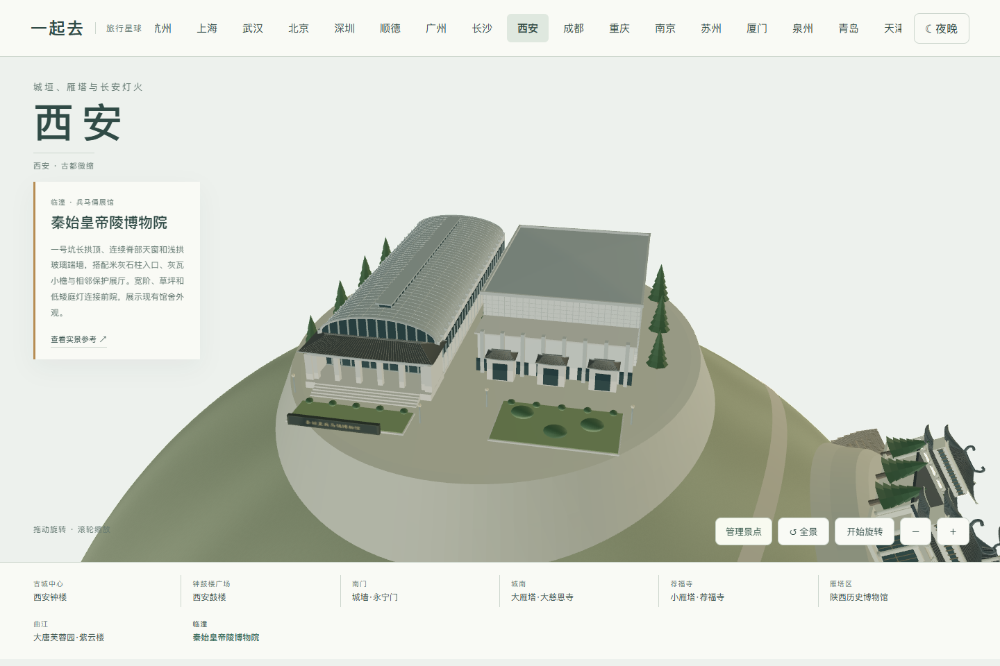

## 0.55.4 钟楼木构与瓦面精修

继续对照上列两张实际日夜照片，并核看[西安科普网形制结构](https://www.xakpw.com/single/23539)与[地方志建筑资料](https://www.xakpw.com/single/36990)。重做三开间门扇、外圈红柱回廊、上层平座与青绿金彩绘梁枋，细分斗拱、绿琉璃瓦行和鎏金宝顶；保留四向真实穿通的券洞、灰砖台基、白石栏板和角落铜钟。夜间以暖色泛光照亮楼身，避免把绿瓦和红柱统一换成金色。

彩画与雕刻为缩微概括，不宣称逐幅复刻。券洞展示建筑结构，现实通行以管理方为准；未据历史资料虚构当前门票或开放状态。原八组位置、其他城市与多人旅行数据不变。

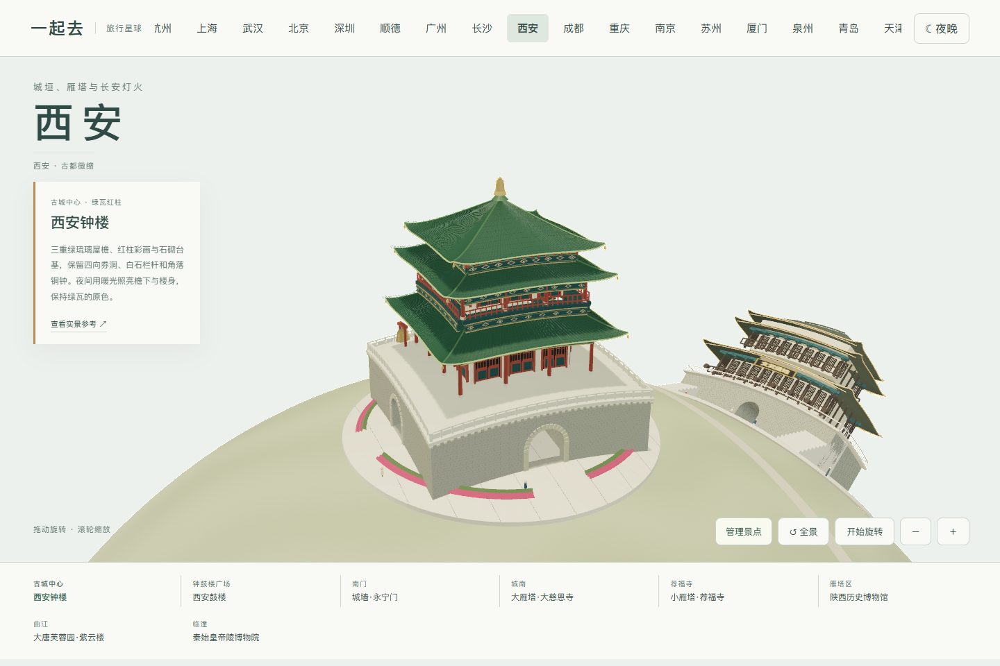

## 0.55.22 大雁塔砖构与寺院精修

对照[《大雁塔——犹存的盛唐》中的现塔实拍](https://m.thepaper.cn/newsDetail_forward_24621530)，直接核看底层入口与碑龛、上层券窗、砖檐近照、葫芦塔刹及寺院航拍；[西安地方志资料](https://xadfz.xa.gov.cn/xadq/rwxa/1802954373708996609.html)用于核对七层与 64.5 米形制。文章中的历史木塔复原和佛光寺构造示意没有当作现塔造型依据。

七层砖塔使用逐层收分、分层倚柱、深券窗和叠涩檐带，底层南门与两侧碑龛分开。砖色改为灰褐，塔顶保留低方顶、葫芦刹和细拉索。院落补灰瓦殿堂、侧廊、石栏与连续入塔台阶，建筑保持水平刚性，周边场地衔接球面。扩宽后调整本组位置，避免挤近永宁门。

寺院院落和雕刻为缩微概括，夜间暖光为场景表达，未声称完整测绘或复刻现实夜游灯光。复制庭树材质时保留颜色对象，修复切换夜景导致树木变黑与画面异常的问题。日夜正侧背、320/390 宽度与整组恢复均已实际核验；手机仍为浏览器模拟。

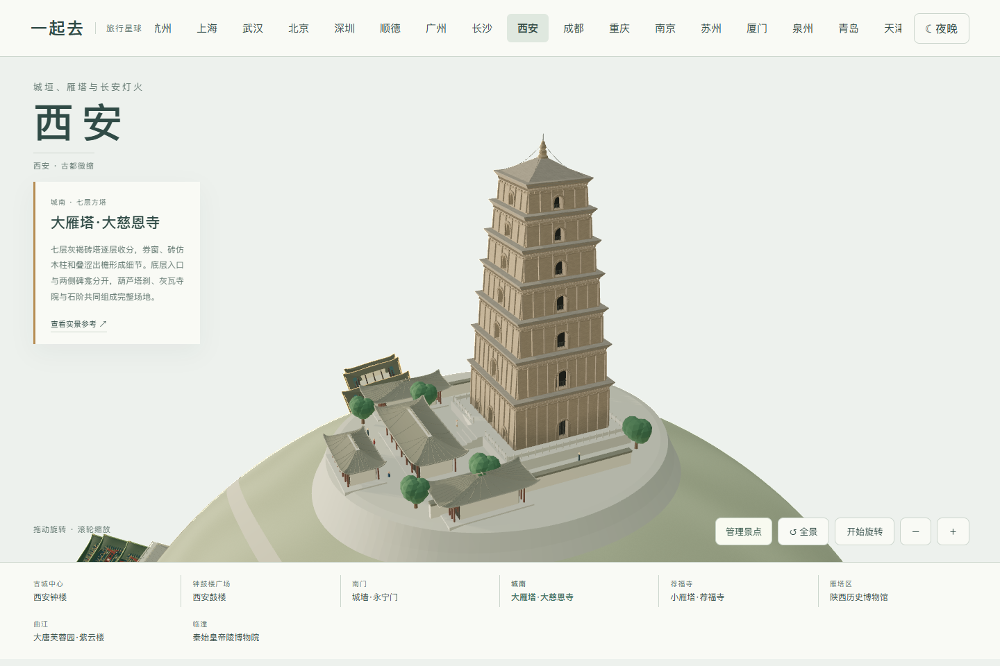

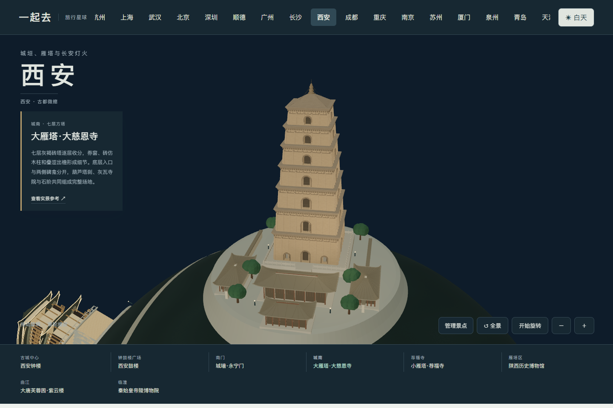

## 0.55.23 鼓楼木构与侧面台阶精修

依据[西安科普网的形制资料与侧面照片](https://www.xakpw.com/single/23806)，以七开间、三进深、两层外廊、三重檐歇山顶和青砖台基作为轮廓约束。直接核看 BrokenSphere 在 2007 年 10 月 24 日拍摄的[西北侧立面](https://commons.wikimedia.org/wiki/File:Xi%27an_Drum_Tower_northwest_view.JPG)、[夜间檐下细部](https://commons.wikimedia.org/wiki/File:Xi%27an_Drum_Tower_facade_at_night.JPG)和[鼓架近照](https://commons.wikimedia.org/wiki/File:Xi%27an_Drum_Tower_row_of_drums.JPG)。历史照片用于形制和配色观察，不声称反映当前每日灯光方案。

取消密集白窗格，改为深木色柱廊、退入内侧的门窗、青绿金彩绘和层叠斗拱。最高屋顶补红山墙、歇山转折、瓦垄与脊兽，保留南北匾额；两列鼓架分别制作鼓身、鼓面和支架，廊下悬挂红灯笼。登楼台阶移到台基两侧，贯通券洞与水平平台保持连通，场地外缘顺接球面。夜间使用低亮度暖光，灯笼缓慢变化，减少动态模式保持稳定。

彩绘、脊兽和鼓面纹饰采用缩微概括，未复制照片作为贴图。该模块为完整可增删单元，未改动其他景点的位置或多人旅行数据。

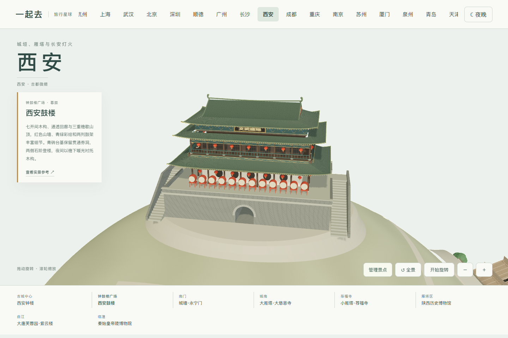

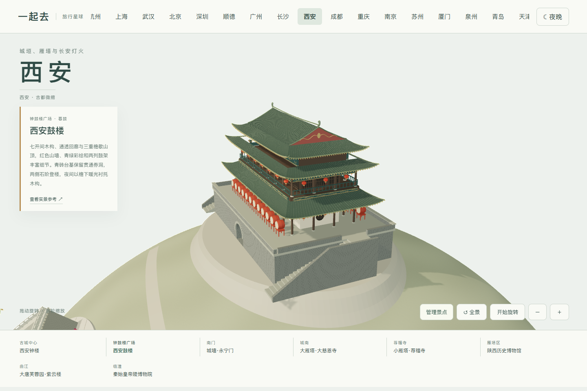

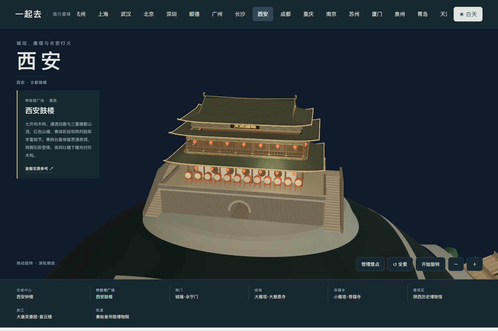

## 0.55.24 小雁塔与荐福寺精修

对照[《小雁塔｜一千三百年长安浮屠》中的现塔照片](https://m.thepaper.cn/newsDetail_forward_28705852)，直接核看塔身南北立面、南石门、北门罩、上层券窗与叠涩砖檐、四角残墙和荐福寺院落航拍。文章发布于 2024 年 9 月，图中现状用于造型参考；其中数字复原图与历史木构罩檐没有作为现存建筑制作。[中国网转载的西安旅游局资料](https://news.china.com.cn/2017-11/02/content_41835457.htm)用于交叉核对十三层残塔与南北券窗。

十三层砖身逐层收分，越往上层高越密；南北两面开券窗，东西保留实墙。砖檐补双层菱角牙子和逐级出挑的叠涩，残顶保留四角砖墩、内井与细金属护栏，不补造完整塔刹。塔基、南石门、北门罩和连续台阶共同组成入口，寺院采用灰瓦殿堂、两侧长殿、中央通道和古树，瓦垄顺屋坡排列。

模型为缩微概括，殿堂与树冠适度压缩，未声称完整测绘。夜间以低亮暖光与庭院小灯衬托砖色，未把场景灯光当作现实夜游开放或灯光秀信息。照片仅用于研究，没有复制为公开纹理；未改其他城市模型或多人旅行数据。

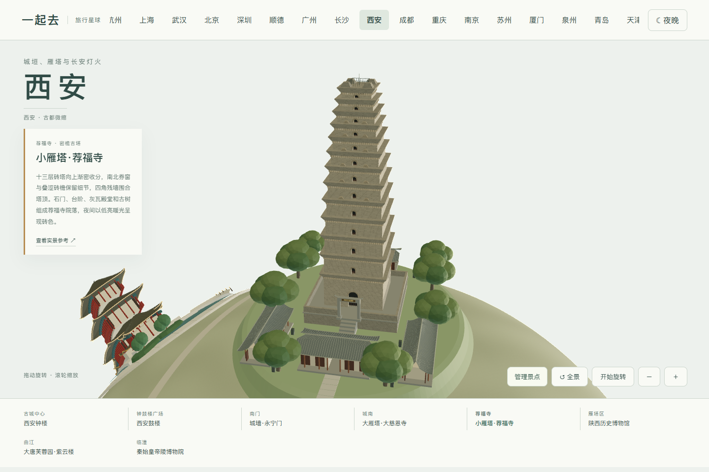

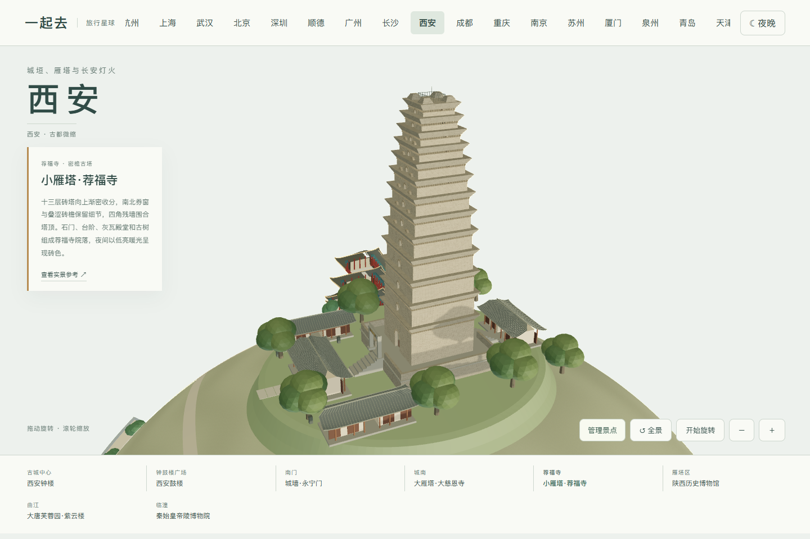

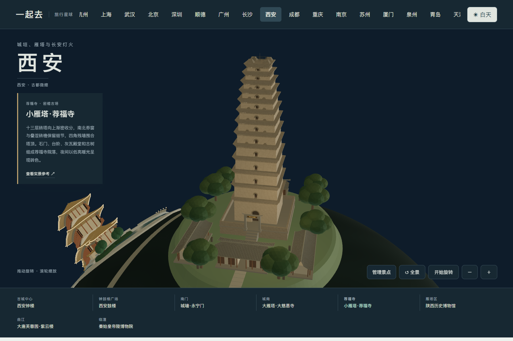

## 0.55.25 陕西历史博物馆本馆

直接核看[中建的张锦秋建筑专题](https://www.cscec.com/ztzl_new/mhsjd81_new/bq/201812/2899627.html)中的馆舍鸟瞰和内庭照片，并对照[清华建筑学院的陕历博航拍](https://www.tsinghua.edu.cn/info/1175/19644.htm)。本次制作的是现有本馆，未把秦汉馆或其他唐风建筑混入。

独立的低矮前门、后方重檐主殿、四角楼和低矮连续侧廊围合院落，灰瓦屋坡、平行瓦垄、浅石柱、退后的玻璃门窗与斗拱保留层次。中央宽阶连续登上主殿平台，斜向石栏随台阶升高。入口水池与灰底金字石牌面向前广场，庭院保留草地和雪松；地面外缘衔接球面，馆舍本身保持水平。稍微调整本组位置，增加与兵马俑展馆的间距。

夜间以廊下分段暖灯、低矮庭灯和适量窗光形成层次，屋顶保留深灰色。模型为外观和院落关系的缩微表达，不是完整测绘；夜景为场景设计，不代表实际夜间开放或灯光安排。参考照片未作为公开纹理或打包资产。

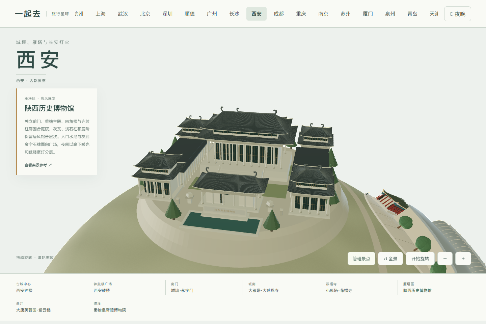

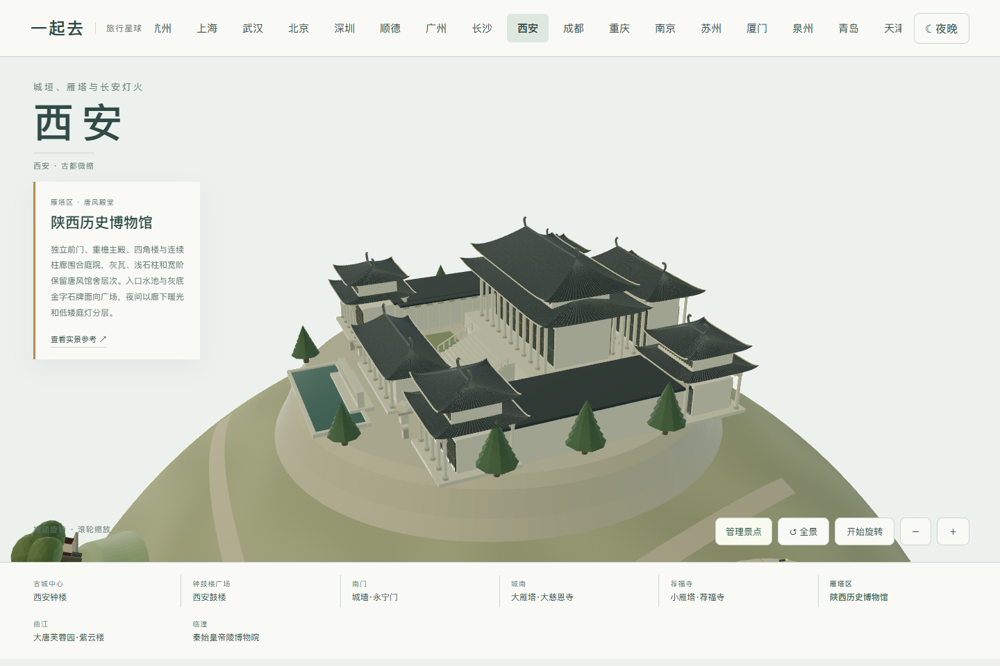

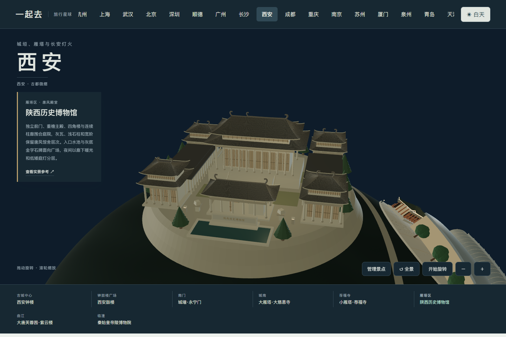

## 0.55.26 兵马俑保护展馆

直接对照[秦始皇帝陵博物院一号坑页面](https://www.bmy.com.cn/pitone.html)的入口实拍、[独立正门照片](https://www.globalmountainsummit.org/terra-cotta-warriors.html)，以及[新华社发布的场馆航拍](https://www.xinhuanet.com/culture/20240910/61e0116ddcc6435584a9c5cc988564d5/c.html)。[博物院导览图](https://www.bmy.com.cn/guide/scenic.html?tid=2)仅用于核对相对位置，不作为屋面实拍。

一号坑采用浅拱长壳，保留连续脊部天窗、两侧窗带、浅拱玻璃端墙和深灰金属分缝。前部改为五跨米灰石柱门廊、低矮灰瓦檐和连续宽阶，露出上部拱窗；去掉旧模型误用的红柱小殿。相邻保护厅保留宽阔低屋面、浅色墙板、前部突出门厅与入口，前院以草坪、修剪灌木和侧方雪松围合；不把其他馆舍冒称某号坑。

夜间保留材质原色，以入口檐下暖灯、窗光和庭灯分层，避免将整片屋面点亮。建筑整体保持水平，场地外缘衔接球面，并拉开与陕历博的间距。模型是两座主要保护展厅的缩微表达，不是完整考古遗址或实测建筑复原；没有把场景灯光表述为现实夜游开放安排。照片仅作内部研究，未作为公开纹理或打包资产。

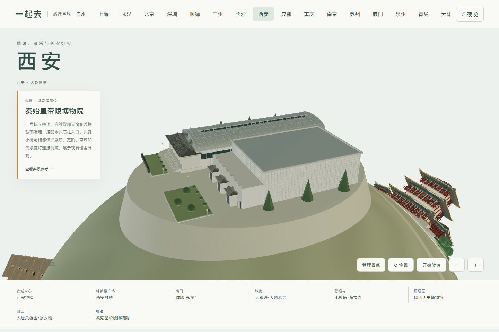

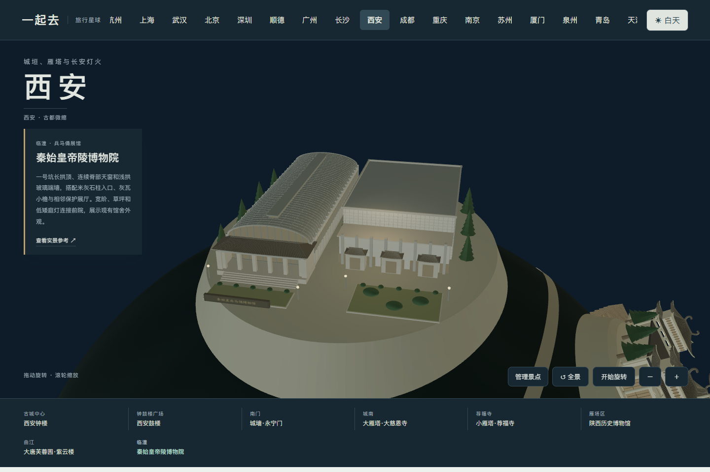
